本讲义将导论、第一章六节、现有习题课和课件附录连成一份文档。题面、条件、解答、原图与作业按主题保留，原页核对默认折叠；手写中值定理及教材另外列参考。分节入口见 [00-微积分Ⅰ导航](/notes/00-微积分I导航)，来源清单见 [10-课件版本与核对记录](/notes/10-课件版本与核对记录)。

阅读脉络：研究对象 → 输入输出关系 → 趋近与误差 → 极限计算 → 存在准则和局部近似 → 连续与存在性结论 → 本章回顾。

## 第一次课：课程说明与微积分的来路

来源为 S01《微积分第一次课 - 信通.pdf》，共 17 页。本篇保留课程安排、学习建议和导论内容；其中提到积分、级数、微分方程，是课程全貌和历史介绍，不代表这些章节已经上过课。

### 一、从应试训练走向主动学习

课件先以新生数学测试的报道引出学习方式的变化，强调大学学习要同时发展知识、能力与思维。需要建立知识体系和方法体系，常思考、善总结，培养发现、分析、解决问题的习惯，并保持专注与持续学习。报道截图属于课件的引入材料，其具体叙述保留在原页。

学校提供的学习机会包括教授课程、拔尖人才培养、出国项目与国际班、高端讲座；竞赛包括 ACM/ICPC、数学建模、大学生数学竞赛。教师团队、工作室、创新项目提供研究训练，班级、学生会、协会与团队工作训练沟通、协作和管理；课件另列有一年级新生课外创新实践项目计划、大学生创新训练计划。

关于 AI，课件把它看作辅助学习与工作的工具，同时强调自身能力和数学基础。使用它整理知识时仍需检查定义、条件与推导，这也适用于本笔记。

> **原页核对：主动学习、学校平台与AI主题的全部原页**
> [S01 · 微积分第一次课 - 信通.pdf · PDF 第 2 页](/library/微积分第一次课-信通#page=2)
>
> 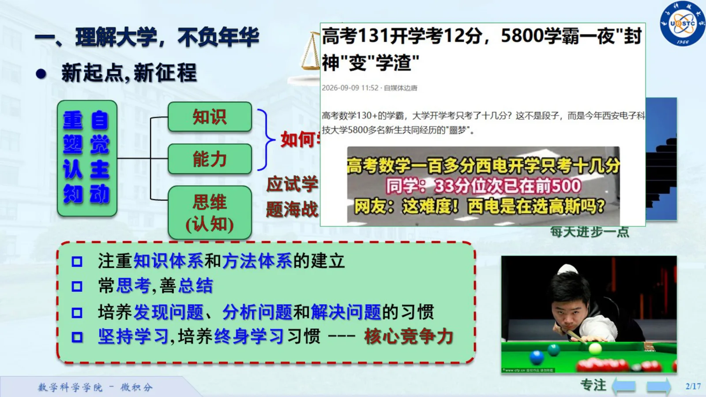
>
> [S01 · 微积分第一次课 - 信通.pdf · PDF 第 3 页](/library/微积分第一次课-信通#page=3)
>
> 
>
> [S01 · 微积分第一次课 - 信通.pdf · PDF 第 4 页](/library/微积分第一次课-信通#page=4)
>
> 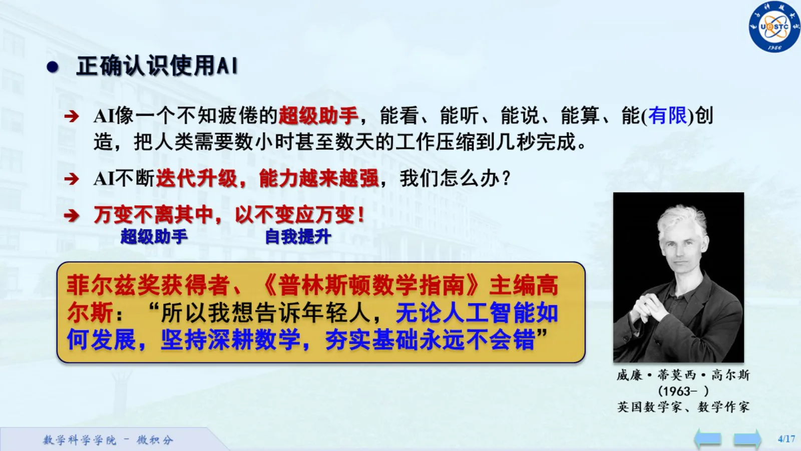

### 二、课程安排、考核与课堂准备

课件介绍微积分分两个学期，涉及一元与多元函数微积分，学分为 $6+5$；微积分Ⅰ的总体内容为函数极限与连续、一元函数微积分学和常微分方程。这些是课程介绍中的范围说明。

学习过程是预习、课堂学习、课后作业与复盘，也可结合 MOOC、网络资料、数学软件、讨论和表达。课件强烈建议精读教材，凝练问题、研究问题、解决问题；独立认真完成习题，结合指导教程。课堂手机静音、按学习需要使用，准备纸笔记录课堂练习、灵感、问题和概要笔记。

**课件给出的成绩构成是平时 50% + 期末 50%。** 平时包含作业、课堂考核、小研究、中国大学 MOOC 每章在线测试和期中考试；课堂考核包含雨课堂小测试。这里记录的是这份课件中的安排。

第一次课要求加入课程 QQ 群、下载并注册中国大学 MOOC、完成认证，具体加入方式课后在群中公布。雨课堂绑定示意与课程群二维码、账号说明等细节全部保留在对应原页，可直接展开查看。

> **原页核对：课程范围、学习要求、考核比例与平台设置原页**
> [S01 · 微积分第一次课 - 信通.pdf · PDF 第 5 页](/library/微积分第一次课-信通#page=5)
>
> 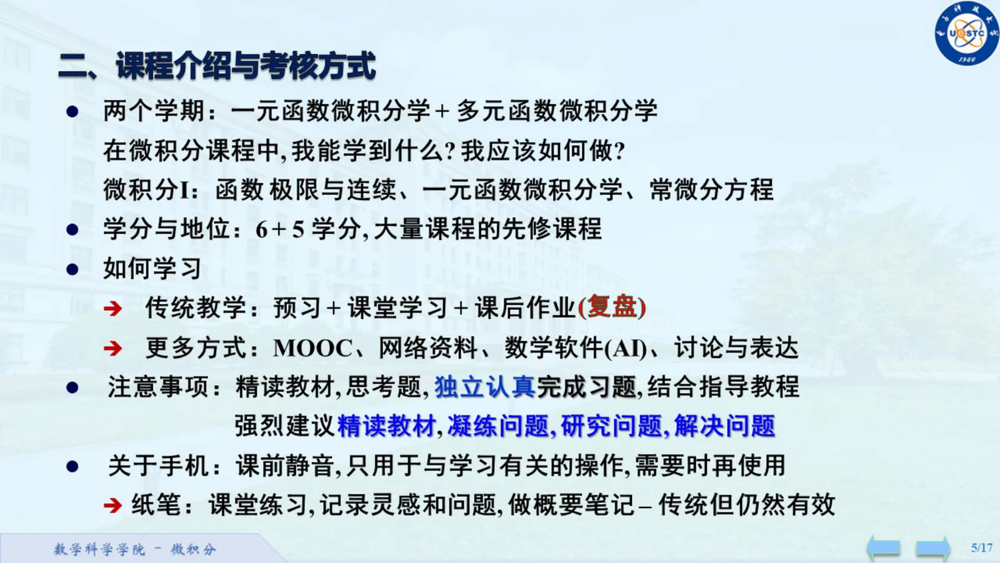
>
> [S01 · 微积分第一次课 - 信通.pdf · PDF 第 6 页](/library/微积分第一次课-信通#page=6)
>
> 
>
> [S01 · 微积分第一次课 - 信通.pdf · PDF 第 7 页](/library/微积分第一次课-信通#page=7)
>
> 

### 三、微积分为什么围绕“趋近”展开

导论把微分学、积分学、级数基础与简单微分方程作为现代微积分的常见内容，并指出数学分析的范围更广。课件用麦克斯韦方程组展示数学语言与理工应用的联系，推荐《微积分的力量》和《无穷小：一个危险的数学理论如何塑造了现代世界》，留下“微积分有哪些现代应用”的思考问题。

**原图：导论应用、书目与麦克斯韦方程组原图**

[S01 · 微积分第一次课 - 信通.pdf · PDF 第 8 页](/library/微积分第一次课-信通#page=8)

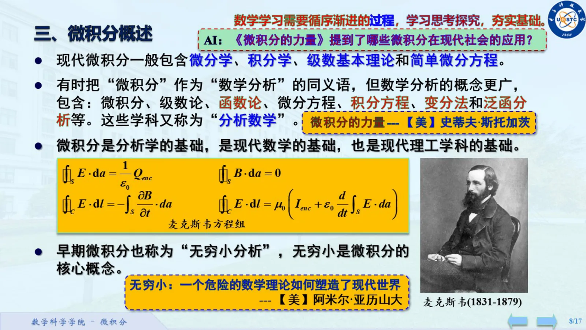

以下按课件的历史叙述梳理，历史日期与人物说明均作为原课件内容保留。

#### 早期的无限思想与穷竭法

课件引用《庄子》“一尺之捶，日取其半，万世不竭”，引出无限过程；又引用刘徽“割之弥细，所失弥少……则与圆合体”，说明用多边形逼近圆的思路。安提丰、阿基米德的穷竭法进一步用内外近似求几何量。

**原图：割圆术、历史人物与阿基米德螺线**

[S01 · 微积分第一次课 - 信通.pdf · PDF 第 9 页](/library/微积分第一次课-信通#page=9)

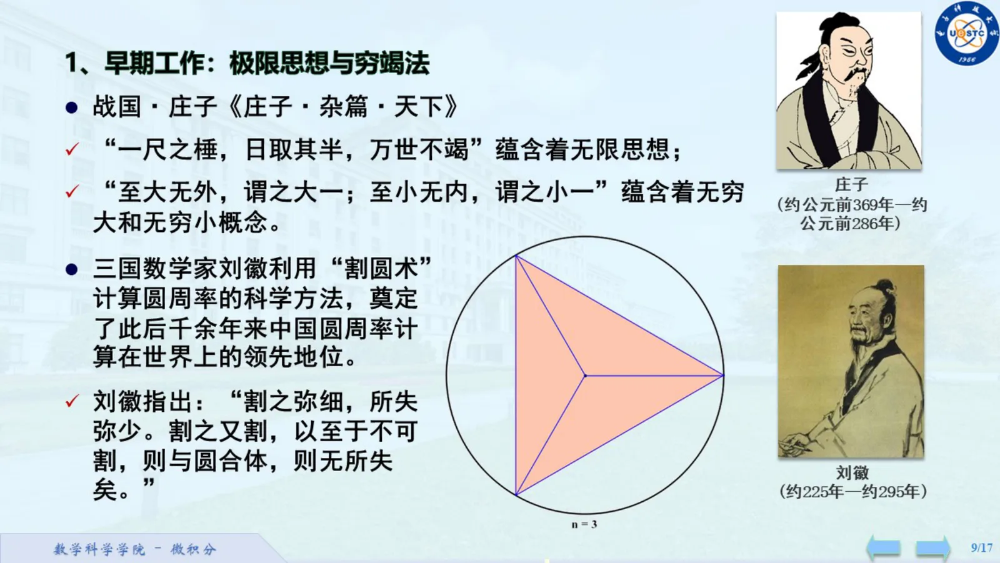

[S01 · 微积分第一次课 - 信通.pdf · PDF 第 10 页](/library/微积分第一次课-信通#page=10)

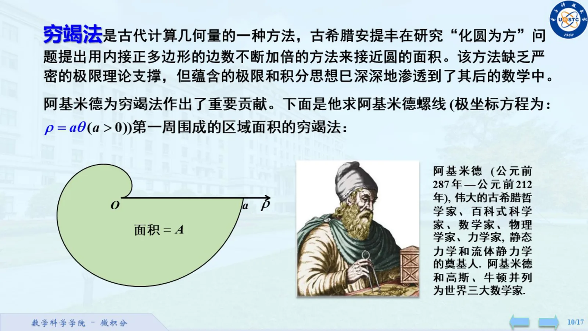

#### 螺线面积例子：先看上下近似，不借用积分公式

课件研究极坐标螺线 $\rho=a\theta$（$a>0$）第一周 $0\le\theta\le2\pi$ 围成的面积 $A$。把角度均分为 $n$ 份，分别用每段较小、较大的半径作扇形，内外面积和是

$$
s_n=\frac43\pi^3a^2\left(1-\frac1n\right)
\left(1-\frac1{2n}\right),
$$

$$
S_n=\frac43\pi^3a^2\left(1+\frac1n\right)
\left(1+\frac1{2n}\right).
$$

它们满足 $s_n<A<S_n$，并都趋于 $\frac43\pi^3a^2$，因而把 $A$ 夹定为这个数。这里的核心是“同一对象被内外近似夹住”，与第一章的夹逼思路相连；不要求提前学习积分计算。

**原图：扇形内外近似、两个和式与极限结果**

[S01 · 微积分第一次课 - 信通.pdf · PDF 第 11 页](/library/微积分第一次课-信通#page=11)

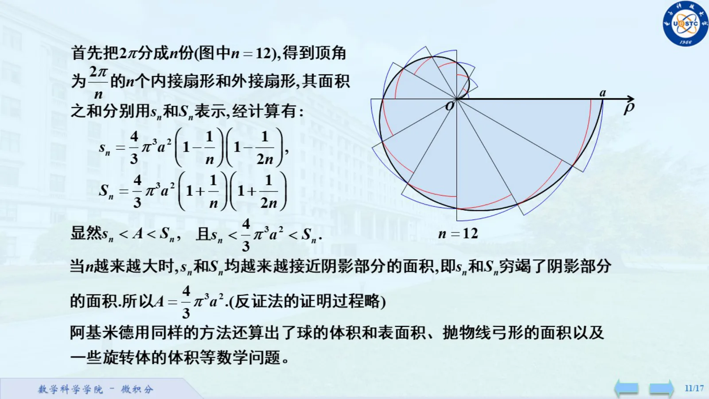

#### 从切线、面积问题走向统一方法

课件先列哥白尼、培根、笛卡尔、伽利略所代表的自然科学革命、实验与归纳、数学演绎、实验观察；再列韦达的符号代数及费马、笛卡尔的解析几何思想。

先驱工作按问题分成三条线：斯蒂文、开普勒、卡瓦列利、托里拆利的求积思路；罗伯瓦尔的速度合成、费马的微小增量切线与极值方法；帕斯卡的无穷小方法、瓦里斯的算术化和巴罗的求切线与求积互逆性。

课件随后介绍牛顿的流数法（列有 1666、1669 年的写作节点）、莱布尼茨 1684 年的微分法论文和沿用至今的符号，以及伯努利兄弟、欧拉的后续发展。

> **原页核对：科学方法、解析几何、先驱工作与微积分建立的原页**
> [S01 · 微积分第一次课 - 信通.pdf · PDF 第 12 页](/library/微积分第一次课-信通#page=12)
>
> 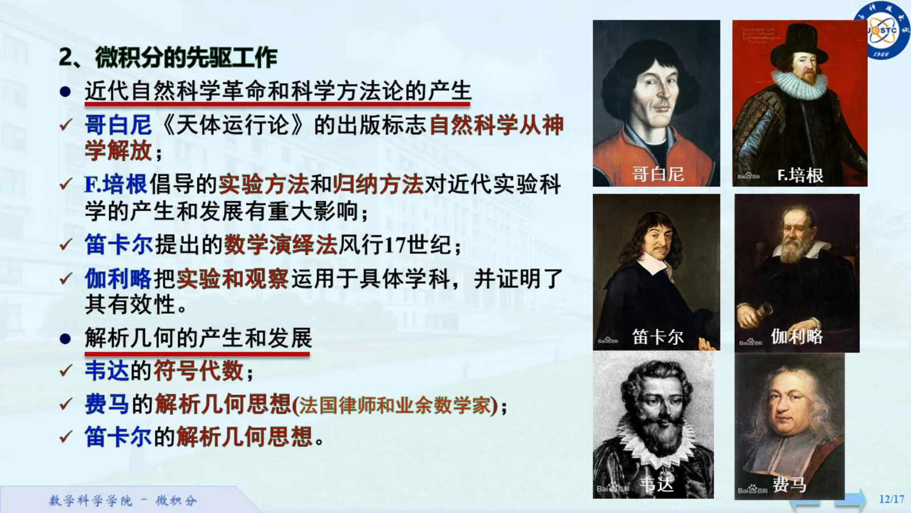
>
> [S01 · 微积分第一次课 - 信通.pdf · PDF 第 13 页](/library/微积分第一次课-信通#page=13)
>
> 
>
> [S01 · 微积分第一次课 - 信通.pdf · PDF 第 14 页](/library/微积分第一次课-信通#page=14)
>
> 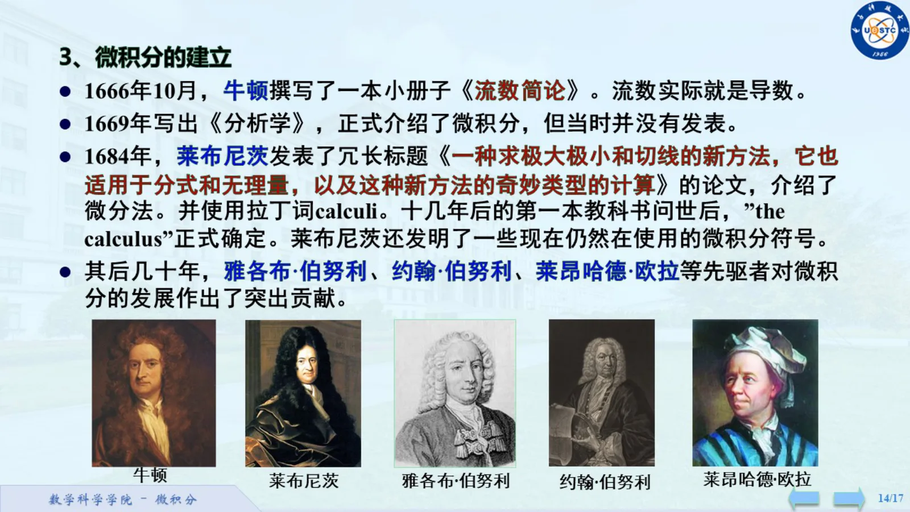

#### 为什么最后还需要严密定义

早期直觉方法会把无穷小一会儿当作非零量约去，一会儿又当作零量舍掉。课件用幂函数的差商展开展示这种逻辑疑问，并列出无穷和与积分交换的疑问。这些问题说明：能算出结果与有充分理由交换运算，是两回事。

随后课件介绍柯西、黎曼、刘维尔、魏尔斯特拉斯对术语和理论的严密化，以及反例促成理论拓展的过程。

最后一个例子是 $(0,1)$ 上的托梅函数：

$$
r(x)=\begin{cases}
1/q,&x=p/q\text{ 是最简有理数，}q>0,\\
0,&x\text{ 为无理数}.
\end{cases}
$$

课件给出它在有理点不连续、无理点连续，并提出“它是否黎曼可积”“可积函数的不连续性可能有多复杂”等后续问题，再引向康托尔、沃尔泰拉、贝尔、勒贝格以及集合论、实数理论、测度论。本篇保留问题，不据此扩写尚未上课的积分理论。

> **原页核对：逻辑基础疑问、严密化、托梅函数与现代拓展**
> [S01 · 微积分第一次课 - 信通.pdf · PDF 第 15 页](/library/微积分第一次课-信通#page=15)
>
> 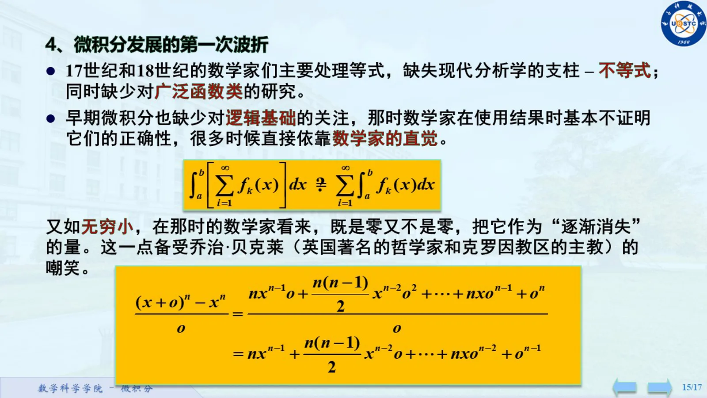
>
> [S01 · 微积分第一次课 - 信通.pdf · PDF 第 16 页](/library/微积分第一次课-信通#page=16)
>
> 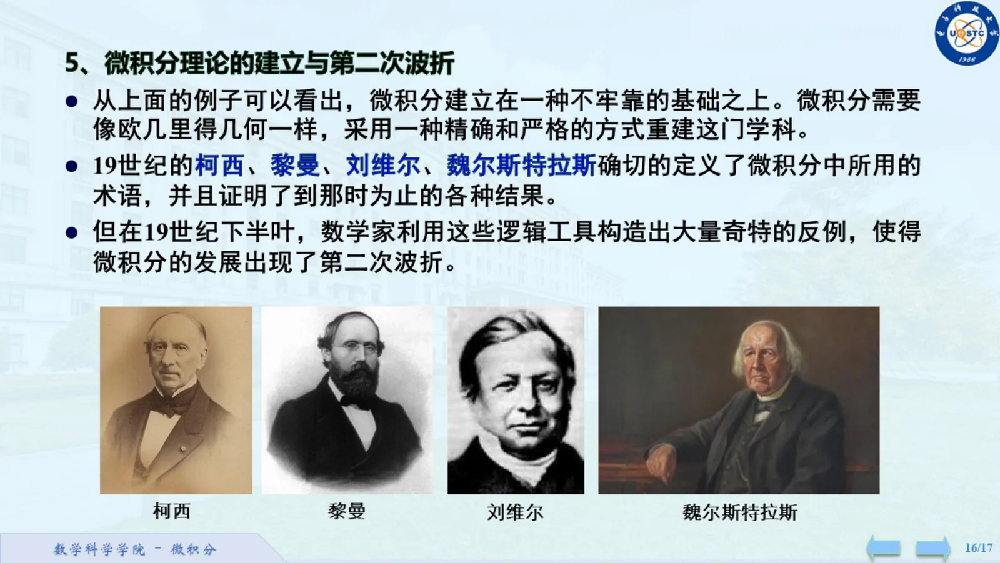
>
> [S01 · 微积分第一次课 - 信通.pdf · PDF 第 17 页](/library/微积分第一次课-信通#page=17)
>
> 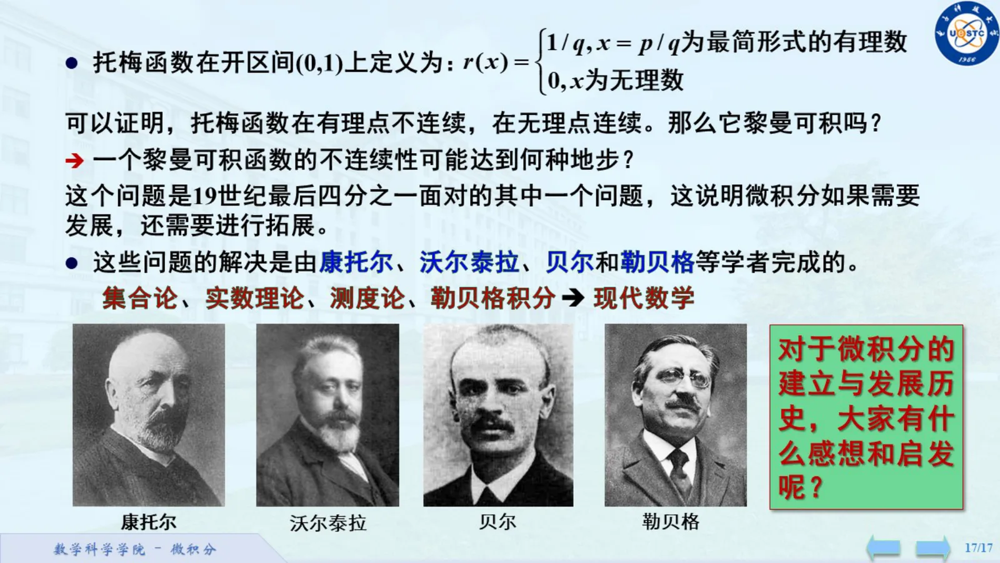

课程正文从 [01-映射与函数](/notes/01-映射与函数) 开始；一次连续阅读可打开 [00-微积分Ⅰ连贯讲义](/notes/00-微积分I连贯讲义)。

### 本篇其余原页

> **逐页保留：前文未单独嵌入的页面**
>
> [S01 · 微积分第一次课 - 信通.pdf · PDF 第 1 页](/library/微积分第一次课-信通#page=1)
>
> 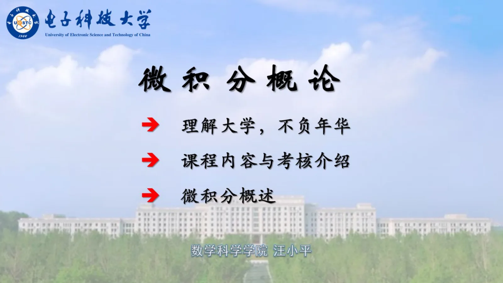

### 本篇来源

- S01：[微积分第一次课 - 信通.pdf](/notes/S01-微积分第一次课-信通)，17 页。

---

## 1.1 映射与函数

研究一个函数之前，先要知道自变量可以取哪些值、每个输入对应什么输出。这就是本节的顺序：**集合与数集 → 映射 → 函数 → 函数性质 → 反函数与复合函数 → 初等函数**。

本节对应本次指定的 S02、S03、S04 三份 PDF。以下引用的页码都是 PDF 页码，和幻灯片右下角的页码可能不同。

### 一、用集合说明研究对象

集合是具有某种确定性质、可以彼此区别的事物的总体；其中的每个事物称为元素。元素与集合的关系写成 $x\in A$ 或 $x\notin A$。

列举法直接写元素，例如 $A=\{a,b,c,d\}$；描述法写出元素满足的条件，例如

$$
A=\{(x,y)\mid x^2+y^2=1\}.
$$

全集 $I$ 是当前研究对象的全体，空集 $\varnothing$ 不含元素。如果 $A$ 中每个元素都属于 $B$，写作 $A\subseteq B$。两个集合相等，等价于互相包含。

**课件提问的整理补充。** 空集包含于任何集合，因为“不存在属于空集却不属于 $A$ 的元素”。一个含 $n$ 个元素的有限集合有 $2^n$ 个子集：每个元素都有“选入、不选入”两种可能。

集合运算分别回答“同时属于”“至少属于一个”“只属于前者”“不属于它”：

| 运算 | 元素条件 |
| --- | --- |
| $A\cap B$ | $x\in A$ 且 $x\in B$ |
| $A\cup B$ | $x\in A$ 或 $x\in B$ |
| $A-B$ | $x\in A$ 且 $x\notin B$ |
| $C_I A$ | $x\in I$ 且 $x\notin A$ |
| $A\times B$ | 有序对 $(x,y)$，其中 $x\in A,\ y\in B$ |

有限集合的笛卡尔积满足 $|A\times B|=|A||B|$。$\mathbb R\times\mathbb R=\mathbb R^2$ 表示平面上的点集。

**原图：集合运算的文氏图与笛卡尔积**

[S02 · 1.1 映射与函数.pdf · PDF 第 4 页](/library/1.1-映射与函数#page=4)

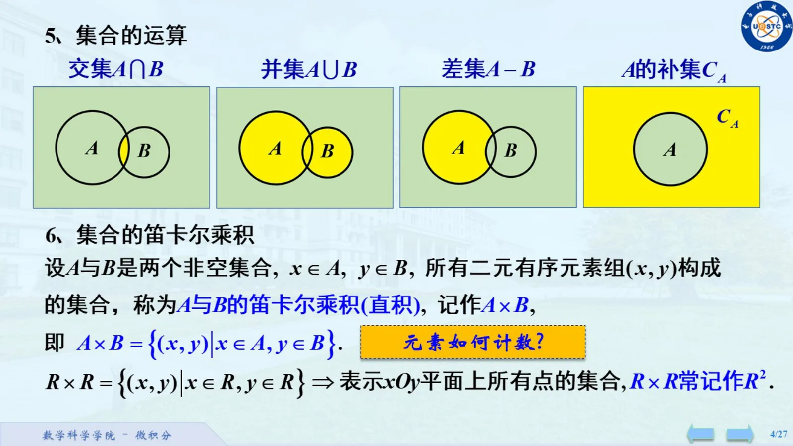

#### 从有限集合走向无限集合

能建立一一对应的两个集合称为等势；描述集合大小的概念是基数。自然数集的基数记为 $\aleph_0$。课件把有限集合以及与自然数集等势的集合统称为可数集合。

有限集合不能与真子集等势，无限集合可以。例如自然数与正偶数通过 $n\mapsto2n$ 一一对应。整数可以按 $0,1,-1,2,-2,\ldots$ 排列；有理数可以把分子、分母列成二维表，沿对角线枚举并去掉重复项。因此 $\mathbb Z,\mathbb Q$ 可数，$\mathbb R$ 不可数。可数个可数集合的并仍可数。

**原图：枚举路线、整数与有理数的可数性**

[S03 · 1.1 映射与函数(1).pdf · PDF 第 1 页](/library/1.1-映射与函数-1#page=1)

[S03 · 1.1 映射与函数(1).pdf · PDF 第 2 页](/library/1.1-映射与函数-1#page=2)

### 二、数集、绝对值和邻域

常见数集为 $\mathbb N,\mathbb Z,\mathbb Q,\mathbb R$。量词 $\forall$ 表示“任意”，$\exists$ 表示“存在”。例如

$$
\forall x\in\mathbb R,\quad\exists y\in\mathbb R,\quad x+y=4
$$

成立，因为可以随 $x$ 选取 $y=4-x$；这里 $y$ 可以依赖 $x$。

绝对值表示数轴上到原点的距离：

$$
|x|=\begin{cases}x,&x\ge0,\\-x,&x<0.\end{cases}
$$

需要保留的性质是

$$
|x|\ge0,\quad|-x|=|x|,\quad-|x|\le x\le|x|,\quad\sqrt{x^2}=|x|,
$$

$$
|x+y|\le|x|+|y|,\qquad
\big||x|-|y|\big|\le|x+y|,
$$

$$
|x-y|\ge|x|-|y|,\qquad |xy|=|x||y|,\qquad
\left|\frac{x}{y}\right|=\frac{|x|}{|y|}\quad(y\ne0).
$$

当 $a>0$，$|x|<a$ 等价于 $-a<x<a$；$|x|>a$ 等价于 $x<-a$ 或 $x>a$。这把距离条件转成了区间条件。

区间 $(a,b)$ 不含端点，$[a,b]$ 含两端，$[a,b)$、$(a,b]$ 只含一端。无穷区间的无穷端始终用圆括号。

点 $x_0$ 的 $\delta$ 邻域及去心邻域为

$$
U(x_0,\delta)=\{x:|x-x_0|<\delta\},\qquad
\mathring U(x_0,\delta)=\{x:0<|x-x_0|<\delta\}.
$$

去心邻域排除了中心点。后面讨论极限时，正是要研究“接近该点”时的情况。

**原图：区间与邻域的数轴图**

[S03 · 1.1 映射与函数(1).pdf · PDF 第 5 页](/library/1.1-映射与函数-1#page=5)

[S03 · 1.1 映射与函数(1).pdf · PDF 第 6 页](/library/1.1-映射与函数-1#page=6)

### 三、映射把输入与输出连接起来

设 $X,Y$ 为非空集合。若规则 $f$ 对每个 $x\in X$ 都指定了 $Y$ 中唯一一个元素 $y$，则称

$$
f:X\to Y,\qquad x\mapsto y=f(x)
$$

为映射。$x$ 是原像，$y$ 是像；定义域是 $X$，值域 $R(f)=\{f(x):x\in X\}\subseteq Y$。**像必须唯一，原像不一定唯一，$Y$ 中也不要求每个元素都有原像。**

| 类型 | 附加条件 |
| --- | --- |
| 满射 | $R(f)=Y$，$Y$ 中每个元素都有原像 |
| 单射 | 不同输入的像不同 |
| 一一映射 | 既是单射，又是满射 |

> **原页核对：映射定义、单射、满射与一一映射的完整原页**
> [S03 · 1.1 映射与函数(1).pdf · PDF 第 7 页](/library/1.1-映射与函数-1#page=7)
>
> 
>
> [S03 · 1.1 映射与函数(1).pdf · PDF 第 8 页](/library/1.1-映射与函数-1#page=8)
>
> 

先用 $\varphi$，再用 $f$，得到复合映射 $f\circ\varphi$。前一映射的值域必须落在后一映射的定义域内：

$$
(f\circ\varphi)(x)=f(\varphi(x)).
$$

一一映射有逆映射 $f^{-1}:Y\to X$，满足

$$
f^{-1}(f(x))=x,\qquad f(f^{-1}(y))=y.
$$

> **原页核对：复合映射示意图与逆映射**
> [S03 · 1.1 映射与函数(1).pdf · PDF 第 9 页](/library/1.1-映射与函数-1#page=9)
>
> 
>
> [S03 · 1.1 映射与函数(1).pdf · PDF 第 10 页](/library/1.1-映射与函数-1#page=10)
>
> 

### 四、函数是数集之间的映射

当输入、输出都是数时，得到函数。$y=f(x)$ 中，$x$ 是自变量，$y$ 是因变量；在 $x_0$ 的函数值记为 $f(x_0)$。输入为一个实变量时是一元函数，输入为 $(x_1,\ldots,x_n)$ 时是多元函数。

本课采用的函数识别方式是看**定义域和对应法则**。例如 $1$ 与 $\sin^2x+\cos^2x$ 在相同定义域 $\mathbb R$ 上表示同一函数；而 $x$ 与 $x^2/x$ 的自然定义域不同，后者不能取 $0$，所以不能直接当作同一函数。

图形是点集 $\{(x,f(x)):x\in D_f\}$。课件提到单值与多值表示：$y=\pm\sqrt{2-x^2}$ 需要分成两个单值分支，本课程主要研究单值函数。

#### 分段函数、特殊函数与隐函数

分段函数是同一个函数在不同输入范围采用不同表达式。例如

$$
f(x)=\begin{cases}2x-1,&x>0,\\x^2-1,&x\le0.\end{cases}
$$

课件例题 $f(x)=3-|x-1|$，先按绝对值内部的符号分段：

$$
f(x)=\begin{cases}2+x,&x<1,\\4-x,&x\ge1.\end{cases}
$$

还包括符号函数、狄利克雷函数、取整函数与最大最小值函数：

$$
\operatorname{sgn}x=\begin{cases}1,&x>0,\\0,&x=0,\\-1,&x<0,\end{cases}
\qquad
D(x)=\begin{cases}1,&x\in\mathbb Q,\\0,&x\notin\mathbb Q.\end{cases}
$$

$[x]=\lfloor x\rfloor$ 是不超过 $x$ 的最大整数。$\min\{f(x),g(x)\}$、$\max\{f(x),g(x)\}$ 也可表示为分段函数。

方程 $F(x,y)=0$ 给出的关系称为隐函数表示，能否确定单值函数还需看范围与分支。课件例子为 $x^2+y^2=4$、$xy=1$、$y-x-e^x\sin y=0$。

**原图：分段函数图像与本页全部例子**

[S03 · 1.1 映射与函数(1).pdf · PDF 第 13 页](/library/1.1-映射与函数-1#page=13)

[S03 · 1.1 映射与函数(1).pdf · PDF 第 14 页](/library/1.1-映射与函数-1#page=14)

### 五、用四种性质描述函数

#### 有界性

在指定集合 $I\subseteq D_f$ 上，若存在 $M>0$ 使所有 $x\in I$ 都有 $|f(x)|\le M$，称有界。无界的准确表述是

$$
\forall M>0,\quad\exists x_0\in I,\quad |f(x_0)|>M.
$$

有界性必须连同讨论范围一起说。

#### 单调性

对任意 $x_1<x_2$，若总有 $f(x_1)<f(x_2)$，是严格单调增加；若总有 $f(x_1)>f(x_2)$，是严格单调减少。把严格不等号换成非严格不等号，得到不减或不增。

**原图：有界、无界与单调性的图像**

[S03 · 1.1 映射与函数(1).pdf · PDF 第 15 页](/library/1.1-映射与函数-1#page=15)

[S03 · 1.1 映射与函数(1).pdf · PDF 第 16 页](/library/1.1-映射与函数-1#page=16)

#### 奇偶性

先要求定义域关于原点对称，再判断

$$
f(-x)=f(x)\quad\text{偶函数},\qquad
f(-x)=-f(x)\quad\text{奇函数}.
$$

偶函数图像关于 $y$ 轴对称，奇函数关于原点对称。

**课件提问的整理补充。** 同类奇偶函数相加减保持原奇偶性；奇乘奇、偶乘偶是偶，奇乘偶是奇，商在分母非零的对称定义域上同理。任一定义域对称的函数可以分解为

$$
f(x)=\frac{f(x)+f(-x)}2+\frac{f(x)-f(-x)}2,
$$

前者为偶函数，后者为奇函数。

#### 周期性

若存在 $T>0$，使定义域内的平移也有定义且恒有 $f(x+T)=f(x)$，则 $T$ 是周期；如果正周期有最小者，它才叫最小正周期。

课件的三个使用规则：$f(ax+b)$（$a\ne0$）具有周期 $T/|a|$；有共同周期 $T$ 的函数相加减，$T$ 仍是周期；两个周期可公度时，其共同整数倍是和差的周期。**这些结论不保证得到的仍是最小正周期**，常函数等也可能没有最小正周期。

> **原页核对：奇偶性与周期性的原图、提问和规则**
> [S03 · 1.1 映射与函数(1).pdf · PDF 第 17 页](/library/1.1-映射与函数-1#page=17)
>
> 
>
> [S03 · 1.1 映射与函数(1).pdf · PDF 第 18 页](/library/1.1-映射与函数-1#page=18)
>
> 

### 六、反函数与复合函数

把函数的输入、输出角色交换，若每个原来的输出都能唯一确定输入，就得到反函数。反函数的定义域是原函数的值域，其值域是原定义域。

$y=f(x)$ 与 $y=f^{-1}(x)$ 的图像关于 $y=x$ 对称；而 $y=f(x)$ 与 $x=f^{-1}(y)$ 是同一关系，图像重合。$f^{-1}(x)$ 不表示 $1/f(x)$。

课件问“是否只有整个定义域单调的函数才有反函数”：严格单调足以保证一一对应，但不是必要条件，核心条件是单射到其值域。

**原图：反函数的对称关系与课堂提问**

[S03 · 1.1 映射与函数(1).pdf · PDF 第 19 页](/library/1.1-映射与函数-1#page=19)

复合函数应从外层向内层拆解，实际求值则从内层向外层：

| 函数 | 分解 |
| --- | --- |
| $\sin\sqrt x$ | $u=\sqrt x,\ y=\sin u$ |
| $\sin(\ln x)$ | $u=\ln x,\ y=\sin u$ |
| $\sqrt{\cot(x/2)}$ | $v=x/2,\ u=\cot v,\ y=\sqrt u$ |
| $e^{\sin^2(1/x)}$ | $w=1/x,\ v=\sin w,\ u=v^2,\ y=e^u$ |

同时检查每一层的定义条件。

### 七、初等函数及课件中的全部图像

基本初等函数包括常数、幂、指数、对数、三角函数和反三角函数。由它们经有限次四则运算、有限次复合并能用一个式子表示的函数称为初等函数。

幂函数 $x^\mu$ 的定义域和形状取决于指数。例如最简有理指数 $\mu=b/a$ 要考虑分母 $a$、分子 $b$ 的奇偶，负指数还要排除 $0$。指数函数 $a^x$ 与对数函数 $\log_a x$ 要求 $a>0,\ a\ne1$；前者定义域 $\mathbb R$，后者 $(0,+\infty)$。

**原图：常数、各类幂函数、指数对数与三角函数的原图**

[S03 · 1.1 映射与函数(1).pdf · PDF 第 24 页](/library/1.1-映射与函数-1#page=24)

[S03 · 1.1 映射与函数(1).pdf · PDF 第 25 页](/library/1.1-映射与函数-1#page=25)

[S03 · 1.1 映射与函数(1).pdf · PDF 第 26 页](/library/1.1-映射与函数-1#page=26)

[S03 · 1.1 映射与函数(1).pdf · PDF 第 27 页](/library/1.1-映射与函数-1#page=27)

反三角函数的主值范围需要和图像一起记：

| 函数 | 定义域 | 主值范围 |
| --- | --- | --- |
| $\arcsin x$ | $[-1,1]$ | $[-\pi/2,\pi/2]$ |
| $\arccos x$ | $[-1,1]$ | $[0,\pi]$ |
| $\arctan x$ | $\mathbb R$ | $(-\pi/2,\pi/2)$ |
| $\operatorname{arccot}x$ | $\mathbb R$ | $(0,\pi)$ |

**原图：反三角函数及其原函数所取的单调分支**

[S04 · 1.1 映射与函数(2).pdf · PDF 第 1 页](/library/1.1-映射与函数-2#page=1)

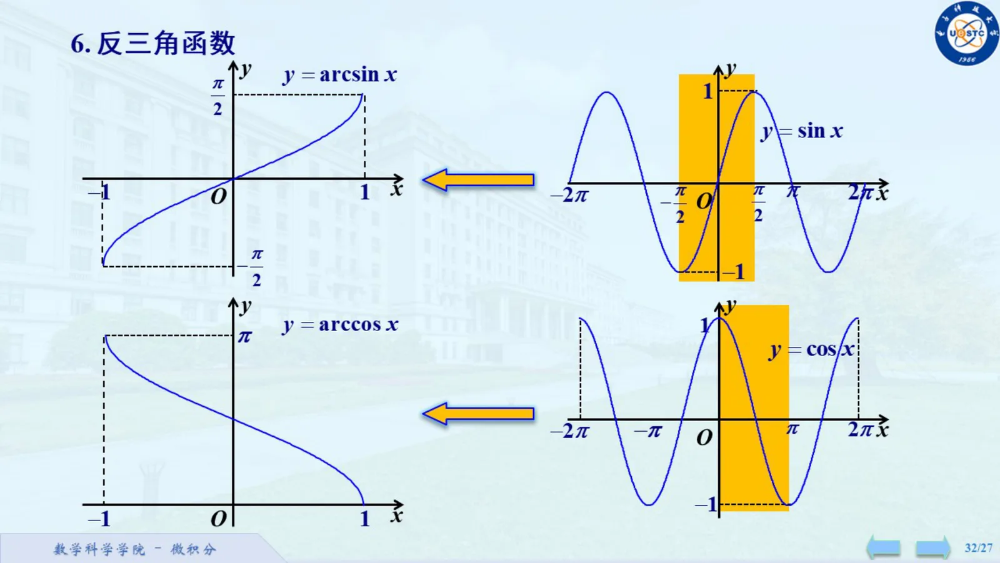

[S04 · 1.1 映射与函数(2).pdf · PDF 第 2 页](/library/1.1-映射与函数-2#page=2)

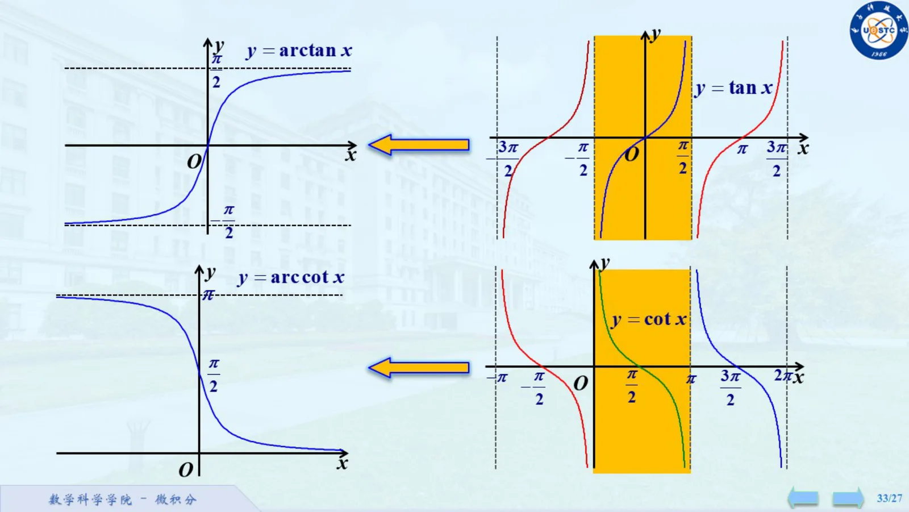

#### 双曲函数与反双曲函数

课件使用 $\mathrm{sh},\mathrm{ch},\mathrm{th}$，对应 $\sinh,\cosh,\tanh$：

$$
\sinh x=\frac{e^x-e^{-x}}2,\quad
\cosh x=\frac{e^x+e^{-x}}2,\quad
\tanh x=\frac{e^x-e^{-x}}{e^x+e^{-x}}.
$$

$$
\cosh^2x-\sinh^2x=1,\quad
\sinh(x\pm y)=\sinh x\cosh y\pm\cosh x\sinh y,
$$

$$
\cosh(x\pm y)=\cosh x\cosh y\pm\sinh x\sinh y,
$$

$$
\sinh2x=2\sinh x\cosh x,\qquad
\cosh2x=\cosh^2x+\sinh^2x.
$$

名称来自双曲线的参数表示，例如 $x=a\cosh t,\ y=b\sinh t$ 满足 $x^2/a^2-y^2/b^2=1$，另一支取 $x=-a\cosh t$。

$$
\operatorname{arsh}x=\ln(x+\sqrt{x^2+1}),\quad x\in\mathbb R,
$$

$$
\operatorname{arch}x=\ln(x+\sqrt{x^2-1}),\quad x\in[1,+\infty),
$$

$$
\operatorname{arth}x=\frac12\ln\frac{1+x}{1-x},\quad x\in(-1,1).
$$

**原图：双曲与反双曲函数、双曲线参数推导及原图**

[S03 · 1.1 映射与函数(1).pdf · PDF 第 21 页](/library/1.1-映射与函数-1#page=21)

[S03 · 1.1 映射与函数(1).pdf · PDF 第 22 页](/library/1.1-映射与函数-1#page=22)

[S03 · 1.1 映射与函数(1).pdf · PDF 第 23 页](/library/1.1-映射与函数-1#page=23)

### 八、公式附录与作业

课件最后的幂指对、三角恒等式、和差化积、积化和差、倍角、半角与降次公式，完整整理在 [08-课件公式附录](/notes/08-课件公式附录)，这里不省略为“高中知识略”。

本节作业为习题册第 1、2、3 页。指定文件中只有这个作业指引，没有习题册相应题面，故不编造题目。

> **原页核对：作业原页**
> [S04 · 1.1 映射与函数(2).pdf · PDF 第 8 页](/library/1.1-映射与函数-2#page=8)
>
> 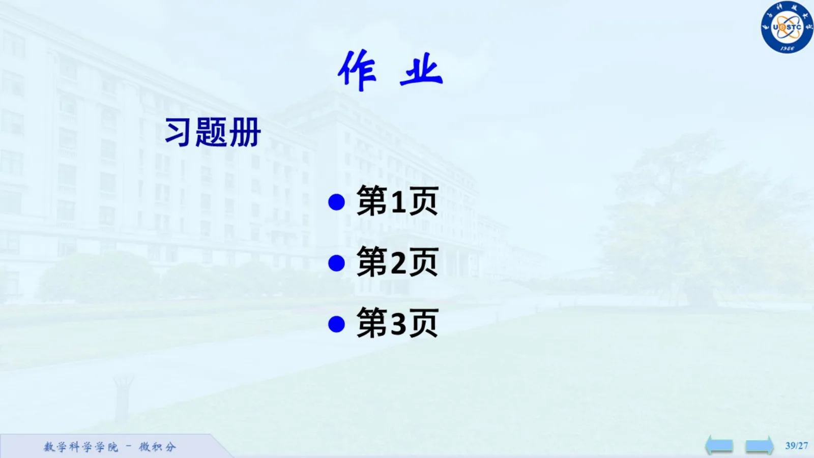

集合确定输入范围，映射确定对应法则，函数性质描述整体形状。接下来在 [02-极限的概念](/notes/02-极限的概念) 中研究：当输入不断变化时，输出会趋向哪里。

### 本篇其余原页

> **逐页保留：前文未单独嵌入的页面**
>
> [S02 · 1.1 映射与函数.pdf · PDF 第 1 页](/library/1.1-映射与函数#page=1)
>
> 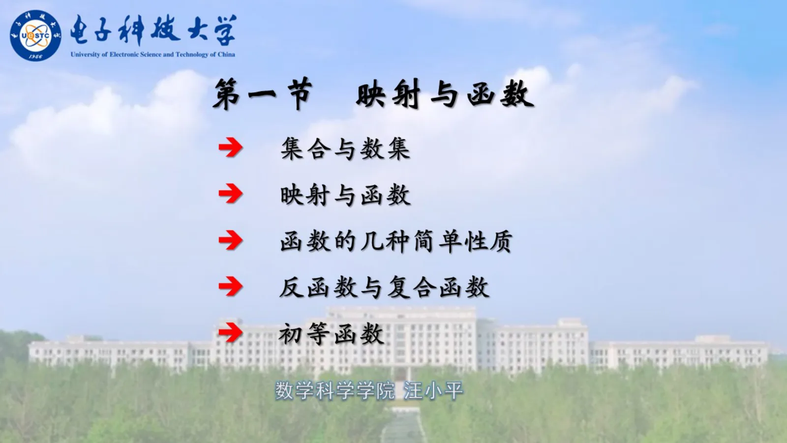
>
> [S02 · 1.1 映射与函数.pdf · PDF 第 2 页](/library/1.1-映射与函数#page=2)
>
> 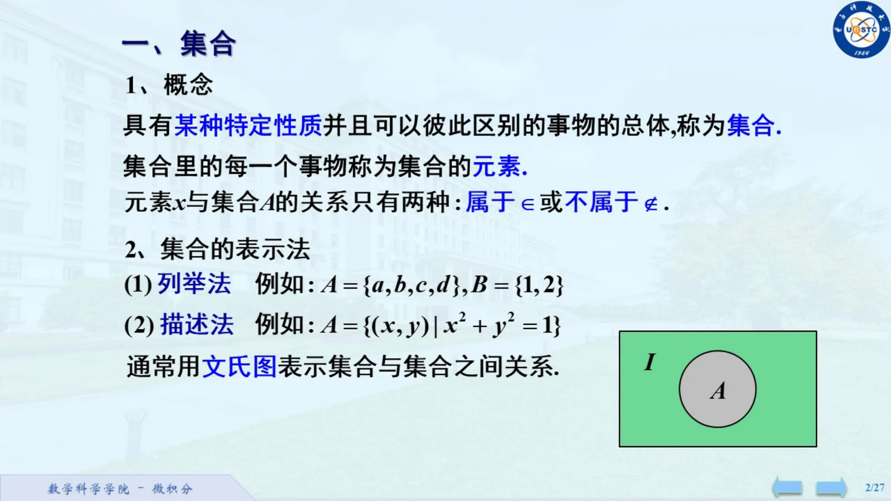
>
> [S02 · 1.1 映射与函数.pdf · PDF 第 3 页](/library/1.1-映射与函数#page=3)
>
> 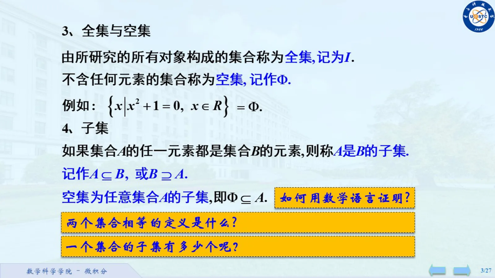
>
> [S02 · 1.1 映射与函数.pdf · PDF 第 5 页](/library/1.1-映射与函数#page=5)
>
> 
>
> [S03 · 1.1 映射与函数(1).pdf · PDF 第 3 页](/library/1.1-映射与函数-1#page=3)
>
> 
>
> [S03 · 1.1 映射与函数(1).pdf · PDF 第 4 页](/library/1.1-映射与函数-1#page=4)
>
> 
>
> [S03 · 1.1 映射与函数(1).pdf · PDF 第 11 页](/library/1.1-映射与函数-1#page=11)
>
> 
>
> [S03 · 1.1 映射与函数(1).pdf · PDF 第 12 页](/library/1.1-映射与函数-1#page=12)
>
> 
>
> [S03 · 1.1 映射与函数(1).pdf · PDF 第 20 页](/library/1.1-映射与函数-1#page=20)
>
> 

### 本篇来源

- S02：[1.1 映射与函数.pdf](/notes/S02-1.1-映射与函数)，5 页。
- S03：[1.1 映射与函数(1).pdf](/notes/S03-1.1-映射与函数-1)，27 页。
- S04：[1.1 映射与函数(2).pdf](/notes/S04-1.1-映射与函数-2)，8 页。

---

## 1.2 极限的概念

上一节描述函数“是什么”，这一节研究变量沿某个过程变化时“趋向什么”。先研究离散的数列，再推广到连续变化的自变量。**极限的核心是：精度可以任意要求，而足够靠后的所有值都满足要求。**

来源：S05、S06、S07、S08。

### 一、数列及其简单性质

按自然数 $1,2,\ldots$ 编号依次排列的一列数 $x_1,x_2,\ldots,x_n,\ldots$ 称为数列，$x_n$ 是通项，也可把数列理解为定义在正整数上的函数。

课件给出的通项与递推例子为

$$
2^n,\quad 2^{-n},\quad(-1)^{n-1},\quad
\frac{n+(-1)^{n-1}}n,\quad
a_1=\sqrt3,\ a_{n+1}=\sqrt{3+a_n}.
$$

如果 $x_{n+1}>x_n$（或 $<$），称严格单调增加（或减少）；允许等号时称不减（或不增）。

数列有界是指存在同一个 $M>0$ 使所有 $n$ 都有 $|x_n|\le M$。无界则是：对每个 $M>0$，都能找到某一项满足 $|x_n|>M$。有上界与有下界同时成立，等价于有界。例如 $\{1/n\}$ 上下都有界，$\{2^n\}$ 有下界而无上界。

**课堂选择题：有限项数列是否一定有界？** 是。有限个确定实数的绝对值有最大者。无穷大不是一个能填入某项的实数。

> **原页核对：全部数列例子、单调性、有界性与选择题解析**
> [S05 · 1.2 极限的概念.pdf · PDF 第 2 页](/library/1.2-极限的概念#page=2)
>
> 
>
> [S05 · 1.2 极限的概念.pdf · PDF 第 3 页](/library/1.2-极限的概念#page=3)
>
> 
>
> [S05 · 1.2 极限的概念.pdf · PDF 第 4 页](/library/1.2-极限的概念#page=4)
>
> 
>
> [S05 · 1.2 极限的概念.pdf · PDF 第 5 页](/library/1.2-极限的概念#page=5)
>
> 
>
> [S05 · 1.2 极限的概念.pdf · PDF 第 6 页](/library/1.2-极限的概念#page=6)
>
> 

### 二、从直观趋近到严格定义

课件比较以下变化：

| 数列 | $n\to\infty$ 时 |
| --- | --- |
| $1/2^{n-1}$ | 趋于 $0$ |
| $(n-1)/n$ | 趋于 $1$ |
| $(-1)^n/n$ | 在 $0$ 两侧跳动，但趋于 $0$ |
| $(-1)^n$ | 在 $-1,1$ 间跳动，无极限 |
| $2^n$ | 不收敛到有限实数 |

所以“不停振荡”本身不够判断极限，必须看振幅是否缩小。仅仅有无穷多项靠近某个数，也不等于整个数列趋向它。

课件另画出一组“多数点靠近 $1$，在某些素数平方编号处插入随机偏离值”的实验：图形上大量点靠近 $1$，并不能代替对整个尾部的检验。随机表达式和当时的图形保留在下面的原页中；不能凭一帧图就认定满足严格定义。

> **原页核对：课件的趋近讨论及动态图静态帧**
> [S05 · 1.2 极限的概念.pdf · PDF 第 7 页](/library/1.2-极限的概念#page=7)
>
> 
>
> [S05 · 1.2 极限的概念.pdf · PDF 第 8 页](/library/1.2-极限的概念#page=8)
>
> 
>
> [S05 · 1.2 极限的概念.pdf · PDF 第 9 页](/library/1.2-极限的概念#page=9)
>
> 
>
> [S05 · 1.2 极限的概念.pdf · PDF 第 10 页](/library/1.2-极限的概念#page=10)
>
> 

#### 数列极限的 $\varepsilon-N$ 定义

$$
\lim_{n\to\infty}x_n=a
\iff
\forall\varepsilon>0,\ \exists N\in\mathbb N^+,\ 
\forall n>N,\ |x_n-a|<\varepsilon.
$$

$\varepsilon$ 是允许误差，$N$ 是保证后面所有项都达标的门槛。$N$ 可以依赖 $\varepsilon$，选择通常不唯一；找到一个足够大的 $N$ 即可。

几何上，任意小区间 $(a-\varepsilon,a+\varepsilon)$ 外只剩有限项。等价表述是“最终全部进入”，不是“进入无穷多次”。改动、增删有限个开头项不影响极限。

**原图：数轴上极限定义的几何解释**

[S05 · 1.2 极限的概念.pdf · PDF 第 13 页](/library/1.2-极限的概念#page=13)

课件在 S05 第 14-15 页的选择题选 **B：任意这样的区间外只有有限项**。选项 A“区间内有无穷多项”不足够，例如交替取 $a$ 和 $a+1$。

### 三、数列定义证明的全部例题

#### 例 1：交错趋近 $1$

证明 $\frac{n+(-1)^{n-1}}n\to1$。误差直接化为

$$
\left|\frac{n+(-1)^{n-1}}n-1\right|=\frac1n.
$$

给定 $\varepsilon>0$，取正整数 $N=\max\{1,\lfloor1/\varepsilon\rfloor\}$。当 $n>N$ 时，$1/n<\varepsilon$，证明完成。$\varepsilon=1/100,1/1000,1/10000$ 时，对应的足够门槛可取 $100,1000,10000$。

#### 例 2：$\lvert q\rvert<1$ 时 $q^n\to0$

$q=0$ 时显然；$0<|q|<1$ 时，误差为 $|q|^n$。取对数后，因 $\ln|q|<0$，不等号方向要反转：

$$
|q|^n<\varepsilon
\iff n>\frac{\ln\varepsilon}{\ln|q|}.
$$

取大于该值的正整数门槛即可。

#### 例 3：正数列的开方

已知 $x_n>0$ 且 $x_n\to a>0$，证明 $\sqrt{x_n}\to\sqrt a$。有理化后

$$
|\sqrt{x_n}-\sqrt a|
=\frac{|x_n-a|}{\sqrt{x_n}+\sqrt a}
\le\frac{|x_n-a|}{\sqrt a}.
$$

在原数列的定义中要求 $|x_n-a|<\sqrt a\,\varepsilon$，即可使开方后的误差小于 $\varepsilon$。

#### 例 4：放大误差

$$
s_n=\frac13-\left(\frac1{2n}-\frac1{6n^2}\right)\to\frac13.
$$

对 $n\ge1$，

$$
\left|s_n-\frac13\right|
=\frac1{2n}-\frac1{6n^2}<\frac1{2n}.
$$

因此取正整数 $N\ge1/(2\varepsilon)$ 即可。证明只需要足够条件，无需解出最小门槛。

#### 例 5：和的极限

已知 $x_n\to a,\ y_n\to b$。分别把两个误差控制在 $\varepsilon/2$ 内，取 $N=\max\{N_1,N_2\}$，则

$$
|(x_n+y_n)-(a+b)|
\le|x_n-a|+|y_n-b|<\varepsilon.
$$

这里取最大值，是为了“同时满足两个足够靠后”的要求。

> **原页核对：上述五个例题的全部课件推导**
> [S05 · 1.2 极限的概念.pdf · PDF 第 16 页](/library/1.2-极限的概念#page=16)
>
> 
>
> [S05 · 1.2 极限的概念.pdf · PDF 第 17 页](/library/1.2-极限的概念#page=17)
>
> 
>
> [S05 · 1.2 极限的概念.pdf · PDF 第 18 页](/library/1.2-极限的概念#page=18)
>
> 
>
> [S05 · 1.2 极限的概念.pdf · PDF 第 19 页](/library/1.2-极限的概念#page=19)
>
> 

### 四、收敛数列的性质及证明思路

**有界性。** 收敛数列一定有界。取 $\varepsilon=1$，足够后的项落在 $(a-1,a+1)$；开头只有有限项，再把它们的绝对值并入一个共同上界。逆命题不成立：$(-1)^n$ 有界而发散。

**唯一性。** 若同时趋于不同的 $a,b$，取 $\varepsilon=|a-b|/3$，足够靠后的同一项必须同时落在两个不相交邻域，矛盾。课件还给出三角不等式证明：

$$
|a-b|\le|x_n-a|+|x_n-b|,
$$

右边可任意小，只能 $a=b$。

**保号性。** 若 $x_n\to a>0$，取 $\varepsilon=a/2$，最终 $x_n>a/2>0$。若 $x_n$ 最终非负且极限存在，只能推出 $a\ge0$，不能推出 $a>0$，反例是 $1/n\to0$。

**保序性。** 若 $x_n\to a,\ y_n\to b$ 且 $a>b$，最终 $x_n>y_n$；反向从最终 $x_n\ge y_n$ 只能得到 $a\ge b$。用差数列 $x_n-y_n$ 和保号性证明。

**子列。** 收敛数列的任意子列都趋于同一极限。$(-1)^n$ 的奇数项子列趋于 $-1$，偶数项子列趋于 $1$，因此原数列不收敛。反过来，如果奇数项与偶数项子列都趋于同一个 $a$，原数列也趋于 $a$：分别控制两组，再取统一门槛覆盖所有项。

> **原页核对：有界性、唯一性的两种证明、保号保序性与子列**
> [S06 · 1.2 极限的概念(1).pdf · PDF 第 1 页](/library/1.2-极限的概念-1#page=1)
>
> 
>
> [S06 · 1.2 极限的概念(1).pdf · PDF 第 2 页](/library/1.2-极限的概念-1#page=2)
>
> 
>
> [S06 · 1.2 极限的概念(1).pdf · PDF 第 3 页](/library/1.2-极限的概念-1#page=3)
>
> 
>
> [S06 · 1.2 极限的概念(1).pdf · PDF 第 4 页](/library/1.2-极限的概念-1#page=4)
>
> 
>
> [S06 · 1.2 极限的概念(1).pdf · PDF 第 5 页](/library/1.2-极限的概念-1#page=5)
>
> 
>
> [S06 · 1.2 极限的概念(1).pdf · PDF 第 6 页](/library/1.2-极限的概念-1#page=6)
>
> 

#### 运算法则与课后思考

两个有限极限都存在时，和、差、积可分别求极限，商还要求分母极限非零，常数倍也成立。

课件的思考题可按下列情况整理，以下反例和说明为整理补充：

| 已知情况 | 和、差 | 积 |
| --- | --- | --- |
| 两者都收敛 | 都收敛 | 收敛 |
| 一者收敛，一者发散 | 都发散，否则可相减推出另一者收敛 | 不一定；$0\cdot(-1)^n=0$ |
| 两者都发散 | 不一定，如 $(-1)^n+[-(-1)^n]=0$ | 不一定，如 $(-1)^n(-1)^n=1$ |

若收敛因子的极限非零，而乘积收敛，则可用商法则反推出另一因子收敛。零极限因子不具备这个推论。

$\lim x_n=0\iff\lim|x_n|=0$，因为到 $0$ 的误差完全相同。一般情况下 $|x_n|$ 收敛不能推出 $x_n$ 收敛，仍看 $(-1)^n$。

> **原页核对：运算法则、全部课后问题及作业**
> [S06 · 1.2 极限的概念(1).pdf · PDF 第 7 页](/library/1.2-极限的概念-1#page=7)
>
> 
>
> [S06 · 1.2 极限的概念(1).pdf · PDF 第 8 页](/library/1.2-极限的概念-1#page=8)
>
> 

### 五、函数在无穷远处的极限

把“编号足够大”换成“自变量足够远”，得到函数极限：

| 过程 | 给定 $\varepsilon>0$ 后选 $X>0$，要求 |
| --- | --- |
| $x\to+\infty$ | $x>X\Rightarrow|f(x)-A|<\varepsilon$ |
| $x\to-\infty$ | $x<-X\Rightarrow|f(x)-A|<\varepsilon$ |
| $x\to\infty$（两端） | $|x|>X\Rightarrow|f(x)-A|<\varepsilon$ |

两端极限为 $A$，等价于正负无穷两端的极限都存在且等于 $A$。

**原图：正无穷、负无穷、两端以及误差带图像**

[S07 · 1.2 极限的概念(续).pdf · PDF 第 2 页](/library/1.2-极限的概念-续#page=2)

[S07 · 1.2 极限的概念(续).pdf · PDF 第 3 页](/library/1.2-极限的概念-续#page=3)

[S07 · 1.2 极限的概念(续).pdf · PDF 第 4 页](/library/1.2-极限的概念-续#page=4)

[S07 · 1.2 极限的概念(续).pdf · PDF 第 5 页](/library/1.2-极限的概念-续#page=5)

**例 1：** $\lim_{x\to\infty}\sin x/x=0$。因为

$$
\left|\frac{\sin x}{x}\right|\le\frac1{|x|},
$$

取 $X=1/\varepsilon$ 即可。这也说明 $\sin x$ 自己没有无穷远极限，但乘上衰减因子后可以收敛。

### 六、有限点处的函数极限

$$
\lim_{x\to x_0}f(x)=A
\iff
\forall\varepsilon>0,\ \exists\delta>0,\ 
0<|x-x_0|<\delta\Rightarrow|f(x)-A|<\varepsilon.
$$

先指定纵向精度 $\varepsilon$，再限制横向范围 $\delta$。条件中的 $0<$ 排除了 $x=x_0$，所以极限与 $f(x_0)$ 是否有定义、定义成什么值无直接关系。

**原图：局部放大图、去心邻域和误差带**

[S07 · 1.2 极限的概念(续).pdf · PDF 第 7 页](/library/1.2-极限的概念-续#page=7)

[S07 · 1.2 极限的概念(续).pdf · PDF 第 8 页](/library/1.2-极限的概念-续#page=8)

[S07 · 1.2 极限的概念(续).pdf · PDF 第 9 页](/library/1.2-极限的概念-续#page=9)

[S07 · 1.2 极限的概念(续).pdf · PDF 第 10 页](/library/1.2-极限的概念-续#page=10)

#### 例 2：约去公共因子

$$
\lim_{x\to1}\frac{x^2-1}{x-1}=2.
$$

对 $x\ne1$，误差就是 $|(x+1)-2|=|x-1|$，取 $\delta=\varepsilon$。虽然原函数在 $1$ 处无定义，极限仍存在。

#### 例 3：平方根的极限

$x_0>0$ 时，

$$
|\sqrt x-\sqrt{x_0}|
\le\frac{|x-x_0|}{\sqrt{x_0}}.
$$

取 $\delta=\min\{x_0,\sqrt{x_0}\varepsilon\}$，既保证 $x>0$，又控制误差。

#### 例 4：先限制分母，再控制误差

$$
\lim_{x\to1}\frac{x+1}{x-2}=-2,\qquad
\left|\frac{x+1}{x-2}+2\right|=\frac{3|x-1|}{|x-2|}.
$$

先要求 $|x-1|<1/2$，得到 $|x-2|>1/2$，误差小于 $6|x-1|$。再取

$$
\delta=\min\left\{\frac12,\frac{\varepsilon}6\right\}.
$$

“先限制、再放大、最后取最小值”是课件这道证明的重点。S08 第 1 页与 S07 第 12 页保留了重叠内容。

> **原页核对：有限点处例2至例4的完整推导**
> [S07 · 1.2 极限的概念(续).pdf · PDF 第 11 页](/library/1.2-极限的概念-续#page=11)
>
> 
>
> [S07 · 1.2 极限的概念(续).pdf · PDF 第 12 页](/library/1.2-极限的概念-续#page=12)
>
> 

### 七、左右极限决定两侧极限

左极限只考察 $x_0-\delta<x<x_0$，右极限只考察 $x_0<x<x_0+\delta$。在左右都有定义的相应邻域中，

$$
\lim_{x\to x_0}f(x)=A
\iff
\lim_{x\to x_0^-}f(x)=
\lim_{x\to x_0^+}f(x)=A.
$$

课件先用 $f(x)=1-x\ (x<0)$、$f(x)=x^2+1\ (x\ge0)$ 引出左右极限，两侧都趋于 $1$。

**原图：左右趋近的图像和定义**

[S08 · 1.2 极限的概念(续)(1).pdf · PDF 第 2 页](/library/1.2-极限的概念-续-1#page=2)

[S08 · 1.2 极限的概念(续)(1).pdf · PDF 第 3 页](/library/1.2-极限的概念-续-1#page=3)

课件的后续例题：

| 例题 | 左极限 | 右极限 | 两侧极限 |
| --- | --- | --- | --- |
| 例5：$|x|/x$，$x\to0$ | $-1$ | $1$ | 不存在 |
| 例6：$f(x)=5+x^2\ (x<0),\ f(0)=10,\ f(x)=x\ (x>0)$ | $5$ | $0$ | 不存在 |
| 例7：$f(x)=x-1\ (x<1),\ f(x)=x^2-1\ (x>1)$，$x\to1$ | $0$ | $0$ | $0$ |

第二题中 $f(0)=10$ 不改变左右极限；第三题在 $1$ 没有函数值也不影响两侧极限。

**原图：上述例5至例7的原题、解答与图像**

[S08 · 1.2 极限的概念(续)(1).pdf · PDF 第 4 页](/library/1.2-极限的概念-续-1#page=4)

[S08 · 1.2 极限的概念(续)(1).pdf · PDF 第 5 页](/library/1.2-极限的概念-续-1#page=5)

### 八、函数极限性质与海涅定理

函数有有限极限，推出相应过程中的**局部有界**，并有唯一性、局部保号性、保序性。证明与数列相似，不过函数不能靠“补上有限开头项”就推成全定义域有界。

> **原页核对：函数极限性质的全部证明**
> [S08 · 1.2 极限的概念(续)(1).pdf · PDF 第 6 页](/library/1.2-极限的概念-续-1#page=6)
>
> 
>
> [S08 · 1.2 极限的概念(续)(1).pdf · PDF 第 7 页](/library/1.2-极限的概念-续-1#page=7)
>
> 
>
> [S08 · 1.2 极限的概念(续)(1).pdf · PDF 第 8 页](/library/1.2-极限的概念-续-1#page=8)
>
> 

海涅定理把函数极限与数列连接起来：在相应去心邻域有定义的前提下，

$$
\lim_{x\to x_0}f(x)=A
\iff
\text{对每个 }x_n\to x_0,\ x_n\ne x_0,\quad f(x_n)\to A.
$$

强调“每个”数列。只有一个选定数列能趋向目标，不足以证明函数极限存在。课件还用 $x_n=1/n$ 连接 $\sin x/x$ 的极限，用 $x_n=\ln n$ 连接 $\arctan x$ 在正无穷的极限。

**例 8：证明 $\sin(1/x)$ 在 $0$ 没有极限。** 取

$$
x_n=\frac1{n\pi},\qquad
y_n=\frac1{2n\pi+\pi/2}.
$$

二者都趋于 $0$，但函数值分别为 $0$ 和 $1$。出现两条不同的趋近结果，排除了函数极限。

**原图：海涅定理示意图和振荡函数原题**

[S08 · 1.2 极限的概念(续)(1).pdf · PDF 第 9 页](/library/1.2-极限的概念-续-1#page=9)

[S08 · 1.2 极限的概念(续)(1).pdf · PDF 第 10 页](/library/1.2-极限的概念-续-1#page=10)

### 九、作业与下一节

数列部分：习题册第 4 页第 2 题；函数极限部分：第 4 页第 3、4 题。指定文件未附习题册题面。

极限为零的情形将被单独命名为“无穷小”，它让一般极限的误差分析变得统一，见 [03-无穷小量与无穷大量](/notes/03-无穷小量与无穷大量)。

### 本篇其余原页

> **逐页保留：前文未单独嵌入的页面**
>
> [S05 · 1.2 极限的概念.pdf · PDF 第 1 页](/library/1.2-极限的概念#page=1)
>
> 
>
> [S05 · 1.2 极限的概念.pdf · PDF 第 11 页](/library/1.2-极限的概念#page=11)
>
> 
>
> [S05 · 1.2 极限的概念.pdf · PDF 第 12 页](/library/1.2-极限的概念#page=12)
>
> 
>
> [S05 · 1.2 极限的概念.pdf · PDF 第 14 页](/library/1.2-极限的概念#page=14)
>
> 
>
> [S05 · 1.2 极限的概念.pdf · PDF 第 15 页](/library/1.2-极限的概念#page=15)
>
> 
>
> [S05 · 1.2 极限的概念.pdf · PDF 第 20 页](/library/1.2-极限的概念#page=20)
>
> 
>
> [S07 · 1.2 极限的概念(续).pdf · PDF 第 1 页](/library/1.2-极限的概念-续#page=1)
>
> 
>
> [S07 · 1.2 极限的概念(续).pdf · PDF 第 6 页](/library/1.2-极限的概念-续#page=6)
>
> 
>
> [S08 · 1.2 极限的概念(续)(1).pdf · PDF 第 1 页](/library/1.2-极限的概念-续-1#page=1)
>
> 
>
> [S08 · 1.2 极限的概念(续)(1).pdf · PDF 第 11 页](/library/1.2-极限的概念-续-1#page=11)
>
> 

### 本篇来源

- S05：[1.2 极限的概念.pdf](/notes/S05-1.2-极限的概念)，20 页。
- S06：[1.2 极限的概念(1).pdf](/notes/S06-1.2-极限的概念-1)，8 页。
- S07：[1.2 极限的概念(续).pdf](/notes/S07-1.2-极限的概念-续)，12 页。
- S08：[1.2 极限的概念(续)(1).pdf](/notes/S08-1.2-极限的概念-续-1)，11 页。

---

## 1.3 无穷小量与无穷大量

上一节用 $|f(x)-A|$ 描述误差。如果误差趋于零，就可以把一般极限统一写成“一个常数加一个趋零量”。本节的概念都必须连同**极限过程**一起说。

来源：S09、S10。

### 一、课件的引入：无限分割与有限结果

课件先介绍芝诺悖论和阿喀琉斯追龟：把追赶过程拆成无穷多段，并不自动说明总时间无穷长。这里要区分“段数无穷多”与“这些段的总量是否有限”。这为无穷小的运算和后面“有限个”的限制埋下伏笔。

> **原页核对：芝诺介绍、追龟问题的原文与插图**
> [S09 · 1.3 无穷小量 无穷大量.pdf · PDF 第 2 页](/library/1.3-无穷小量-无穷大量#page=2)
>
> 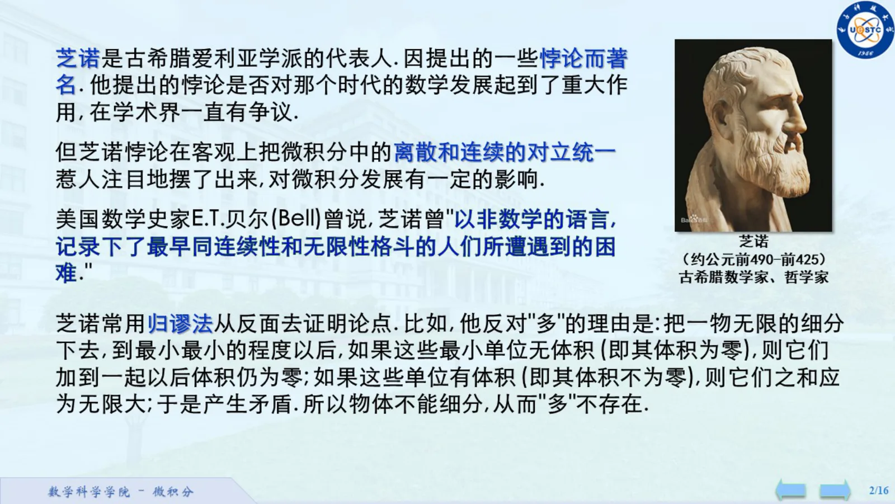
>
> [S09 · 1.3 无穷小量 无穷大量.pdf · PDF 第 3 页](/library/1.3-无穷小量-无穷大量#page=3)
>
> 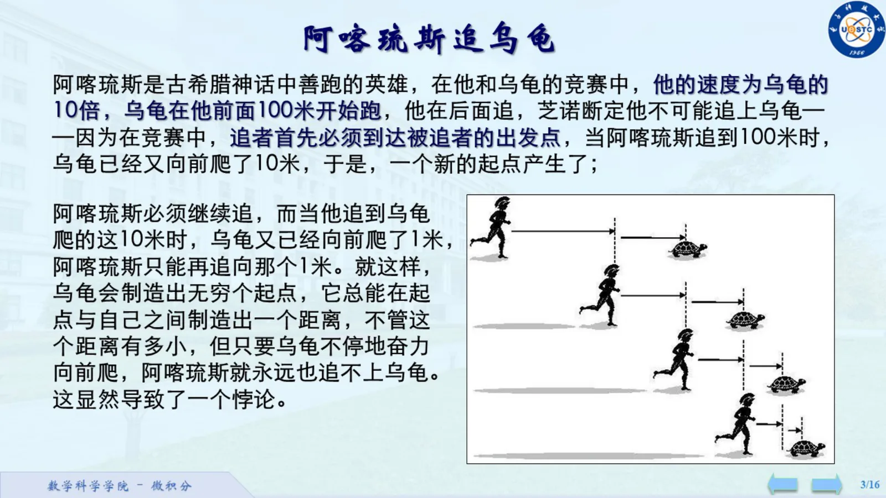

### 二、无穷小是趋于零的变量

在某一指定过程中，极限为零的变量称为无穷小。例如

$$
\sin x\quad(x\to0),\qquad
\frac1x\quad(x\to\infty),\qquad
\frac{(-1)^n}{n}\quad(n\to\infty).
$$

它不是“一个很小的非零常数”。对 $x\to x_0$，定义就是

$$
\forall\varepsilon>0,\ \exists\delta>0,\quad
0<|x-x_0|<\delta\Rightarrow |f(x)|<\varepsilon.
$$

对 $x\to\infty$，把横向条件换成 $|x|>X$。数列情形换成 $n>N$。

#### 有限极限与无穷小的等价关系

$$
\lim f(x)=A
\iff f(x)=A+\alpha(x),\quad\alpha(x)\to0.
$$

必要性取 $\alpha(x)=f(x)-A$；充分性则由 $|f(x)-A|=|\alpha(x)|\to0$。因此

$$
f(x)\to A
\iff f(x)-A\to0
\iff |f(x)-A|\to0.
$$

> **原页核对：无穷小定义、例子与等价关系的完整证明**
> [S09 · 1.3 无穷小量 无穷大量.pdf · PDF 第 4 页](/library/1.3-无穷小量-无穷大量#page=4)
>
> 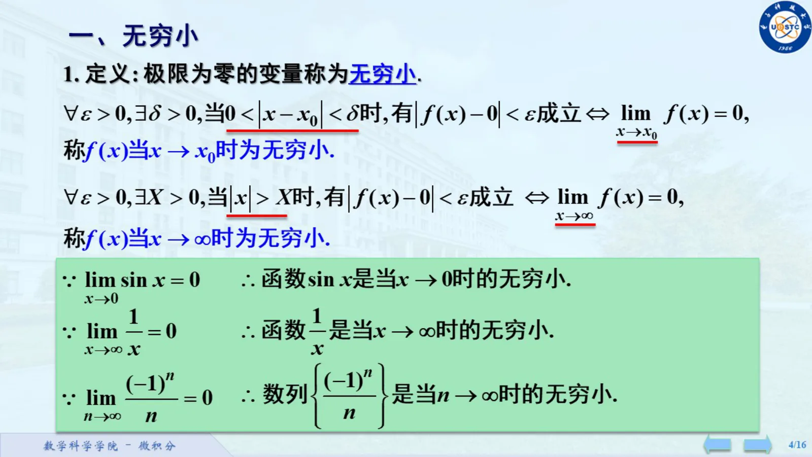
>
> [S09 · 1.3 无穷小量 无穷大量.pdf · PDF 第 5 页](/library/1.3-无穷小量-无穷大量#page=5)
>
> 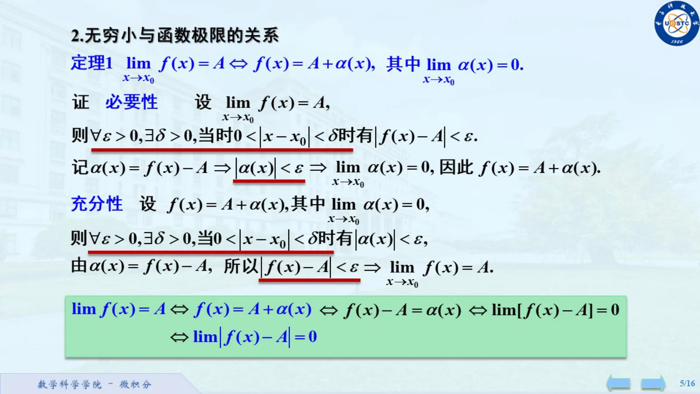

#### 课堂选择题：按题面与证明判断

题面说：若 $x_n\to a$，是否存在数列 $\alpha_n=x_n-a$ 且 $\alpha_n\to0$？当 $a$ 为有限实数时，答案应为 **A“一定正确”**，因为这个定义直接给出

$$
|\alpha_n|=|x_n-a|\to0.
$$

原页高亮 C“不一定正确”，与这里的题面不一致，可能是课件或导出答案标记的问题；原图照留，不把高亮当作证明。

**原图：存在答案标记疑点的课堂题原图**

[S09 · 1.3 无穷小量 无穷大量.pdf · PDF 第 6 页](/library/1.3-无穷小量-无穷大量#page=6)

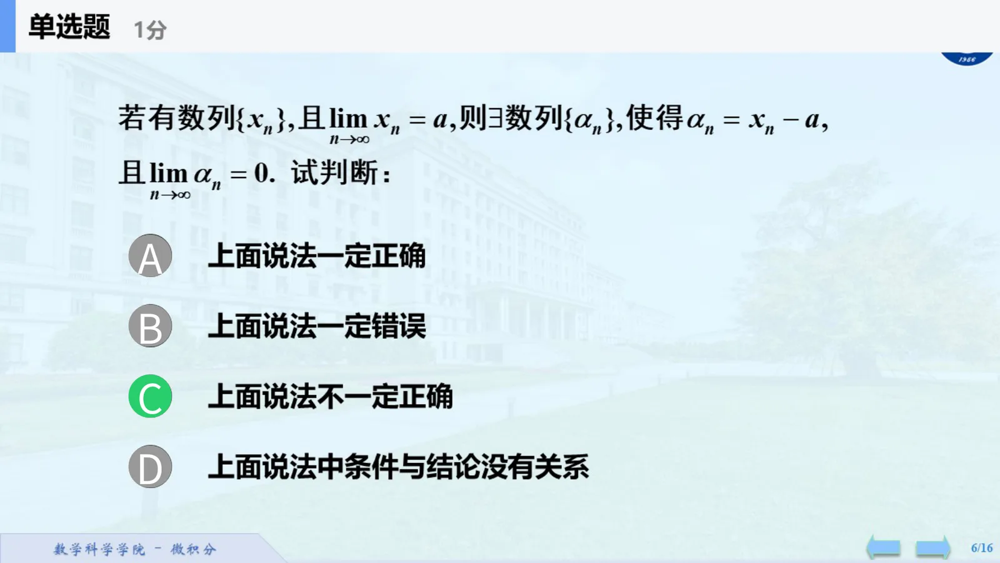

### 三、无穷小的运算性质

#### 有限个无穷小的代数和仍是无穷小

对两个无穷小 $\alpha,\beta$，分别要求 $|\alpha|<\varepsilon/2$、$|\beta|<\varepsilon/2$。取两者邻域半径的最小值，就有

$$
|\alpha\pm\beta|\le|\alpha|+|\beta|<\varepsilon.
$$

推广到固定有限个量，把总误差分配给各项即可。原页用 $\varepsilon+\varepsilon=2\varepsilon$ 也能表达任意小，但正文用 $\varepsilon/2$ 分配，最终直接回到定义要求。

#### 有界函数乘无穷小仍是无穷小

如果相应过程中 $|f(x)|\le M$，$\alpha(x)\to0$，先让 $|\alpha(x)|<\varepsilon/M$，就有

$$
|f(x)\alpha(x)|\le M|\alpha(x)|<\varepsilon.
$$

所以有限极限量乘无穷小、常数乘无穷小、有限个无穷小的乘积，都是无穷小。

> **原页核对：代数和与乘积定理的证明及全部推论**
> [S09 · 1.3 无穷小量 无穷大量.pdf · PDF 第 7 页](/library/1.3-无穷小量-无穷大量#page=7)
>
> 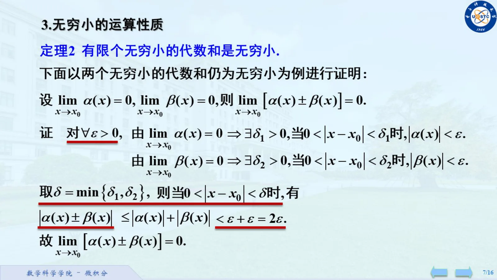
>
> [S09 · 1.3 无穷小量 无穷大量.pdf · PDF 第 8 页](/library/1.3-无穷小量-无穷大量#page=8)
>
> 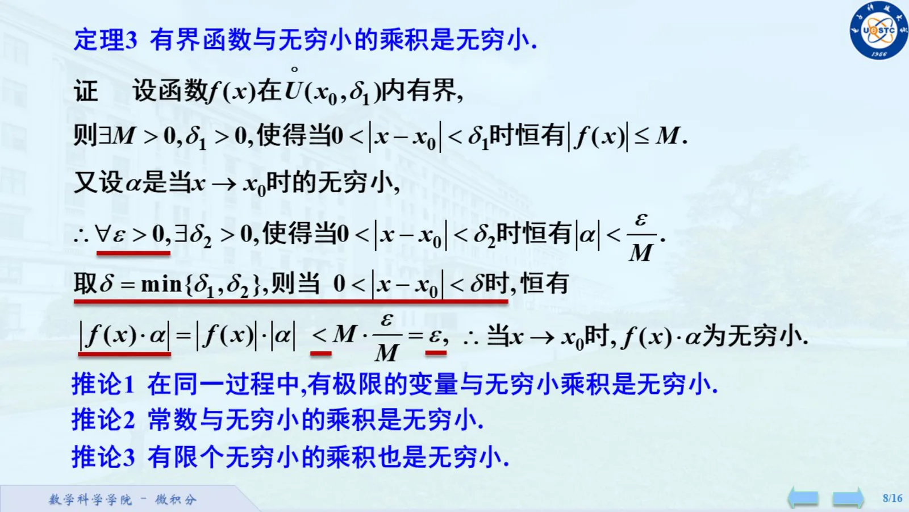

#### 为什么一定强调“有限个”

S10 第 2 页排列了一个数列阵：第 $m$ 行前若干项为 $1$、第 $m$ 项为 $m^{m-1}$、后面为 $1/(m+1),1/(m+2),\ldots$。固定一行看，它趋于 $0$；但若每次随着 $n$ 增加，取前 $n$ 行在第 $n$ 列的乘积：

$$
\underbrace{\frac1n\cdots\frac1n}_{n-1\text{ 个}}\cdot n^{n-1}=1.
$$

这说明“每个固定因子都是无穷小”不能直接推广成“因子数随 $n$ 增长的乘积也是无穷小”。这个数列阵本身保留如下。

**原图：随n增加因子数的数列阵**

[S10 · 1.3 无穷小量 无穷大量(1).pdf · PDF 第 2 页](/library/1.3-无穷小量-无穷大量-1#page=2)

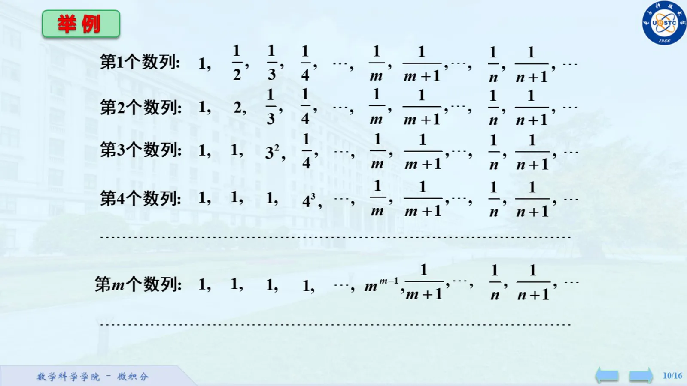

### 四、课件的两个乘积极限例题

**例 1：**

$$
\lim_{x\to\infty}\frac{2x}{\sqrt{1+x^2}}\arctan\frac1x=0.
$$

$\arctan(1/x)\to0$，而

$$
\left|\frac{2x}{\sqrt{1+x^2}}\right|\le2.
$$

用有界量乘无穷小即可，不必分别求第一个因子的两端极限。

**例 2：**

$$
\lim_{x\to0}x^2\sin\frac1x=0.
$$

$x^2\to0$，$|\sin(1/x)|\le1$。后一个因子振荡不收敛，但不妨碍乘积收敛。

> **原页核对：两个例题的完整原解**
> [S10 · 1.3 无穷小量 无穷大量(1).pdf · PDF 第 3 页](/library/1.3-无穷小量-无穷大量-1#page=3)
>
> 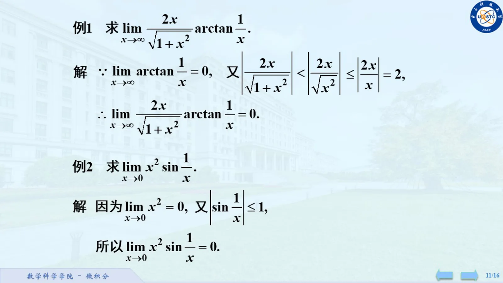

### 五、无穷大与无界的差别

在 $x\to x_0$ 时，若

$$
\forall M>0,\ \exists\delta>0,\quad
0<|x-x_0|<\delta\Rightarrow |f(x)|>M,
$$

称 $f(x)$ 为无穷大。课件把这种**绝对值趋于正无穷**记为 $f(x)\to\infty$，不必固定正负号。正无穷大要求 $f(x)>M$；负无穷大要求 $f(x)<-M$。

自变量过程也要区分：

| 自变量过程 | “足够进入该过程”的条件 |
| --- | --- |
| $x\to x_0$ | $0<|x-x_0|<\delta$ |
| $x\to+\infty$ | $x>X$ |
| $x\to-\infty$ | $x<-X$ |
| $x\to\infty$（两端） | $|x|>X$ |

对每种过程，分别配上 $f(x)>M$、$f(x)<-M$、$|f(x)|>M$，就得到相应定义。这也补全了课件要求自行写出的几种定义。

无穷大一定无界；无界只要求“总能找到特别大的值”，无穷大要求“足够靠近之后所有值的绝对值都大”。课程中“极限存在”通常指有限实数极限，应和这种无穷大记号区别。

> **原页核对：无穷大的各类定义、待补定义与注意事项**
> [S10 · 1.3 无穷小量 无穷大量(1).pdf · PDF 第 4 页](/library/1.3-无穷小量-无穷大量-1#page=4)
>
> 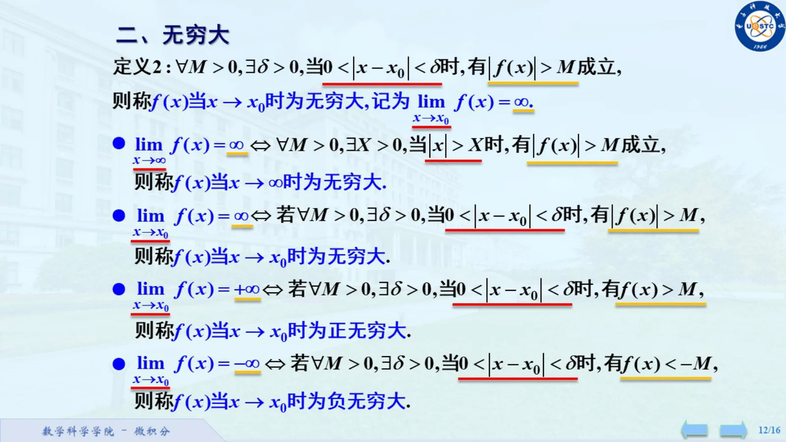
>
> [S10 · 1.3 无穷小量 无穷大量(1).pdf · PDF 第 5 页](/library/1.3-无穷小量-无穷大量-1#page=5)
>
> 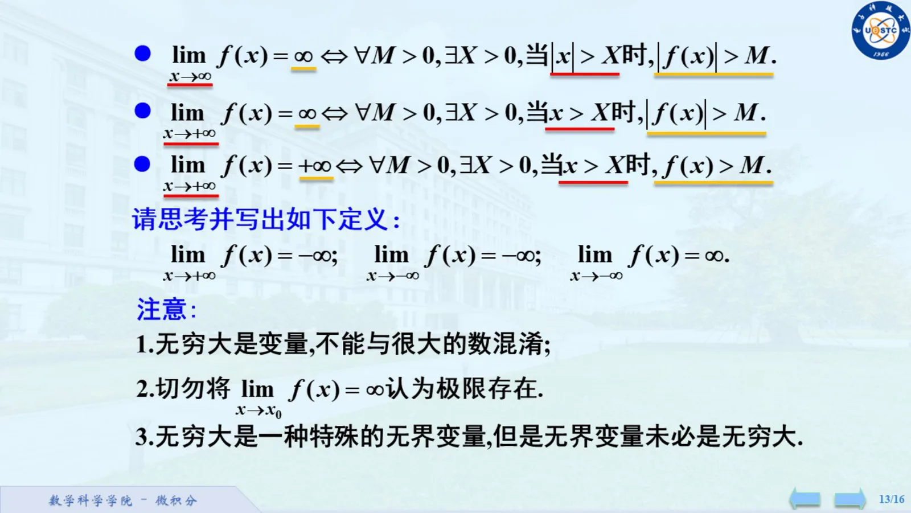

#### 例 3：无界但不是无穷大

考察 $f(x)=\frac1x\sin\frac1x$，$x\to0$。

取 $x_k=1/(2k\pi+\pi/2)$，函数值为 $2k\pi+\pi/2$，可任意大；但取 $y_k=1/(2k\pi)$，$k\ge1$，函数值总为 $0$。因此它在每个去心邻域里无界，却不满足“最终所有绝对值都大于 $M$”。

**原图：无界但非无穷大的原图与两列取点**

[S10 · 1.3 无穷小量 无穷大量(1).pdf · PDF 第 6 页](/library/1.3-无穷小量-无穷大量-1#page=6)

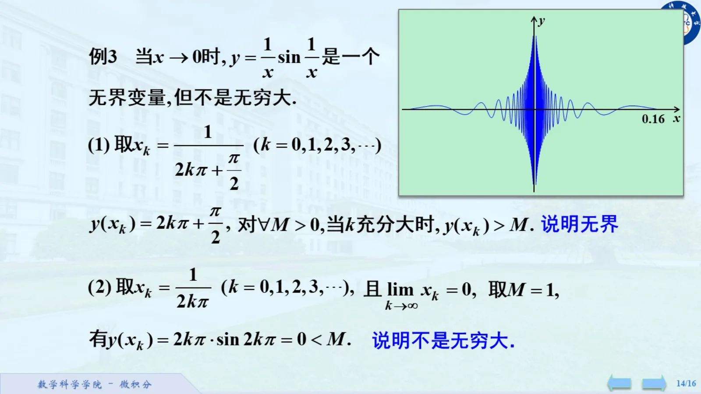

#### 例 4：倒数型无穷大及竖直渐近线

$$
\frac1{x-1}\to\infty\quad(x\to1)
$$

这里是无符号无穷大：取 $\delta=1/M$，有 $|1/(x-1)|>M$。右侧趋于 $+\infty$，左侧趋于 $-\infty$，所以不存在两侧的正无穷极限。

曲线在某点的一侧或两侧出现无穷大时，对应直线可作为竖直渐近线。本例为 $x=1$。

**原图：定义证明和竖直渐近线**

[S10 · 1.3 无穷小量 无穷大量(1).pdf · PDF 第 7 页](/library/1.3-无穷小量-无穷大量-1#page=7)

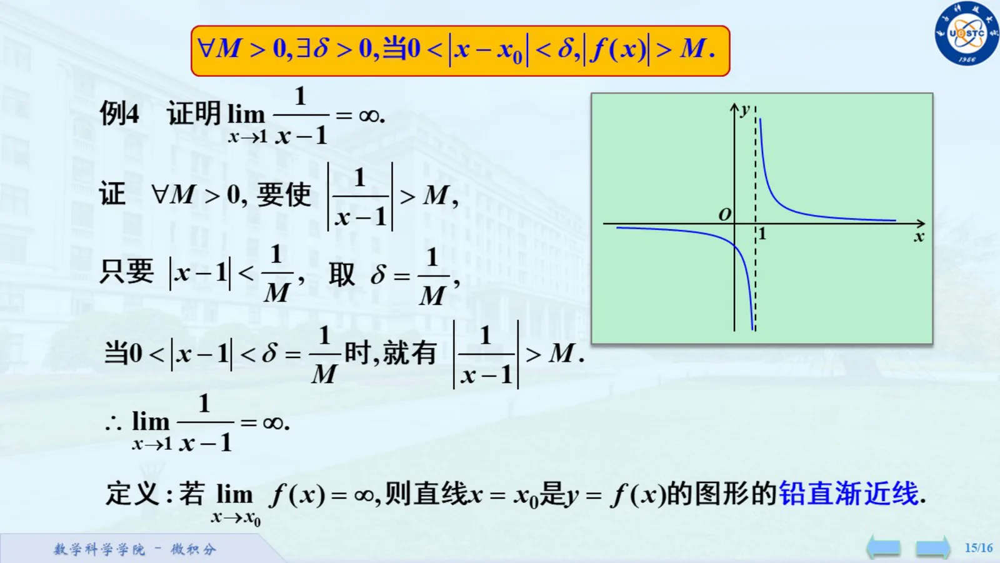

### 六、无穷小与无穷大的倒数关系

同一过程中，

$$
|f(x)|\to+\infty\Rightarrow\frac1{f(x)}\to0.
$$

反过来，若 $\alpha(x)\to0$，而且在所考察的足够近范围内 $\alpha(x)\ne0$，则

$$
\left|\frac1{\alpha(x)}\right|\to+\infty.
$$

关键是倒数必须有定义。证明把无穷大的门槛 $M$ 和无穷小的精度 $\varepsilon$ 通过 $M=1/\varepsilon$ 相互转换。

> **原页核对：倒数关系的证明与作业原页**
> [S10 · 1.3 无穷小量 无穷大量(1).pdf · PDF 第 8 页](/library/1.3-无穷小量-无穷大量-1#page=8)
>
> 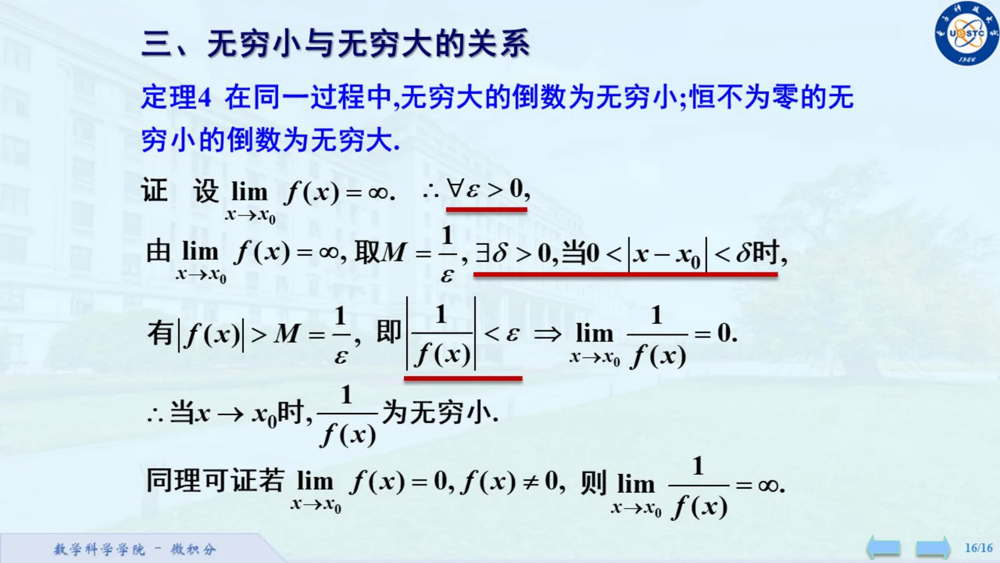
>
> [S10 · 1.3 无穷小量 无穷大量(1).pdf · PDF 第 9 页](/library/1.3-无穷小量-无穷大量-1#page=9)
>
> 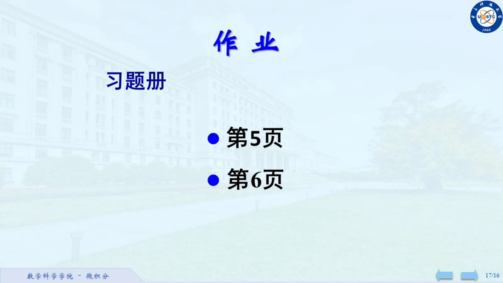

作业：习题册第 5、6 页。接下来用这些性质证明一般的极限运算，并整理求极限的具体步骤，见 [04-极限的性质及运算法则](/notes/04-极限的性质及运算法则)。

### 本篇其余原页

> **逐页保留：前文未单独嵌入的页面**
>
> [S09 · 1.3 无穷小量 无穷大量.pdf · PDF 第 1 页](/library/1.3-无穷小量-无穷大量#page=1)
>
> 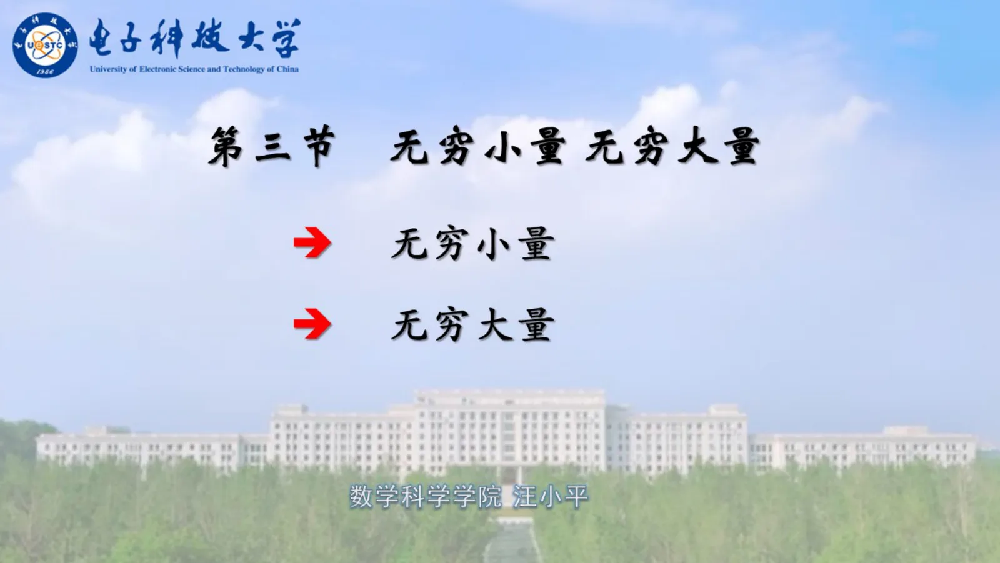
>
> [S10 · 1.3 无穷小量 无穷大量(1).pdf · PDF 第 1 页](/library/1.3-无穷小量-无穷大量-1#page=1)
>
> 

### 本篇来源

- S09：[1.3 无穷小量 无穷大量.pdf](/notes/S09-1.3-无穷小量-无穷大量)，8 页。
- S10：[1.3 无穷小量 无穷大量(1).pdf](/notes/S10-1.3-无穷小量-无穷大量-1)，9 页。

---

## 1.4 极限的性质及运算法则

上一节把“趋向常数”写成“常数加无穷小”。现在把这种表示代入和、积、商，就能说明什么时候可以把极限分别算出来。之后的例题围绕同一个问题：**原式是否已经满足运算法则的条件；不满足时怎样先改写。**

来源：S11、S12。原页提及后续的洛必达法则等方法，只保留为课件备注，本节解答按已出现的代数、无穷小与换元方法展开。

### 一、运算法则与前提

在同一过程中，若 $f(x)\to A,\ g(x)\to B$，且 $A,B$ 为有限实数，则

$$
\lim(f\pm g)=A\pm B,\qquad
\lim(fg)=AB,\qquad
\lim\frac fg=\frac AB\quad(B\ne0).
$$

由此有 $\lim(Cf)=C\lim f$，以及对固定正整数 $n$，$\lim f^n=A^n$。

证明令 $f=A+\alpha,\ g=B+\beta$，其中 $\alpha,\beta\to0$。则

$$
f\pm g=(A\pm B)+(\alpha\pm\beta),
$$

$$
fg=AB+(A\beta+B\alpha+\alpha\beta).
$$

误差项都是无穷小。商还需 $B\ne0$，这样分母最终离零有正距离。用

$$
\frac fg-\frac AB=\frac{B(f-A)-A(g-B)}{Bg}
$$

即可控制误差。

> **原页核对：原定理、证明与两个推论**
> [S11 · 1.4 极限的性质及运算法则.pdf · PDF 第 2 页](/library/1.4-极限的性质及运算法则#page=2)
>
> 

### 二、先看分母，再决定能不能直接代入

#### 例 1：分母极限非零

$$
\lim_{x\to2}\frac{x^3-1}{x^2-3x+5}
=\frac{2^3-1}{2^2-3\cdot2+5}=\frac73.
$$

多项式的有限点极限可直接代入；有理函数 $P/Q$ 在 $Q(x_0)\ne0$ 时也可直接代入。

#### 例 2：分子趋于非零，分母趋于零

$$
\lim_{x\to1}\frac{4x-1}{x^2+2x-3}.
$$

不能写成实数的 $3/0$。其倒数趋于 $0$，因此原式为无符号无穷大。因分母为 $(x-1)(x+3)$，还可看出左侧趋于 $-\infty$，右侧趋于 $+\infty$。所以这里不能把课件的 $\infty$ 改成 $+\infty$。

#### 例 3：$0/0$ 先消公共因子

$$
\lim_{x\to1}\frac{x^2-1}{x^2+2x-3}
=\lim_{x\to1}\frac{(x-1)(x+1)}{(x-1)(x+3)}
=\frac12.
$$

约去的是去心邻域内非零的 $x-1$。$0/0$ 是未定式类型，不是结果。

> **原页核对：例1至例3与课件中的题型提示**
> [S11 · 1.4 极限的性质及运算法则.pdf · PDF 第 3 页](/library/1.4-极限的性质及运算法则#page=3)
>
> 
>
> [S11 · 1.4 极限的性质及运算法则.pdf · PDF 第 4 页](/library/1.4-极限的性质及运算法则#page=4)
>
> 

### 三、无穷远的有理式：看最高次数

#### 例 4

$$
\lim_{x\to\infty}\frac{2x^3+3x^2+5}{7x^3+4x^2-1}
=\lim_{x\to\infty}\frac{2+3/x+5/x^3}{7+4/x-1/x^3}
=\frac27.
$$

一般地，设首项系数 $a_0,b_0\ne0$：

$$
\frac{a_0x^m+\cdots+a_m}{b_0x^n+\cdots+b_n}.
$$

当 $x$ 的绝对值趋于无穷时，$m<n$ 得 $0$，$m=n$ 得 $a_0/b_0$，$m>n$ 时绝对值趋于无穷。要进一步判断正负号，应结合自变量方向、次数奇偶和系数符号。

#### 课堂练习

$$
\lim_{x\to\infty}
\frac{(2x-1)^{30}(3x-2)^{20}}{(2x+1)^{50}}
=\lim\left(\frac{2x-1}{2x+1}\right)^{30}
\left(\frac{3x-2}{2x+1}\right)^{20}
=\left(\frac32\right)^{20}.
$$

选择题答案 B。两个固定幂都能使用运算法则；指数随变量增长的情形不能直接照搬。

> **原页核对：最高次幂规则、选择题与完整解答**
> [S11 · 1.4 极限的性质及运算法则.pdf · PDF 第 5 页](/library/1.4-极限的性质及运算法则#page=5)
>
> 
>
> [S11 · 1.4 极限的性质及运算法则.pdf · PDF 第 6 页](/library/1.4-极限的性质及运算法则#page=6)
>
> 
>
> [S11 · 1.4 极限的性质及运算法则.pdf · PDF 第 7 页](/library/1.4-极限的性质及运算法则#page=7)
>
> 

### 四、项数变化的和与有界振荡因子

#### 例 5：先求和，再取极限

$$
\lim_{n\to\infty}\left(\frac1{n^2}+\frac2{n^2}+\cdots+\frac n{n^2}\right)
=\lim_{n\to\infty}\frac{n(n+1)}{2n^2}=\frac12.
$$

虽然每个固定 $k$ 的 $k/n^2\to0$，和中的项数也随 $n$ 增长，不能直接把有限和法则套成结果 $0$。

#### 例 6：$\sin x/x$

$\sin x$ 在无穷远不收敛，但有界，$1/x\to0$，所以

$$
\lim_{x\to\infty}\frac{\sin x}{x}=0.
$$

**原图：项数变化的和式与振荡衰减图像**

[S11 · 1.4 极限的性质及运算法则.pdf · PDF 第 8 页](/library/1.4-极限的性质及运算法则#page=8)

### 五、绝对值未定式：两种化简

#### 例 7

$$
\lim_{x\to0}\frac{2x}{|2x-1|-|2x+1|}=-\frac12.
$$

方法一，乘共轭：

$$
\frac{2x(|2x-1|+|2x+1|)}{(2x-1)^2-(2x+1)^2}
=-\frac{|2x-1|+|2x+1|}4\to-\frac12.
$$

方法二，先限定 $|x|<1/2$，此时 $|2x-1|=1-2x$，$|2x+1|=1+2x$。原式变成 $2x/(-4x)=-1/2$。

> **原页核对：例7的两种原解**
> [S11 · 1.4 极限的性质及运算法则.pdf · PDF 第 9 页](/library/1.4-极限的性质及运算法则#page=9)
>
> 

### 六、复合函数极限和变量代换

若 $u=\varphi(x)\to a$，外层 $f(u)\to A$，并且足够近时 $\varphi(x)\ne a$，则

$$
\lim_{x\to x_0}f(\varphi(x))=A.
$$

为什么加 $\varphi(x)\ne a$？外层极限只约束 $u\ne a$，若内层反复取到 $a$，而 $f(a)$ 又不等于极限，结论就不自动成立。后面若已知外层在 $a$ 连续，便可允许内层等于 $a$。

定义证明先用外层极限选取中间精度 $\eta$，再用内层极限把 $|\varphi(x)-a|$ 控制在 $\eta$ 内。无穷远、单侧过程也有相应版本。

> **原页核对：复合极限定理的全部条件和证明**
> [S11 · 1.4 极限的性质及运算法则.pdf · PDF 第 10 页](/library/1.4-极限的性质及运算法则#page=10)
>
> 

#### 例 8：看清中间变量趋向

$$
\lim_{x\to\pi/2}\ln(\sin x)=0.
$$

令 $u=\sin x$，则 $u\to1$，$\ln u\to0$；足够近时 $\sin x>0$，对数有定义。

#### 例 9：用根式作新变量

$$
\lim_{x\to0}\frac{\sqrt[n]{1+x}-1}{x}=\frac1n,\qquad n\in\mathbb N^+.
$$

令 $u=\sqrt[n]{1+x}$，则 $u\to1,\ x=u^n-1$。利用

$$
u^n-1=(u-1)(u^{n-1}+\cdots+u+1),
$$

原式等于 $1/(u^{n-1}+\cdots+u+1)\to1/n$。课件还要求回顾一般的幂差公式

$$
x^n-y^n=(x-y)(x^{n-1}+x^{n-2}y+\cdots+xy^{n-2}+y^{n-1}).
$$

> **原页核对：例8、例9及幂差公式**
> [S11 · 1.4 极限的性质及运算法则.pdf · PDF 第 11 页](/library/1.4-极限的性质及运算法则#page=11)
>
> 

#### 例 10：负无穷处根式相消

S12 这份只有一页，承接前一文件，不能遗漏：

$$
\lim_{x\to-\infty}\left(\sqrt{4x^2-8x+5}+2x+1\right)=3.
$$

令 $u=-x\to+\infty$，原式为 $\sqrt{4u^2+8u+5}-2u+1$。把整个表达式配成共轭：

$$
\sqrt{4u^2+8u+5}-(2u-1)
=\frac{12u+4}{\sqrt{4u^2+8u+5}+2u-1}
\to\frac{12}{4}=3.
$$

课件还给出 $t=1/u\to0^+$ 的换元：先化成

$$
\frac{\sqrt{4+8t+5t^2}+t-2}{t},
$$

再乘共轭，得到

$$
\frac{12+4t}{\sqrt{4+8t+5t^2}+2-t}\to3.
$$

**原图：例10的两条完整解题路线**

[S12 · 1.4 极限的性质及运算法则(1).pdf · PDF 第 1 页](/library/1.4-极限的性质及运算法则-1#page=1)

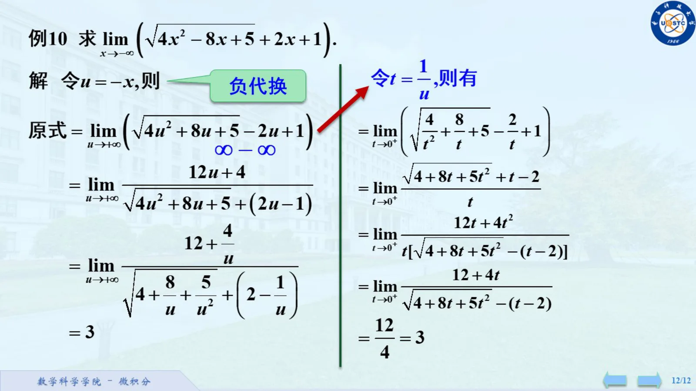

### 七、把题型连起来

先检查定义域与趋近方向；能直接代入就使用连续或四则法则；遇到 $0/0$，先约分、有理化或换元；遇到无穷远有理式，先提取最高次；遇到振荡因子，检查能否用有界乘无穷小；遇到项数变化，保留整个和式或先求和。

这些方法仍需要证明某些新极限确实存在。下一节用夹逼准则、单调有界准则和两个重要极限补齐工具，见 [05-极限存在准则与两个重要极限](/notes/05-极限存在准则与两个重要极限)。

### 本篇其余原页

> **逐页保留：前文未单独嵌入的页面**
>
> [S11 · 1.4 极限的性质及运算法则.pdf · PDF 第 1 页](/library/1.4-极限的性质及运算法则#page=1)
>
> 

### 本篇来源

- S11：[1.4 极限的性质及运算法则.pdf](/notes/S11-1.4-极限的性质及运算法则)，11 页。
- S12：[1.4 极限的性质及运算法则(1).pdf](/notes/S12-1.4-极限的性质及运算法则-1)，1 页。

---

## 1.5 极限存在准则、两个重要极限与等价无穷小

前面的运算法则往往以“各部分极限已存在”为前提。本节先解决存在性，再建立两个基础极限，最后把它们转成可反复使用的等价关系。来源为 S13、S14、S15、S16 四份 PDF，重叠页仍在原页索引中保留。

### 一、夹逼准则：让上下界趋于同一个数

在同一过程中，若足够后恒有

$$
g(x)\le f(x)\le h(x),\qquad g(x)\to A,\quad h(x)\to A,
$$

则 $f(x)\to A$。证明分别使上下界落在 $(A-\varepsilon,A+\varepsilon)$ 中，再取两者邻域半径的最小值；中间量也只能落在这个区间。

#### 例 1：没有简便求和公式的和式

$$
S_n=\frac1{\sqrt{n^2+1}}+\frac1{\sqrt{n^2+2}}+\cdots+\frac1{\sqrt{n^2+n}}.
$$

每一项在 $1/\sqrt{n^2+n}$ 与 $1/\sqrt{n^2+1}$ 之间，故

$$
\frac n{\sqrt{n^2+n}}\le S_n\le
\frac n{\sqrt{n^2+1}}.
$$

左右都趋于 $1$，所以 $S_n\to1$。这里把项数 $n$ 保留在上下界中，避免逐项取零。

#### 例 2：$\cos x\to1$

$$
0\le1-\cos x=2\sin^2\frac x2\le\frac{x^2}2\to0,
$$

因此 $x\to0$ 时 $\cos x\to1$。

#### 例 3：最大项控制n次根

固定 $m$，各 $a_i>0$。设 $a=\max(a_1,\ldots,a_m)$，则

$$
a\le\sqrt[n]{a_1^n+\cdots+a_m^n}\le a\sqrt[n]m.
$$

$\sqrt[n]m=e^{(\ln m)/n}\to1$，故所求极限为 $\max(a_1,\ldots,a_m)$。

> **原页核对：夹逼准则证明及例1至例3原解**
> [S13 · 1.5 极限存在准则 两个重要极限.pdf · PDF 第 2 页](/library/1.5-极限存在准则-两个重要极限#page=2)
>
> 
>
> [S13 · 1.5 极限存在准则 两个重要极限.pdf · PDF 第 3 页](/library/1.5-极限存在准则-两个重要极限#page=3)
>
> 
>
> [S13 · 1.5 极限存在准则 两个重要极限.pdf · PDF 第 4 页](/library/1.5-极限存在准则-两个重要极限#page=4)
>
> 

### 二、单调有界准则：先证收敛，再求极限

单调不减且有上界，或单调不增且有下界的实数列必有有限极限。相应的单侧函数极限、无穷远函数极限也可在单调有界条件下讨论。对于递推数列，不能只把 $x_n,x_{n+1}$ 换成同一个 $A$ 就宣称证明了收敛。

#### 例 4：平均迭代求平方根

$$
x_1>0,\quad a>0,\qquad
x_{n+1}=\frac12\left(x_n+\frac a{x_n}\right).
$$

所有项为正。均值不等式给出 $x_{n+1}\ge\sqrt a$，所以从第 2 项开始下界是 $\sqrt a$。当 $n\ge2$，

$$
x_{n+1}-x_n=\frac{a-x_n^2}{2x_n}\le0.
$$

因此尾部单调不增且有下界，极限 $A$ 存在且 $A\ge\sqrt a>0$。对递推式取极限，$A=(A+a/A)/2$，故 $A=\sqrt a$。

课件的第二种证明直接控制误差。对 $n\ge2$，

$$
x_{n+1}-\sqrt a
=\frac12(x_n-\sqrt a)\left(1-\frac{\sqrt a}{x_n}\right),
$$

括号在 $[0,1)$ 中，故

$$
0\le x_n-\sqrt a\le2^{-(n-2)}(x_2-\sqrt a)\to0.
$$

这同时证明收敛和极限值。

#### 例 5：递推根式

$$
x_1=\sqrt a,\quad x_{n+1}=\sqrt{a+x_n},\qquad a>0.
$$

由递推的单调性归纳得 $x_{n+1}>x_n$。设

$$
L=\frac{1+\sqrt{1+4a}}2,\qquad L^2=a+L.
$$

$x_1<L$，若 $x_n<L$ 则 $x_{n+1}<\sqrt{a+L}=L$，故数列递增有上界。极限满足 $A=\sqrt{a+A}$，舍去负根得到 $A=L$。

课件展示的特殊值为

$$
\sqrt{2+\sqrt{2+\cdots}}=2,\qquad
\sqrt{6+\sqrt{6+\cdots}}=3.
$$

还展示连分式 $\sqrt2=1+\frac1{2+\frac1{2+\cdots}}$；严格含义是相应有限截断的极限。

> **原页核对：单调有界准则、例4的两证与例5全部原页**
> [S13 · 1.5 极限存在准则 两个重要极限.pdf · PDF 第 5 页](/library/1.5-极限存在准则-两个重要极限#page=5)
>
> 
>
> [S13 · 1.5 极限存在准则 两个重要极限.pdf · PDF 第 6 页](/library/1.5-极限存在准则-两个重要极限#page=6)
>
> 
>
> [S13 · 1.5 极限存在准则 两个重要极限.pdf · PDF 第 7 页](/library/1.5-极限存在准则-两个重要极限#page=7)
>
> 
>
> [S13 · 1.5 极限存在准则 两个重要极限.pdf · PDF 第 8 页](/library/1.5-极限存在准则-两个重要极限#page=8)
>
> 

### 三、第一个重要极限

$$
\boxed{\lim_{x\to0}\frac{\sin x}{x}=1}
$$

角度以弧度计。对 $0<x<\pi/2$，单位圆的三角形、扇形和切线三角形的面积比较给出

$$
\sin x<x<\tan x
\quad\Rightarrow\quad
\cos x<\frac{\sin x}{x}<1.
$$

利用 $\cos x\to1$ 夹逼；再利用 $\sin x/x$ 的偶性得到左侧。若 $u(x)\to0$ 且足够近时 $u(x)\ne0$，同样有 $\sin u(x)/u(x)\to1$。

**原图：单位圆面积比较的原图和证明**

[S13 · 1.5 极限存在准则 两个重要极限.pdf · PDF 第 9 页](/library/1.5-极限存在准则-两个重要极限#page=9)

#### 课堂选择题：分母是平方时

若 $\varphi(x)\to0$ 且足够近时非零，求

$$
\frac{\sin\varphi(x)}{\varphi^2(x)}
=\frac{\sin\varphi(x)}{\varphi(x)}\cdot\frac1{\varphi(x)}.
$$

第一因子趋于 $1$，第二因子的绝对值趋于无穷，所以结果是课件记号中的无符号 $\infty$，选择 D。若要判定 $+\infty$ 或 $-\infty$，还需 $\varphi$ 的符号信息。

相关命题：若 $f\to A>0$、$|g|\to\infty$，则 $|fg|\to\infty$。给定门槛 $M$，先让 $f>A/2$，再让 $|g|>2M/A$，从而 $|fg|>M$。

> **原页核对：选择题与正极限乘无穷大的原页**
> [S13 · 1.5 极限存在准则 两个重要极限.pdf · PDF 第 10 页](/library/1.5-极限存在准则-两个重要极限#page=10)
>
> 
>
> [S13 · 1.5 极限存在准则 两个重要极限.pdf · PDF 第 11 页](/library/1.5-极限存在准则-两个重要极限#page=11)
>
> 

#### 三角极限的七个例题

以下是课件的完整题目序列，部分题在 S13、S14 交界处重复：

1. **$\displaystyle\lim_{x\to0}\frac{1-\cos x}{x^2}=\frac12$。** 用 $1-\cos x=2\sin^2(x/2)$，化成 $\frac12[\sin(x/2)/(x/2)]^2$。
2. **$\displaystyle\lim_{x\to0}\frac{x^2\sin(1/x)}{\sin x}=0$。** 拆为 $(x/\sin x)\cdot[x\sin(1/x)]$，前者趋于 $1$，后者由有界乘无穷小趋于 $0$。
3. **$\displaystyle\lim_{x\to0}\frac{\tan x}{x}=1$。** 改写为 $(\sin x/x)/\cos x$。
4. **$\displaystyle\lim_{x\to0}\frac{\sin mx}{\sin nx}=\frac mn$，$m,n\ne0$。** 补齐 $mx,nx$，得到 $(\sin mx/mx)(m/n)(nx/\sin nx)$。
5. **$\displaystyle\lim_{x\to0}\frac{\tan x-\sin x}{x^3}=\frac12$。** 用 $\tan x-\sin x=\tan x(1-\cos x)$，拆成 $\tan x/x$ 和 $(1-\cos x)/x^2$。
6. **$\displaystyle\lim_{x\to\pi}\frac{\sin3x}{\tan5x}=-\frac35$。** 令 $t=\pi-x$，分子变成 $\sin3t$，分母变成 $-\tan5t$。负号不能漏。
7. **$\displaystyle\lim_{x\to1}(1-x)\tan\frac{\pi x}2=\frac2\pi$。** 令 $u=1-x$，化为 $u\cot(\pi u/2)=\frac2\pi\frac{\pi u/2}{\tan(\pi u/2)}$。

> **原页核对：三角例1至例7的原始推导**
> [S14 · 1.5 极限存在准则 两个重要极限(1).pdf · PDF 第 1 页](/library/1.5-极限存在准则-两个重要极限-1#page=1)
>
> 
>
> [S14 · 1.5 极限存在准则 两个重要极限(1).pdf · PDF 第 2 页](/library/1.5-极限存在准则-两个重要极限-1#page=2)
>
> 
>
> [S14 · 1.5 极限存在准则 两个重要极限(1).pdf · PDF 第 3 页](/library/1.5-极限存在准则-两个重要极限-1#page=3)
>
> 

### 四、第二个重要极限

$$
\boxed{
\lim_{n\to\infty}\left(1+\frac1n\right)^n
=\lim_{x\to\infty}\left(1+\frac1x\right)^x
=\lim_{t\to0}(1+t)^{1/t}=e
}
$$

课件以利息分期结算引入：单位本金、单位年利率，一年结算 $n$ 次得到 $(1+1/n)^n$。这是数学模型，分期次数不断增加时，结果趋于 $e=2.71828\ldots$。

#### 证明线索全部保留

先令 $a_n=(1+1/n)^n$。二项式展开为

$$
a_n=2+\sum_{k=2}^n\frac1{k!}
\left(1-\frac1n\right)\left(1-\frac2n\right)\cdots
\left(1-\frac{k-1}n\right).
$$

$n$ 增加时已有因子不减，又多出一个正项，因此数列递增。另一方面，

$$
a_n\le2+\frac1{2!}+\cdots+\frac1{n!}<3
$$

（边界小 $n$ 可直接检查）。所以由单调有界准则存在极限，把它定义为 $e$。

实变量 $x\to+\infty$ 时，取整数 $n\le x<n+1$，有

$$
\left(1+\frac1{n+1}\right)^n
\le\left(1+\frac1x\right)^x
\le\left(1+\frac1n\right)^{n+1}.
$$

两端都趋于 $e$。对 $x\to-\infty$，令 $t=-x$，把原式改写成

$$
\left(1-\frac1t\right)^{-t}
=\left(1+\frac1{t-1}\right)^t
=\left(1+\frac1{t-1}\right)^{t-1}
\cdot\left(1+\frac1{t-1}\right)\to e.
$$

即把指数分为 $(t-1)+1$，两个因子的极限分别为 $e$ 和 $1$。

> **原页核对：利息引入、二项式证明、正负无穷换元的完整原页**
> [S14 · 1.5 极限存在准则 两个重要极限(1).pdf · PDF 第 4 页](/library/1.5-极限存在准则-两个重要极限-1#page=4)
>
> 
>
> [S14 · 1.5 极限存在准则 两个重要极限(1).pdf · PDF 第 5 页](/library/1.5-极限存在准则-两个重要极限-1#page=5)
>
> 
>
> [S14 · 1.5 极限存在准则 两个重要极限(1).pdf · PDF 第 6 页](/library/1.5-极限存在准则-两个重要极限-1#page=6)
>
> 
>
> [S14 · 1.5 极限存在准则 两个重要极限(1).pdf · PDF 第 7 页](/library/1.5-极限存在准则-两个重要极限-1#page=7)
>
> 
>
> [S14 · 1.5 极限存在准则 两个重要极限(1).pdf · PDF 第 8 页](/library/1.5-极限存在准则-两个重要极限-1#page=8)
>
> 

令 $t=1/x$，最后得到 $t\to0$ 的形式。使用时需要底数为正、分母中的趋零量非零。对一般 $u\to0$，常把

$$
(1+u)^v=\left[(1+u)^{1/u}\right]^{uv}
$$

作为配形方法；若 $uv\to L$，在相应定义条件下极限为 $e^L$。

#### 指数型极限的全部例题

| 原课件题目 | 改写的关键 | 结果 |
| --- | --- | --- |
| 例8：$\displaystyle(1-1/x)^x,\ x\to\infty$ | $u=-1/x,\ ux=-1$ | $e^{-1}$ |
| 例9(1)：$\displaystyle((x+3)/(x+2))^{2x},\ x\to\infty$ | 底数 $1+1/(x+2)$；$2x/(x+2)\to2$ | $e^2$ |
| 例9(2)：$\displaystyle(1+3\tan^2x)^{\cot^2x},\ x\to0$ | $u=3\tan^2x$；$u\cot^2x=3$ | $e^3$ |
| 例10及选择题：$\displaystyle(1-m^2/n^2)^n,\ n\to\infty$ | $m$ 固定；$n(-m^2/n^2)\to0$ | $1$，选 B |
| 例11：$\displaystyle(1+(2nx+x^2)/(2n^2))^{-n},\ n\to\infty$ | $x$ 固定；$(-n)(2nx+x^2)/(2n^2)\to-x$ | $e^{-x}$ |

课件还有正底数的变指数法则：若 $f\to B>0,\ g\to A$ 都为有限极限，则 $f^g=e^{g\ln f}\to B^A$。这里的证明也解释了配形后的指数为什么可以继续取极限。

> **原页核对：全部指数型例题、选择题、变指数命题与作业**
> [S14 · 1.5 极限存在准则 两个重要极限(1).pdf · PDF 第 9 页](/library/1.5-极限存在准则-两个重要极限-1#page=9)
>
> 
>
> [S14 · 1.5 极限存在准则 两个重要极限(1).pdf · PDF 第 10 页](/library/1.5-极限存在准则-两个重要极限-1#page=10)
>
> 
>
> [S14 · 1.5 极限存在准则 两个重要极限(1).pdf · PDF 第 11 页](/library/1.5-极限存在准则-两个重要极限-1#page=11)
>
> 
>
> [S14 · 1.5 极限存在准则 两个重要极限(1).pdf · PDF 第 12 页](/library/1.5-极限存在准则-两个重要极限-1#page=12)
>
> 

### 五、无穷小的阶：比较趋零的速度

以下都在同一极限过程中，$\alpha,\beta\to0$，相应比值有定义：

| 比较 | 含义 |
| --- | --- |
| $\beta/\alpha\to0$ | $\beta=o(\alpha)$，高阶无穷小 |
| $\beta/\alpha\to C\ne0$ | 同阶无穷小 |
| $\beta/\alpha\to1$ | 等价无穷小，$\alpha\sim\beta$ |
| $\beta/\alpha^k\to C\ne0$ | $\beta$ 是关于 $\alpha$ 的 $k$ 阶无穷小 |

例如 $x^2/(3x)\to0$，$x^2$ 比 $3x$ 更快趋零；$\sin x/(3x)\to1/3$，两者同阶但不等价。

**例 1：** $4x\tan^3x$ 关于 $x$ 是四阶，因为除以 $x^4$ 后得到 $4(\tan x/x)^3\to4$。

**例 2：** $\tan x-\sin x$ 关于 $x$ 是三阶，因为除以 $x^3$ 的极限为 $1/2$。

### 六、常用等价关系及其来路

当 $x\to0$，

$$
\sin x\sim x,\quad\tan x\sim x,\quad
\arcsin x\sim x,\quad\arctan x\sim x,
$$

$$
1-\cos x\sim\frac{x^2}2,\qquad
\tan x-\sin x\sim\frac{x^3}2,
$$

$$
e^x-1\sim x,\quad a^x-1\sim x\ln a,\quad
\ln(1+x)\sim x,\quad\log_a(1+x)\sim\frac x{\ln a},
$$

$$
\sqrt[n]{1+x}-1\sim\frac xn,\qquad
(1+x)^\mu-1\sim\mu x.
$$

一般指数关系要求固定 $\mu\ne0$；对数底数要求 $a>0,\ a\ne1$。所有式子都在各自定义域内使用。

这些公式可以相互推出：$\sin x/x\to1$ 推出三角类；令 $t=\arctan x$ 可推出反正切类；$\ln(1+x)/x=\ln[(1+x)^{1/x}]\to1$ 来自第二重要极限；令 $u=a^x-1$ 再换元可推出指数类。

**原图：公式推导、完整等价表和关系图**

[S15 · 1.5 极限存在准则 两个重要极限(续).pdf · PDF 第 3 页](/library/1.5-极限存在准则-两个重要极限-续#page=3)

[S15 · 1.5 极限存在准则 两个重要极限(续).pdf · PDF 第 4 页](/library/1.5-极限存在准则-两个重要极限-续#page=4)

[S15 · 1.5 极限存在准则 两个重要极限(续).pdf · PDF 第 5 页](/library/1.5-极限存在准则-两个重要极限-续#page=5)

[S15 · 1.5 极限存在准则 两个重要极限(续).pdf · PDF 第 6 页](/library/1.5-极限存在准则-两个重要极限-续#page=6)

### 七、替换定理：乘除结构保留主要量

如果 $\alpha\sim\alpha'$、$\beta\sim\beta'$，且相关比值有定义，替换后的比值有极限，则

$$
\lim\frac{\beta}{\alpha}
=\lim\frac{\beta'}{\alpha'}.
$$

因为

$$
\frac{\beta}{\alpha}
=\frac{\beta}{\beta'}\cdot\frac{\beta'}{\alpha'}\cdot\frac{\alpha'}{\alpha},
$$

两边因子趋于 $1$。乘积中也可替换相应因子。

但加减内部可能发生主项抵消，不能把 $\tan x-\sin x$ 各自替换成 $x-x$。正确做法是把整个差式视为一个量，使用 $\tan x-\sin x\sim x^3/2$，或先作恒等变形。

课件多选题选 B、D：替换的是完整乘法因子或完整分母；A、C 在减法内部替换，缺乏一般保证。题目默认相关定义和极限条件满足。

> **原页核对：替换定理证明、推论及多选题原页**
> [S15 · 1.5 极限存在准则 两个重要极限(续).pdf · PDF 第 7 页](/library/1.5-极限存在准则-两个重要极限-续#page=7)
>
> 
>
> [S15 · 1.5 极限存在准则 两个重要极限(续).pdf · PDF 第 8 页](/library/1.5-极限存在准则-两个重要极限-续#page=8)
>
> 

### 八、等价替换例题全录

#### 例 3 与例 4：先看阶数

$$
\lim_{x\to0}\frac{\tan^2(2x)}{1-\cos x}
=\lim\frac{(2x)^2}{x^2/2}=8,
$$

$$
\lim_{x\to0}\frac{\tan x-\sin x}{\sin^3(2x)}
=\lim\frac{x^3/2}{(2x)^3}=\frac1{16}.
$$

#### 例 5 与例 6：根式内部也可作整体换元

$$
\lim_{x\to0}\frac{1-\cos2x}{\sqrt[3]{1+x^2}-1}
=\lim\frac{(2x)^2/2}{x^2/3}=6,
$$

$$
\lim_{x\to0}\frac{\tan x-\sin x}{x^2(\sqrt{1+x}-1)}
=\lim\frac{x^3/2}{x^2(x/2)}=1.
$$

S16 第 1 页重复保留了这两题。

> **原页核对：例3至例6的原始完整推导**
> [S15 · 1.5 极限存在准则 两个重要极限(续).pdf · PDF 第 9 页](/library/1.5-极限存在准则-两个重要极限-续#page=9)
>
> 
>
> [S15 · 1.5 极限存在准则 两个重要极限(续).pdf · PDF 第 10 页](/library/1.5-极限存在准则-两个重要极限-续#page=10)
>
> 

#### 例 7：两层复合的等价

$$
\lim_{x\to0}\frac{\sqrt{1+x\sin x}-1}{e^{x^2}-1}
=\lim\frac{\frac12x\sin x}{x^2}
=\frac12.
$$

先对 $u=x\sin x\to0$ 用 $\sqrt{1+u}-1\sim u/2$，再用 $\sin x\sim x$。

#### 例 8：无穷远处的对数乘积

对固定 $a>0$、实数 $b$，

$$
\lim_{x\to+\infty}\ln(1+e^{ax})\ln\left(1+\frac bx\right)=ab.
$$

当 $b=0$ 时表达式恒为 $0$；其余情况先用 $\ln(1+b/x)\sim b/x$，再写

$$
\ln(1+e^{ax})=ax+\ln(1+e^{-ax}).
$$

原乘积的极限等于 $ab+\lim(b/x)\ln(1+e^{-ax})=ab$。

#### 例 9：先把相消的余弦差变成乘积

$$
\lim_{x\to0}\frac{\cos(xe^x)-\cos(xe^{-x})}{(\sin x)^3}=-2.
$$

用和差化积，分子为

$$
-2\sin\left(\frac{x(e^x+e^{-x})}2\right)
\sin\left(\frac{x(e^x-e^{-x})}2\right).
$$

两个正弦的自变量都趋于零，可替换完整正弦因子，得到

$$
-\frac12(e^x+e^{-x})\frac{e^x-e^{-x}}x\to-2.
$$

课件两种收尾方式都成立：一是 $e^x-e^{-x}=e^{-x}(e^{2x}-1)$；二是拆成 $(e^x-1)-(e^{-x}-1)$，两项各自除以 $x$ 后都存在有限极限。不能在未检查条件时任意拆开相消项。

> **原页核对：例7至例9及例9的两种解法**
> [S16 · 1.5 极限存在准则 两个重要极限(续)(1).pdf · PDF 第 2 页](/library/1.5-极限存在准则-两个重要极限-续-1#page=2)
>
> 
>
> [S16 · 1.5 极限存在准则 两个重要极限(续)(1).pdf · PDF 第 3 页](/library/1.5-极限存在准则-两个重要极限-续-1#page=3)
>
> 
>
> [S16 · 1.5 极限存在准则 两个重要极限(续)(1).pdf · PDF 第 4 页](/library/1.5-极限存在准则-两个重要极限-续-1#page=4)
>
> 

#### 例 10：在非零点平移变量

$$
\lim_{x\to a}\frac{a^x-x^a}{x^2-a^2}
=\frac{a^a(\ln a-1)}{2a},\qquad a>0.
$$

加减 $a^a$，并把分母写成 $(x+a)(x-a)$。分别计算

$$
\frac{a^x-a^a}{x-a}
=a^a\frac{a^{x-a}-1}{x-a}\to a^a\ln a,
$$

$$
\frac{x^a-a^a}{x-a}
=a^a\frac{(1+(x-a)/a)^a-1}{x-a}\to a^a.
$$

两项相减后再除以 $x+a\to2a$。这里的拆项成立，是因为每项的新比值都有有限极限。

> **原页核对：例10原解与课件中的后续方法备注**
> [S16 · 1.5 极限存在准则 两个重要极限(续)(1).pdf · PDF 第 5 页](/library/1.5-极限存在准则-两个重要极限-续-1#page=5)
>
> 

#### 小o表达式与例 11

$\beta\sim\alpha$ 等价于 $\beta=\alpha+o(\alpha)$；这把“近似”写成带误差阶数的等式。例如

$$
\sin x=x+o(x),\qquad 1-\cos x=\frac{x^2}2+o(x^2).
$$

于是

$$
\lim_{x\to0}\frac{\tan5x-\cos x+1}{\sin3x}
=\lim\frac{5x+o(x)+x^2/2+o(x^2)}{3x+o(x)}
=\frac53.
$$

这里没有把加减中的每项直接用“$\sim$”乱替换，而是明确保留误差，并在除以 $x$ 后控制它们。

#### 例 12：非整数阶数

当 $x\to0$，$\tan2x\sin3x\sim6x^2$，是关于 $x$ 的二阶无穷小。

当 $x\to0^+$，

$$
2\sqrt x+x+x^2=\sqrt x(2+\sqrt x+x^{3/2})\sim2\sqrt x,
$$

是关于 $x$ 的 $1/2$ 阶无穷小。这里需要右侧过程，因为实数平方根的定义域限制。

> **原页核对：小o表达、例11、例12与作业**
> [S16 · 1.5 极限存在准则 两个重要极限(续)(1).pdf · PDF 第 6 页](/library/1.5-极限存在准则-两个重要极限-续-1#page=6)
>
> 
>
> [S16 · 1.5 极限存在准则 两个重要极限(续)(1).pdf · PDF 第 7 页](/library/1.5-极限存在准则-两个重要极限-续-1#page=7)
>
> 
>
> [S16 · 1.5 极限存在准则 两个重要极限(续)(1).pdf · PDF 第 8 页](/library/1.5-极限存在准则-两个重要极限-续-1#page=8)
>
> 

### 九、作业及下一步

前半部分：习题册第 8 页第 1 题，第 9 页第 5、6、7 题。等价无穷小部分：第 8 页第 2 题，第 9 页第 3、4 题。

两个重要极限提供了局部近似。接下来把“趋近后的极限”与“该点实际函数值”比较，就得到 [06-连续函数](/notes/06-连续函数)。

### 本篇其余原页

> **逐页保留：前文未单独嵌入的页面**
>
> [S13 · 1.5 极限存在准则 两个重要极限.pdf · PDF 第 1 页](/library/1.5-极限存在准则-两个重要极限#page=1)
>
> 
>
> [S13 · 1.5 极限存在准则 两个重要极限.pdf · PDF 第 12 页](/library/1.5-极限存在准则-两个重要极限#page=12)
>
> 
>
> [S15 · 1.5 极限存在准则 两个重要极限(续).pdf · PDF 第 1 页](/library/1.5-极限存在准则-两个重要极限-续#page=1)
>
> 
>
> [S15 · 1.5 极限存在准则 两个重要极限(续).pdf · PDF 第 2 页](/library/1.5-极限存在准则-两个重要极限-续#page=2)
>
> 
>
> [S16 · 1.5 极限存在准则 两个重要极限(续)(1).pdf · PDF 第 1 页](/library/1.5-极限存在准则-两个重要极限-续-1#page=1)
>
> 

### 本篇来源

- S13：[1.5 极限存在准则 两个重要极限.pdf](/notes/S13-1.5-极限存在准则-两个重要极限)，12 页。
- S14：[1.5 极限存在准则 两个重要极限(1).pdf](/notes/S14-1.5-极限存在准则-两个重要极限-1)，12 页。
- S15：[1.5 极限存在准则 两个重要极限(续).pdf](/notes/S15-1.5-极限存在准则-两个重要极限-续)，10 页。
- S16：[1.5 极限存在准则 两个重要极限(续)(1).pdf](/notes/S16-1.5-极限存在准则-两个重要极限-续-1)，8 页。

---

## 1.6 连续函数

极限研究靠近一点时的趋势，连续性进一步要求这个趋势与该点的实际函数值接上。本节按“点上的连续 → 间断类型 → 连续性的运算 → 闭区间上的整体性质”展开，对应 S17、S18、S19。

### 一、从增量理解连续

自变量由 $x_0$ 变成 $x_0+\Delta x$ 时，

$$
\Delta x=x-x_0,\qquad
\Delta y=f(x_0+\Delta x)-f(x_0).
$$

$\Delta x$ 可以正、负或为零。连续表示输入变化足够小时，输出变化也能任意小：

$$
\lim_{\Delta x\to0}\Delta y=0.
$$

这等价于

$$
\boxed{\lim_{x\to x_0}f(x)=f(x_0)}.
$$

用量词表述：任意 $\varepsilon>0$，存在 $\delta>0$，只要 $x$ 在讨论的定义范围内且 $|x-x_0|<\delta$，就有 $|f(x)-f(x_0)|<\varepsilon$。这里允许 $x=x_0$；它和去心极限定义的区别，正是函数值也参与连续性的判断。

**原图：增量示意、连续与不连续图像、三种等价定义**

[S17 · 1.6 连续函数.pdf · PDF 第 2 页](/library/1.6-连续函数#page=2)

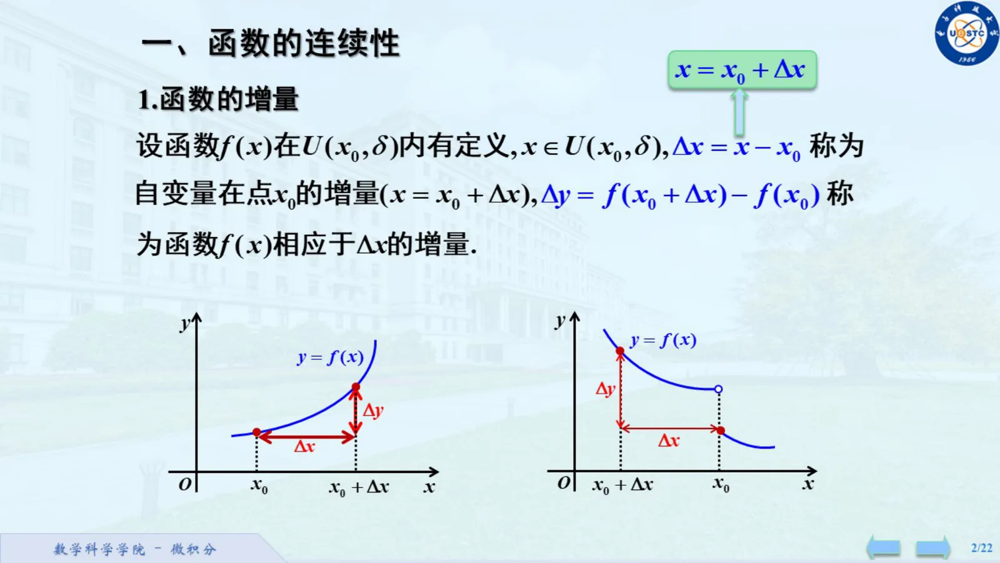

[S17 · 1.6 连续函数.pdf · PDF 第 3 页](/library/1.6-连续函数#page=3)

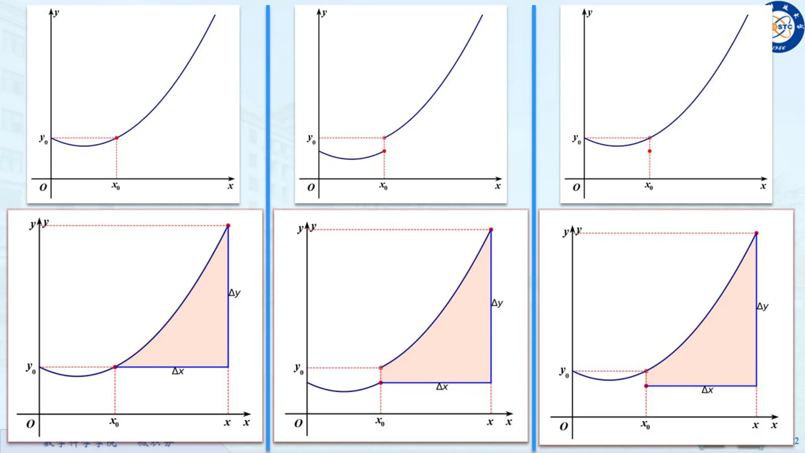

[S17 · 1.6 连续函数.pdf · PDF 第 4 页](/library/1.6-连续函数#page=4)

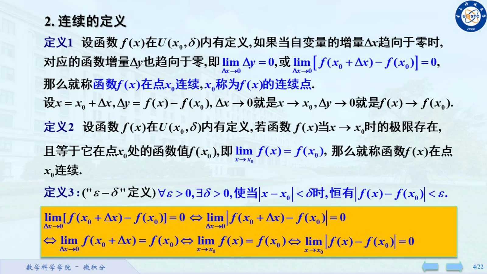

#### 例 1：振荡被趋零因子压住

$$
f(x)=\begin{cases}
x\sin(1/x),&x\ne0,\\
0,&x=0.
\end{cases}
$$

由 $|x\sin(1/x)|\le|x|\to0$，可得 $\lim_{x\to0}f(x)=0=f(0)$，因此在 $0$ 连续。$\sin(1/x)$ 自身没有极限，但它的振荡幅度被 $x$ 压到零。

### 二、单侧连续与区间连续

左连续指 $\lim_{x\to x_0^-}f(x)=f(x_0)$，右连续指 $\lim_{x\to x_0^+}f(x)=f(x_0)$。当两侧都有定义时，在该点连续当且仅当左右都连续。

#### 例 2：只在一侧接上

$$
f(x)=\begin{cases}x+2,&x\ge0,\\x-2,&x<0.\end{cases}
$$

$f(0)=2$，右极限为 $2$，左极限为 $-2$。所以在 $0$ 右连续，既不左连续，也不连续。

在 $(a,b)$ 每一点连续，记为 $f\in C(a,b)$。$f\in C[a,b]$ 除了要求内部连续，还要求在 $a$ 右连续、在 $b$ 左连续；端点不要求延伸到区间外讨论。

#### 例 3：正弦函数的连续性

对任意 $x_0$，

$$
\Delta y=\sin(x_0+\Delta x)-\sin x_0
=2\cos\left(x_0+\frac{\Delta x}2\right)\sin\frac{\Delta x}2\to0.
$$

余弦因子有界，正弦因子趋零，所以 $\sin x$ 在实数轴连续。$\cos x$ 同理。

> **原页核对：例1至例3、单侧连续、区间连续的完整原页**
> [S17 · 1.6 连续函数.pdf · PDF 第 5 页](/library/1.6-连续函数#page=5)
>
> 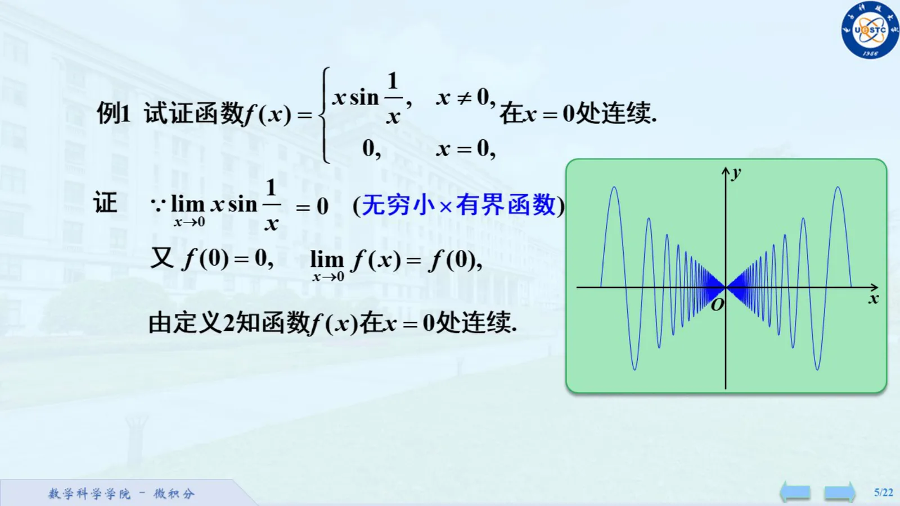
>
> [S17 · 1.6 连续函数.pdf · PDF 第 6 页](/library/1.6-连续函数#page=6)
>
> 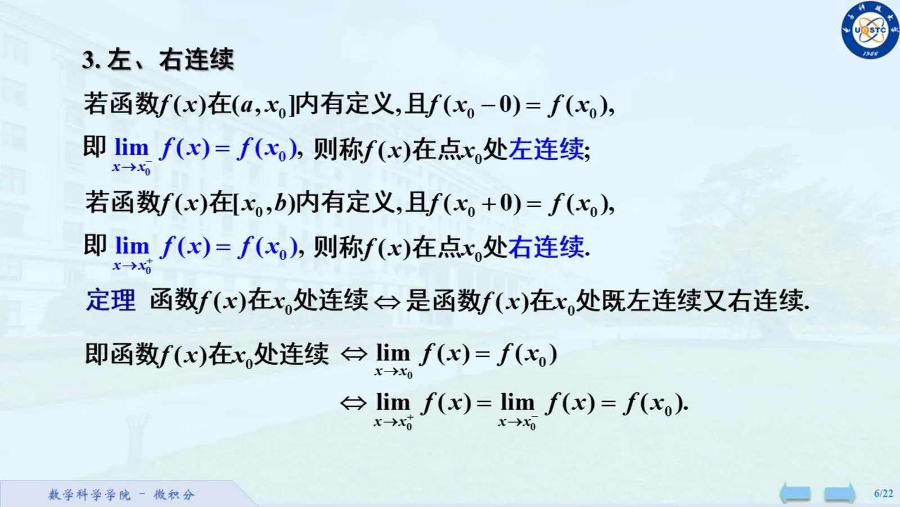
>
> [S17 · 1.6 连续函数.pdf · PDF 第 7 页](/library/1.6-连续函数#page=7)
>
> 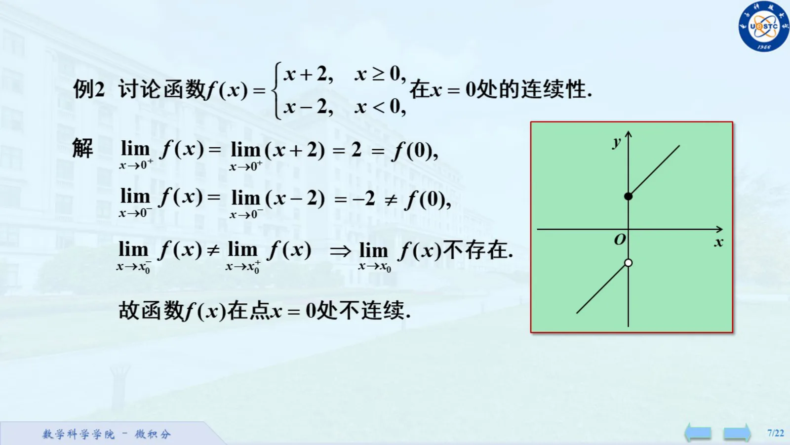
>
> [S17 · 1.6 连续函数.pdf · PDF 第 8 页](/library/1.6-连续函数#page=8)
>
> 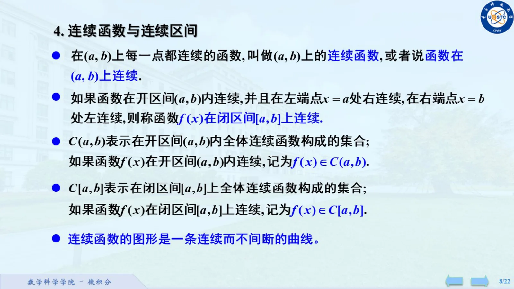
>
> [S17 · 1.6 连续函数.pdf · PDF 第 9 页](/library/1.6-连续函数#page=9)
>
> 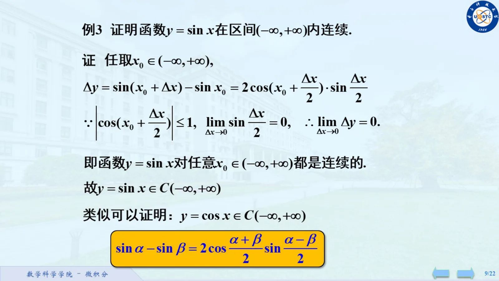

### 三、间断点：具体是哪一步没有接上

连续要求同时满足：$f(x_0)$ 有定义、有限极限 $\lim_{x\to x_0}f(x)$ 存在、该极限等于 $f(x_0)$。任一条失败，就需要按具体情况判断间断。

| 类别 | 判断条件 | 能否只改该点函数值修复 |
| --- | --- | --- |
| 第一类：可去间断 | 左右有限极限相等，但函数值缺失或不相等 | 可以 |
| 第一类：跳跃间断 | 左右有限极限都存在，但不相等 | 不可以 |
| 第二类：无穷间断 | 至少一侧呈无穷大趋势 | 不可以 |
| 第二类：振荡间断 | 至少一侧振荡而没有极限 | 不可以 |

第一类要求左右都是**有限极限**。第二类还可能有其他形式，表中的无穷型、振荡型是本课例子。

#### 例 4：可去间断

$$
f(x)=\begin{cases}
2\sqrt x,&0\le x<1,\\
1,&x=1,\\
1+x,&x>1.
\end{cases}
$$

左右极限都是 $2$，而 $f(1)=1$。所以 $1$ 为可去间断点；只需改成 $f(1)=2$ 即可连续。

#### 例 5：跳跃间断

$$
f(x)=\begin{cases}-x,&x\le0,\\1+x,&x>0.\end{cases}
$$

$f(0^-)=0$，$f(0^+)=1$，两个有限极限不同，故 $0$ 为跳跃间断点。

#### 例 6：无穷间断

$$
f(x)=\begin{cases}1/x,&x>0,\\x,&x\le0.\end{cases}
$$

左极限为 $0$，右侧趋于 $+\infty$。$0$ 为第二类间断点中的无穷间断点。

#### 例 7：振荡间断

$f(x)=\sin(1/x)$ 在 $0$ 没有定义，而且取两列趋于 $0$ 的点，可分别使函数值恒为 $1$ 与 $-1$，所以极限不存在。$0$ 为第二类间断点中的振荡间断点。

#### 例 8：由连续性确定参数

$$
f(x)=\begin{cases}\cos x,&x<0,\\a+x,&x\ge0.\end{cases}
$$

左极限为 $1$，右极限及 $f(0)$ 都为 $a$。因此在 $0$ 连续当且仅当 $a=1$。

**原图：例4至例8的全部原图与题面**

[S18 · 1.6 连续函数(1).pdf · PDF 第 2 页](/library/1.6-连续函数-1#page=2)

[S18 · 1.6 连续函数(1).pdf · PDF 第 3 页](/library/1.6-连续函数-1#page=3)

[S18 · 1.6 连续函数(1).pdf · PDF 第 4 页](/library/1.6-连续函数-1#page=4)

[S18 · 1.6 连续函数(1).pdf · PDF 第 5 页](/library/1.6-连续函数-1#page=5)

> **原页核对：连续性的三条件与间断点定义**
> [S17 · 1.6 连续函数.pdf · PDF 第 10 页](/library/1.6-连续函数#page=10)
>
> 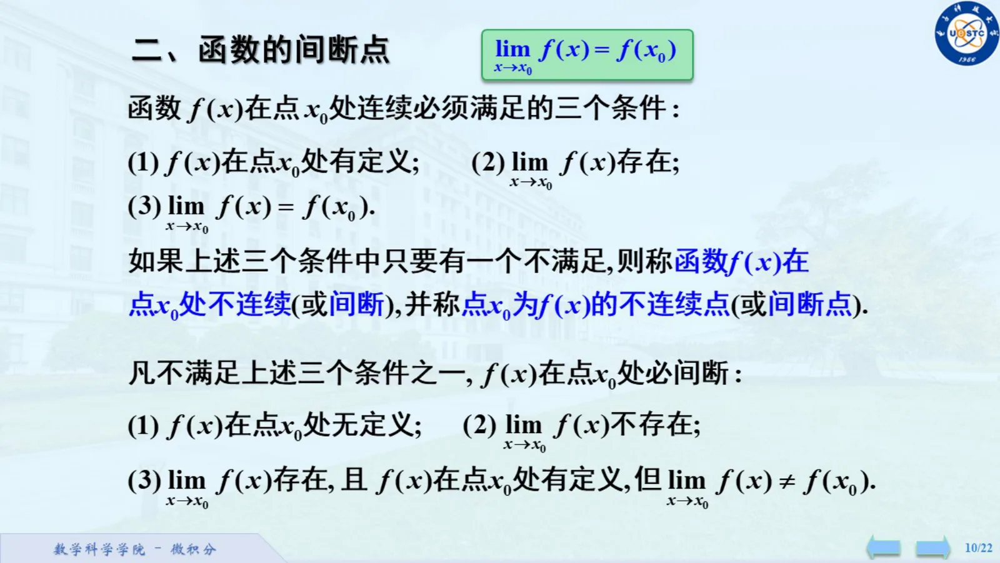
>
> [S17 · 1.6 连续函数.pdf · PDF 第 11 页](/library/1.6-连续函数#page=11)
>
> 
> **原页核对：第一类间断的分类重叠页**
> [S18 · 1.6 连续函数(1).pdf · PDF 第 1 页](/library/1.6-连续函数-1#page=1)
>
> 

### 四、怎样从已知连续函数得到新函数

#### 四则运算

$f,g$ 在 $x_0$ 连续，则 $f\pm g,fg$ 也连续；若 $g(x_0)\ne0$，$f/g$ 也连续。这来自有限极限的四则运算。于是 $\tan x,\cot x,\sec x,\csc x$ 在分母不为零的相应区间连续。

#### 反函数

在区间上严格单调且连续的函数，其反函数在相应值域区间上也严格单调且连续。例如 $\sin x$ 限制在 $[-\pi/2,\pi/2]$ 后，其反函数 $\arcsin x$ 在 $[-1,1]$ 连续且递增；$\arccos x$ 在 $[-1,1]$ 连续且递减。其他反三角函数同理。

**原图：反函数连续性及正弦、余弦与反函数图像**

[S18 · 1.6 连续函数(1).pdf · PDF 第 7 页](/library/1.6-连续函数-1#page=7)

#### 连续外函数可以与极限交换

若 $\varphi(x)\to a$ 且 $f$ 在 $a$ 连续，则

$$
\lim f(\varphi(x))=f(a)=f(\lim\varphi(x)).
$$

证明的衔接是：先由 $f$ 连续，为给定 $\varepsilon$ 选到输入误差 $\eta$；再由 $\varphi\to a$ 选到 $\delta$，使 $|\varphi(x)-a|<\eta$，于是 $|f(\varphi(x))-f(a)|<\varepsilon$。

与只假设外函数有极限的复合法则相比，外函数在 $a$ 连续时允许内函数取到 $a$。对正底数的变指数，也可写 $f(x)^{g(x)}=\exp(g(x)\ln f(x))$；先处理指数的极限，再用指数函数连续性。

#### 例 1：对数基本极限

$$
\lim_{x\to0}\frac{\ln(1+x)}x
=\lim_{x\to0}\ln\left[(1+x)^{1/x}\right]=\ln e=1.
$$

因此当 $a>0,a\ne1$，

$$
\lim_{x\to0}\frac{\log_a(1+x)}x=\frac1{\ln a},\qquad
\lim_{x\to0}\frac{\log_a(1+x)}{x\log_a e}=1.
$$

#### 例 2：指数基本极限

令 $y=e^x-1$，则 $y\to0$、$x=\ln(1+y)$，所以

$$
\lim_{x\to0}\frac{e^x-1}x
=\lim_{y\to0}\frac y{\ln(1+y)}=1.
$$

相应地，

$$
\lim_{x\to0}\frac{a^x-1}x=\ln a,\qquad
\lim_{x\to0}\frac{a^x-1}{x\ln a}=1.
$$

这些也说明上一节等价无穷小表中的指数、对数关系从何而来。

#### 复合函数与初等函数

若 $\varphi$ 在 $x_0$ 连续，$f$ 在 $\varphi(x_0)$ 连续，则 $f\circ\varphi$ 在 $x_0$ 连续。例如 $\sin(1/x)$ 在 $(0,+\infty)$ 内连续；在 $0$ 的振荡不妨碍它在其他点的连续。

初等函数在其**定义区间**内连续。课件强调“区间”，是采用通常的邻域/单侧邻域来讨论连续性。例如 $\sqrt{\cos x-1}$ 的实定义域只有 $\{2k\pi:k\in\mathbb Z\}$，这些孤立点没有定义区间；$\sqrt{x^2(x-1)^3}$ 的定义域是 $\{0\}\cup[1,+\infty)$，在区间 $[1,+\infty)$ 上连续。这里不要把课件的区间约定推广成关于“相对定义域连续性”的一般断言。

#### 例 3：直接代入之前先检查定义

在 $x=1$ 附近，$e^x-1>0$，复合函数连续，所以

$$
\lim_{x\to1}\sin\sqrt{e^x-1}=\sin\sqrt{e-1}.
$$

#### 例 4：仍然需要先消去不定式

$$
\lim_{x\to0}\frac{\sqrt{1+x^2}-1}x
=\lim_{x\to0}\frac{x}{\sqrt{1+x^2}+1}=0.
$$

不能因为根号函数连续，就把原式直接算成 $0/0$；连续性用于有理化后分母非零的表达式。

> **原页核对：四则运算、复合定理的证明、例1至例4与定义区间说明**
> [S18 · 1.6 连续函数(1).pdf · PDF 第 6 页](/library/1.6-连续函数-1#page=6)
>
> 
>
> [S18 · 1.6 连续函数(1).pdf · PDF 第 7 页](/library/1.6-连续函数-1#page=7)
>
> 
>
> [S18 · 1.6 连续函数(1).pdf · PDF 第 8 页](/library/1.6-连续函数-1#page=8)
>
> 
>
> [S18 · 1.6 连续函数(1).pdf · PDF 第 9 页](/library/1.6-连续函数-1#page=9)
>
> 
>
> [S18 · 1.6 连续函数(1).pdf · PDF 第 10 页](/library/1.6-连续函数-1#page=10)
>
> 
>
> [S18 · 1.6 连续函数(1).pdf · PDF 第 11 页](/library/1.6-连续函数-1#page=11)
>
> 
>
> [S18 · 1.6 连续函数(1).pdf · PDF 第 12 页](/library/1.6-连续函数-1#page=12)
>
> 

### 五、闭区间连续函数的最值与有界性

函数在集合 $I$ 上的最大值是某个实际取得的函数值 $f(x_M)$，并满足 $f(x)\le f(x_M)$ 对所有 $x\in I$ 成立；最小值类似。只知道上界不等于知道取得最大值。

**最大最小值定理：** $f\in C[a,b]$，则存在 $x_m,x_M\in[a,b]$ 使

$$
m=f(x_m)\le f(x)\le f(x_M)=M.
$$

例如 $1+\sin x$ 在 $[0,2\pi]$ 的最大值为 $2$，最小值为 $0$。闭区间和连续两个条件都要检查；开区间或有间断时，结论不一定成立。

取 $K=\max(|m|,|M|)$，便有 $|f(x)|\le K$。这给出**有界性定理：闭区间连续函数必有界。**

**原图：最值的几何含义、开区间与间断反例图**

[S19 · 1.6 连续函数(续).pdf · PDF 第 2 页](/library/1.6-连续函数-续#page=2)

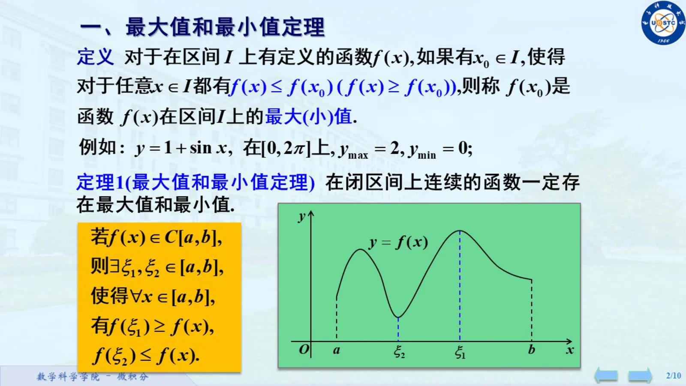

[S19 · 1.6 连续函数(续).pdf · PDF 第 3 页](/library/1.6-连续函数-续#page=3)

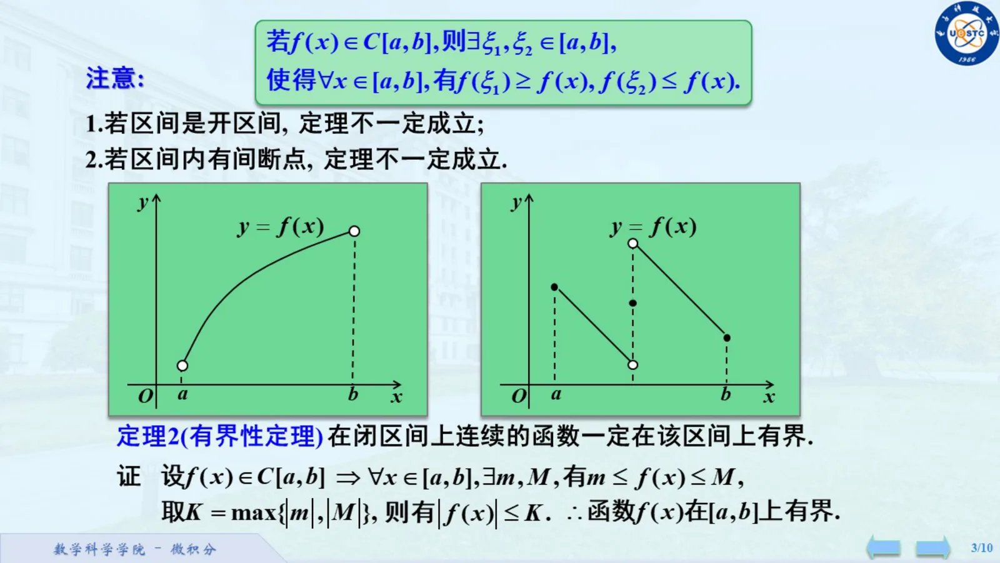

### 六、介值定理：连续曲线不会跳过中间高度

设 $f\in C[a,b]$，且 $f(a)\ne f(b)$。若 $c$ 严格介于两端函数值之间，就存在 $\xi\in(a,b)$，使 $f(\xi)=c$。

同理，若 $m,M$ 是整个区间上的最小、最大值，则每个 $m<c<M$ 都能取到。可在取得最值的两个点之间使用介值定理。

取 $c=0$ 得到**零点存在定理**：

$$
f\in C[a,b],\quad f(a)f(b)<0
\quad\Longrightarrow\quad
\exists\xi\in(a,b),\quad f(\xi)=0.
$$

这保证“至少一个”。若再有严格单调性，便得到唯一性；只是不减或不增仍可能有一整段零点，不能直接推出唯一。

**原图：介值定理与零点定理的原图**

[S19 · 1.6 连续函数(续).pdf · PDF 第 4 页](/library/1.6-连续函数-续#page=4)

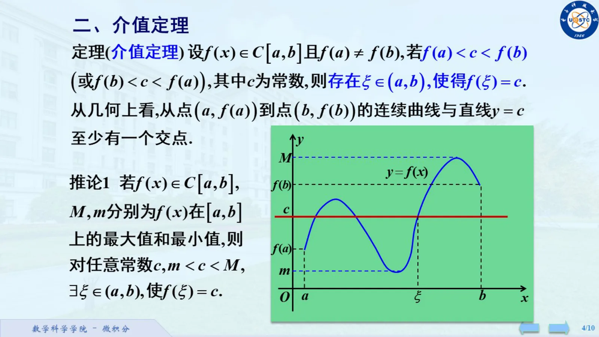

[S19 · 1.6 连续函数(续).pdf · PDF 第 5 页](/library/1.6-连续函数-续#page=5)

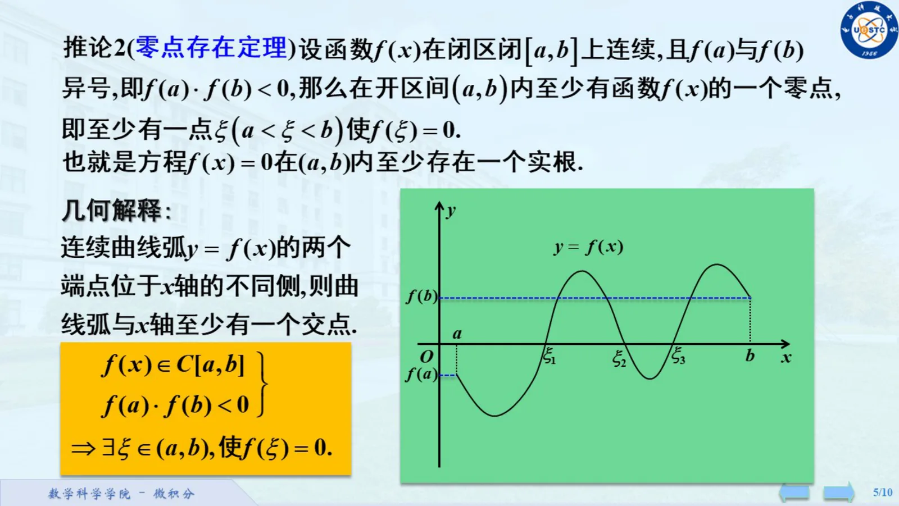

#### 二分法的思路

在两端异号的区间取中点 $m=(a+b)/2$。若 $f(m)=0$ 就结束；否则保留两端异号的半个区间，重复。第 $n$ 次后区间长度为 $(b-a)/2^n$，连续性保证其中始终有零点。

**原图：课件所展示的二分法动画静帧**

[S19 · 1.6 连续函数(续).pdf · PDF 第 6 页](/library/1.6-连续函数-续#page=6)

原 PDF 只保存这一帧，无法恢复原动画；上面的迭代说明用来连接静图与零点定理。

#### 例 1：证明方程至少有一根

对 $x^3-4x^2+1=0$，令 $f(x)=x^3-4x^2+1$。它在 $[0,1]$ 连续，且 $f(0)=1>0,\ f(1)=-2<0$，所以 $(0,1)$ 中至少有一根。

#### 例 2：把不动点变成零点

已知 $f\in C[a,b]$，$f(a)<a,\ f(b)>b$。设 $F(x)=f(x)-x$，则 $F(a)<0<F(b)$，所以存在 $\xi\in(a,b)$ 使 $F(\xi)=0$，即 $f(\xi)=\xi$。

#### 例 3：把两个函数相等变成零点

$f,g\in C[a,b]$，$f(a)>g(a)$、$f(b)<g(b)$。设 $F=f-g$，两端异号，故存在 $\xi$ 使 $f(\xi)=g(\xi)$。

#### 例 4：水平相隔固定距离的等高点

设 $f$ 在 $[0,1]$ 非负且连续，$f(0)=f(1)=0$。对任意固定 $0<\alpha<1$，证明有 $\xi\in[0,1)$ 使 $f(\xi)=f(\xi+\alpha)$。

为保证两个自变量都在定义域中，先在 $[0,1-\alpha]$ 上定义

$$
F(x)=f(x)-f(x+\alpha).
$$

$F$ 连续，且

$$
F(0)=-f(\alpha)\le0,\qquad
F(1-\alpha)=f(1-\alpha)\ge0.
$$

若其中一个等于零，直接取相应端点；若都不为零，则两端异号，在内部用零点定理。于是总有 $\xi\in[0,1-\alpha]\subset[0,1)$ 满足要求。这题必须保留端点为零的情况，不能把“$\le0$”直接当成“$<0$”。

> **原页核对：严格单调下的唯一性与例1至例4原证**
> [S19 · 1.6 连续函数(续).pdf · PDF 第 7 页](/library/1.6-连续函数-续#page=7)
>
> 
>
> [S19 · 1.6 连续函数(续).pdf · PDF 第 8 页](/library/1.6-连续函数-续#page=8)
>
> 
>
> [S19 · 1.6 连续函数(续).pdf · PDF 第 9 页](/library/1.6-连续函数-续#page=9)
>
> 

### 七、介值定理的四种推广

端点本身未包含在区间中时，可以用端点处的极限替代端点值：

| 连续区间 | 已知两端高度 | 结论 |
| --- | --- | --- |
| $[a,+\infty)$ | $f(a)$ 与 $\lim_{x\to+\infty}f(x)=B$，两者不同 | 每个严格介于两者的 $c$ 在 $(a,+\infty)$ 取到 |
| $\mathbb R$ | $\lim_{x\to-\infty}f(x)=A,\ \lim_{x\to+\infty}f(x)=B,\ A\ne B$ | 每个严格介于 $A,B$ 的 $c$ 在实轴取到 |
| $[a,b)$ | $f(a)$ 与 $\lim_{x\to b^-}f(x)=B$，两者不同 | 每个严格介于两者的 $c$ 在 $(a,b)$ 取到 |
| $(a,b)$ | $\lim_{x\to a^+}f(x)=A,\ \lim_{x\to b^-}f(x)=B,\ A\ne B$ | 每个严格介于 $A,B$ 的 $c$ 在 $(a,b)$ 取到 |

证明共用同一思路：由极限在区间内部选到有限的两个点，使函数值分处 $c$ 两侧；再在这两个点围成的闭区间上应用普通介值定理。不要直接对开区间套用闭区间定理。

> **原页核对：四种推广的完整条件**
> [S19 · 1.6 连续函数(续).pdf · PDF 第 10 页](/library/1.6-连续函数-续#page=10)
>
> 

### 八、作业与本章衔接

连续性前半部分：习题册第 10 页第 1、2、3、4、5 题，第 11 页第 6、7、8 题。

闭区间连续性质：第 11 页第 10、11、12、13、15 题，并完成复习题一第 12、13 页。

> **原页核对：连续性作业**
> [S18 · 1.6 连续函数(1).pdf · PDF 第 13 页](/library/1.6-连续函数-1#page=13)
>
> 
> **原页核对：闭区间性质作业与复习题要求**
> [S19 · 1.6 连续函数(续).pdf · PDF 第 11 页](/library/1.6-连续函数-续#page=11)
>
> 

第一章现在形成一个整体：函数提供研究对象，极限描述趋近，运算法则和等价关系帮助计算，连续性把局部趋势接到实际函数值，闭区间定理再把局部连续转成最值与存在性结论。下一篇 [07-第一章习题课](/notes/07-第一章习题课) 按课件中的知识图重新串联这些关系。

### 本篇其余原页

> **逐页保留：前文未单独嵌入的页面**
>
> [S17 · 1.6 连续函数.pdf · PDF 第 1 页](/library/1.6-连续函数#page=1)
>
> 
>
> [S19 · 1.6 连续函数(续).pdf · PDF 第 1 页](/library/1.6-连续函数-续#page=1)
>
> 

### 本篇来源

- S17：[1.6 连续函数.pdf](/notes/S17-1.6-连续函数)，11 页。
- S18：[1.6 连续函数(1).pdf](/notes/S18-1.6-连续函数-1)，13 页。
- S19：[1.6 连续函数(续).pdf](/notes/S19-1.6-连续函数-续)，11 页。

---

## 第一章习题课：函数、极限与连续的整体联系

> **本次文件的实际内容**
> 来源是你指定的 S20《第一章习题课.pdf》，实际只有 **5 个 PDF 页面**，页脚对应 `1/32` 至 `5/32`。第 6 至 32 张未包含在该文件中。本篇保留这 5 页全部内容；没有从其他年份的习题课补入例题。

### 一、按知识结构图把本章接起来

**原图：第一章完整知识结构图**

[S20 · 第一章习题课.pdf · PDF 第 2 页](/library/第一章习题课#page=2)

映射给出对应关系；函数进一步讨论反函数、复合函数、有界性、单调性、奇偶性和周期性，以及基本初等函数、初等函数与分段函数。极限分为数列极限和函数极限，由定义引出有界性、唯一性、局部保号和保序等性质。

计算极限时，一条路线是四则运算与复合运算，另一条路线是夹逼准则、单调有界准则、两个重要极限以及无穷小的运算与比较。最后用“极限等于函数值”定义连续，再研究间断点，以及闭区间连续函数的最值、有界、介值和零点性质。

对应正文依次是 [01-映射与函数](/notes/01-映射与函数)、[02-极限的概念](/notes/02-极限的概念)、[03-无穷小量与无穷大量](/notes/03-无穷小量与无穷大量)、[04-极限的性质及运算法则](/notes/04-极限的性质及运算法则)、[05-极限存在准则与两个重要极限](/notes/05-极限存在准则与两个重要极限)、[06-连续函数](/notes/06-连续函数)。

### 二、极限定义中的两个量各管什么

课件要求深刻理解七种极限概念。将其中的数列极限与函数在有限点、单侧、无穷远的极限放在一起看，核心都是“给定输出误差，再找输入范围”。例如

$$
x_n\to a
\iff
\forall\varepsilon>0,\ \exists N,\ 
n>N\Rightarrow |x_n-a|<\varepsilon.
$$

数轴上，$(a-\varepsilon,a+\varepsilon)$ 是目标带，$N$ 是保证尾部全部落入该带的门槛。$\varepsilon$ 由检验者任意给定，$N$ 可以依赖 $\varepsilon$，不要求最小，取更大通常仍有效。

课件保留了三个提问，下面是便于复习的整理回答：

1. **如何理解 $\varepsilon$ 与 $N$？** 前者控制精度，后者控制从哪项开始。不能只让部分项落入目标带，必须让之后所有项都落入。
2. **一维数轴上如何理解定义？** 无论画多窄的以 $a$ 为中心的带，最终都能容纳整个数列尾部。
3. **极限存在时，选 $\varepsilon$ 有什么技巧？** 证明有界性可固定 $\varepsilon=1$；证明保号性可取 $|a|/2$；用反证法比较两个候选极限时，可取它们距离的一部分。任意性用于定义，具体取值用于推出后果。

### 三、性质之间怎样互相配合

数列收敛则整体有界；函数在某点有有限极限则在该点的某个去心邻域有界。极限唯一。极限非零时，足够接近以后函数与极限同号；比较两个函数可借助差函数的保号性得到保序结论。

收敛数列的任何子列都趋于同一极限。反过来，找到两条不同极限的子列，就能否定原数列收敛。函数与数列之间的海涅定理也提供同样的检验：沿趋向该点且不取中心的任意数列，函数值应趋于同一个数。

课件提到把数列极限转换为函数极限，有时可使用适用于函数的方法，并举“洛必达法则”为后续方法名。本次第一章正文没有因此增补洛必达法则或后续教学内容。

> **原页核对：定义、三个课堂问题、极限性质及海涅定理提示**
> [S20 · 第一章习题课.pdf · PDF 第 3 页](/library/第一章习题课#page=3)
>
> 

### 四、四则运算必须带着条件使用

在同一过程中，若 $f\to A,\ g\to B$ 是有限极限，则

$$
f\pm g\to A\pm B,\qquad fg\to AB,\qquad
\frac fg\to\frac AB\quad(B\ne0).
$$

若两个函数都没有有限极限，不能直接拆开和差。例如相消可能让整体有极限。若其中一个有有限极限，则和差整体有有限极限当且仅当另一个有有限极限，这可由移项和四则法则证明。

乘法需要多一条条件：已知因子极限为**非零有限数**时，可以用它除回去，判断乘积与另一个因子的有限极限存在性。已知因子趋于零时，这个反推不成立；$0\cdot\infty$ 也不是一个能直接运算的数值。

复合换元时，若

$$
\varphi(x)\to a,\quad \varphi(x)\ne a\text{（足够近时）},\quad
\lim_{u\to a}f(u)=A,
$$

则 $f(\varphi(x))\to A$。若外层函数在 $a$ 连续，则可不要求内函数避开 $a$。这两种条件不要混淆。

> **原页核对：运算法则、不能直接使用的情况与复合换元法则**
> [S20 · 第一章习题课.pdf · PDF 第 4 页](/library/第一章习题课#page=4)
>
> 

### 五、无穷小把极限写成“主值加误差”

无穷小是指定过程中趋于零的变量。下列关系把不同表述接到一起：

$$
f\to0\iff |f|\to0,
$$

$$
f\to A
\iff f=A+\alpha,\quad \alpha\to0
\iff |f-A|\to0.
$$

有限个无穷小的代数和是无穷小；有界量与无穷小的乘积是无穷小。由后者立即得到：有有限极限的量与无穷小相乘、常数与无穷小相乘、有限个无穷小相乘，都仍趋于零。

这里每次都要检查“同一极限过程”“有限个”“有界”等条件。对项数不断增加的和，不能逐项取极限；相应夹逼例题已在 [05-极限存在准则与两个重要极限](/notes/05-极限存在准则与两个重要极限) 中保留。

> **原页核对：无穷小定义、误差表达与所有运算性质**
> [S20 · 第一章习题课.pdf · PDF 第 5 页](/library/第一章习题课#page=5)
>
> 

### 六、现有习题课文件到此结束

这一文件所包含的内容是知识图、概念回顾与运算法则，没有后续题型页。各小节正式课件中的题目和解答仍按原位置保留在前六篇正文中；习题册的页码与题号也保留，但未把没有提供的习题册题面编写成原题。

### 本篇其余原页

> **逐页保留：前文未单独嵌入的页面**
>
> [S20 · 第一章习题课.pdf · PDF 第 1 页](/library/第一章习题课#page=1)
>
> 

### 本篇来源

- S20：[第一章习题课.pdf](/notes/S20-第一章习题课)，5 页。

---

## 课件公式附录：幂指对与三角恒等式

来源为 S04《1.1 映射与函数(2).pdf》第 3 至 7 页。以下保留原附录各组公式；每一式都在实数表达式有定义的条件下使用，分母不能为零。对数底数要求正且不为 $1$，真数要求正。

### 一、幂、指数与对数

在相应底数和指数允许的条件下，

$$
a^bc^b=(ac)^b,\qquad
\frac{a^b}{c^b}=\left(\frac ac\right)^b,
$$

$$
a^ba^c=a^{b+c},\qquad
(a^b)^c=a^{bc}.
$$

实指数情形优先在正底数下使用这些恒等式。

$$
\log_a(b^c)=c\log_a b,\qquad
\log_a b=\frac{\log_c b}{\log_c a},
$$

$$
\log_a(a^b)=b,\qquad \ln(e^b)=b,
$$

$$
a^{\log_a b}=b,\qquad b=a^{\log_a b},\qquad
a^b=e^{b\ln a}.
$$

### 二、三角函数基本关系

$$
\tan\alpha=\frac{\sin\alpha}{\cos\alpha},\quad
\cot\alpha=\frac{\cos\alpha}{\sin\alpha},\quad
\tan\alpha=\frac1{\cot\alpha},
$$

$$
\csc\alpha=\frac1{\sin\alpha},\qquad
\sec\alpha=\frac1{\cos\alpha},
$$

$$
\sin^2\alpha+\cos^2\alpha=1,\qquad
\sec^2\alpha=\tan^2\alpha+1,\qquad
\csc^2\alpha=\cot^2\alpha+1.
$$

> **原页核对：幂指对与三角基本关系原页**
> [S04 · 1.1 映射与函数(2).pdf · PDF 第 3 页](/library/1.1-映射与函数-2#page=3)
>
> 

### 三、诱导公式

#### 奇偶性与周期

$$
\sin(-x)=-\sin x,\quad \cos(-x)=\cos x,\quad
\tan(-x)=-\tan x,\quad\cot(-x)=-\cot x.
$$

对整数 $k$，

$$
\sin(2k\pi+x)=\sin x,\quad\cos(2k\pi+x)=\cos x,
$$

$$
\tan(k\pi+x)=\tan x,\quad\cot(k\pi+x)=\cot x.
$$

#### $\pi$ 附近

$$
\sin(\pi+x)=-\sin x,\quad\sin(\pi-x)=\sin x,
$$

$$
\cos(\pi+x)=-\cos x,\quad\cos(\pi-x)=-\cos x.
$$

#### $\pi/2$ 附近

$$
\sin\left(\frac\pi2+x\right)=\cos x,\quad
\sin\left(\frac\pi2-x\right)=\cos x,
$$

$$
\cos\left(\frac\pi2+x\right)=-\sin x,\quad
\cos\left(\frac\pi2-x\right)=\sin x,
$$

$$
\tan\left(\frac\pi2+x\right)=-\cot x,\quad
\tan\left(\frac\pi2-x\right)=\cot x,
$$

$$
\cot\left(\frac\pi2+x\right)=-\tan x,\quad
\cot\left(\frac\pi2-x\right)=\tan x.
$$

课件记忆方法是先把 $x$ 看成锐角，判断原角所在象限以确定符号；$\pi/2$ 的这一组还要把函数名称换成对应余函数。

> **原页核对：诱导公式及记忆规律**
> [S04 · 1.1 映射与函数(2).pdf · PDF 第 4 页](/library/1.1-映射与函数-2#page=4)
>
> 
>
> [S04 · 1.1 映射与函数(2).pdf · PDF 第 5 页](/library/1.1-映射与函数-2#page=5)
>
> 

### 四、和角与差角

$$
\sin(\alpha\pm\beta)=\sin\alpha\cos\beta\pm\cos\alpha\sin\beta,
$$

$$
\cos(\alpha\pm\beta)=\cos\alpha\cos\beta\mp\sin\alpha\sin\beta,
$$

$$
\tan(\alpha\pm\beta)=
\frac{\tan\alpha\pm\tan\beta}{1\mp\tan\alpha\tan\beta}.
$$

### 五、和差化积

$$
\sin\alpha+\sin\beta=
2\sin\frac{\alpha+\beta}2\cos\frac{\alpha-\beta}2,
$$

$$
\sin\alpha-\sin\beta=
2\cos\frac{\alpha+\beta}2\sin\frac{\alpha-\beta}2,
$$

$$
\cos\alpha+\cos\beta=
2\cos\frac{\alpha+\beta}2\cos\frac{\alpha-\beta}2,
$$

$$
\cos\alpha-\cos\beta=
-2\sin\frac{\alpha+\beta}2\sin\frac{\alpha-\beta}2.
$$

### 六、积化和差

$$
\sin\alpha\cos\beta=\frac12[\sin(\alpha+\beta)+\sin(\alpha-\beta)],
$$

$$
\cos\alpha\sin\beta=\frac12[\sin(\alpha+\beta)-\sin(\alpha-\beta)],
$$

$$
\cos\alpha\cos\beta=\frac12[\cos(\alpha+\beta)+\cos(\alpha-\beta)],
$$

$$
\sin\alpha\sin\beta=-\frac12[\cos(\alpha+\beta)-\cos(\alpha-\beta)].
$$

### 七、倍角公式

$$
\sin2\alpha=2\sin\alpha\cos\alpha,
$$

$$
\cos2\alpha=\cos^2\alpha-\sin^2\alpha
=2\cos^2\alpha-1=1-2\sin^2\alpha,
$$

$$
1+\cos2\alpha=2\cos^2\alpha,\qquad
1-\cos2\alpha=2\sin^2\alpha.
$$

> **原页核对：和差角、和差化积、积化和差与倍角公式**
> [S04 · 1.1 映射与函数(2).pdf · PDF 第 5 页](/library/1.1-映射与函数-2#page=5)
>
> 
>
> [S04 · 1.1 映射与函数(2).pdf · PDF 第 6 页](/library/1.1-映射与函数-2#page=6)
>
> 

### 八、万能公式

按课件的角度写法：

$$
\tan2\alpha=\frac{2\tan\alpha}{1-\tan^2\alpha},\qquad
\sin2\alpha=\frac{2\tan\alpha}{1+\tan^2\alpha},\qquad
\cos2\alpha=\frac{1-\tan^2\alpha}{1+\tan^2\alpha}.
$$

等价地，令 $t=\tan(\theta/2)$，则

$$
\sin\theta=\frac{2t}{1+t^2},\quad
\cos\theta=\frac{1-t^2}{1+t^2},\quad
\tan\theta=\frac{2t}{1-t^2}.
$$

后一个写法只是换了变量，仍需检查半角正切与各分母有定义。

### 九、半角与降次

$$
\sin\frac\alpha2=\pm\sqrt{\frac{1-\cos\alpha}2},\qquad
\cos\frac\alpha2=\pm\sqrt{\frac{1+\cos\alpha}2},
$$

$$
\tan\frac\alpha2=\pm\sqrt{\frac{1-\cos\alpha}{1+\cos\alpha}},
$$

$$
\tan\frac\alpha2=\frac{1-\cos\alpha}{\sin\alpha}
=\frac{\sin\alpha}{1+\cos\alpha}.
$$

根式前的符号由半角所在象限决定，不是任选。两个分式各自在自身有定义的角度使用。

$$
\sin^2\alpha=\frac{1-\cos2\alpha}2,\qquad
\cos^2\alpha=\frac{1+\cos2\alpha}2.
$$

> **原页核对：万能、半角与降次公式原页**
> [S04 · 1.1 映射与函数(2).pdf · PDF 第 7 页](/library/1.1-映射与函数-2#page=7)
>
> 

### 本篇来源

- S04：[1.1 映射与函数(2).pdf](/notes/S04-1.1-映射与函数-2)，8 页。

---
