上一节描述函数“是什么”，这一节研究变量沿某个过程变化时“趋向什么”。先研究离散的数列，再推广到连续变化的自变量。**极限的核心是：精度可以任意要求，而足够靠后的所有值都满足要求。**

来源：S05、S06、S07、S08。

## 一、数列及其简单性质

按自然数 $1,2,\ldots$ 编号依次排列的一列数 $x_1,x_2,\ldots,x_n,\ldots$ 称为数列，$x_n$ 是通项，也可把数列理解为定义在正整数上的函数。

课件给出的通项与递推例子为

$$
2^n,\quad 2^{-n},\quad(-1)^{n-1},\quad
\frac{n+(-1)^{n-1}}n,\quad
a_1=\sqrt3,\ a_{n+1}=\sqrt{3+a_n}.
$$

如果 $x_{n+1}>x_n$（或 $<$），称严格单调增加（或减少）；允许等号时称不减（或不增）。

数列有界是指存在同一个 $M>0$ 使所有 $n$ 都有 $|x_n|\le M$。无界则是：对每个 $M>0$，都能找到某一项满足 $|x_n|>M$。有上界与有下界同时成立，等价于有界。例如 $\{1/n\}$ 上下都有界，$\{2^n\}$ 有下界而无上界。

**课堂选择题：有限项数列是否一定有界？** 是。有限个确定实数的绝对值有最大者。无穷大不是一个能填入某项的实数。

> **原页核对：全部数列例子、单调性、有界性与选择题解析**
> [S05 · 1.2 极限的概念.pdf · PDF 第 2 页](/library/1.2-极限的概念#page=2)
>
> 
>
> [S05 · 1.2 极限的概念.pdf · PDF 第 3 页](/library/1.2-极限的概念#page=3)
>
> 
>
> [S05 · 1.2 极限的概念.pdf · PDF 第 4 页](/library/1.2-极限的概念#page=4)
>
> 
>
> [S05 · 1.2 极限的概念.pdf · PDF 第 5 页](/library/1.2-极限的概念#page=5)
>
> 
>
> [S05 · 1.2 极限的概念.pdf · PDF 第 6 页](/library/1.2-极限的概念#page=6)
>
> 

## 二、从直观趋近到严格定义

课件比较以下变化：

| 数列 | $n\to\infty$ 时 |
| --- | --- |
| $1/2^{n-1}$ | 趋于 $0$ |
| $(n-1)/n$ | 趋于 $1$ |
| $(-1)^n/n$ | 在 $0$ 两侧跳动，但趋于 $0$ |
| $(-1)^n$ | 在 $-1,1$ 间跳动，无极限 |
| $2^n$ | 不收敛到有限实数 |

所以“不停振荡”本身不够判断极限，必须看振幅是否缩小。仅仅有无穷多项靠近某个数，也不等于整个数列趋向它。

课件另画出一组“多数点靠近 $1$，在某些素数平方编号处插入随机偏离值”的实验：图形上大量点靠近 $1$，并不能代替对整个尾部的检验。随机表达式和当时的图形保留在下面的原页中；不能凭一帧图就认定满足严格定义。

> **原页核对：课件的趋近讨论及动态图静态帧**
> [S05 · 1.2 极限的概念.pdf · PDF 第 7 页](/library/1.2-极限的概念#page=7)
>
> 
>
> [S05 · 1.2 极限的概念.pdf · PDF 第 8 页](/library/1.2-极限的概念#page=8)
>
> 
>
> [S05 · 1.2 极限的概念.pdf · PDF 第 9 页](/library/1.2-极限的概念#page=9)
>
> 
>
> [S05 · 1.2 极限的概念.pdf · PDF 第 10 页](/library/1.2-极限的概念#page=10)
>
> 

### 数列极限的 $\varepsilon-N$ 定义

$$
\lim_{n\to\infty}x_n=a
\iff
\forall\varepsilon>0,\ \exists N\in\mathbb N^+,\ 
\forall n>N,\ |x_n-a|<\varepsilon.
$$

$\varepsilon$ 是允许误差，$N$ 是保证后面所有项都达标的门槛。$N$ 可以依赖 $\varepsilon$，选择通常不唯一；找到一个足够大的 $N$ 即可。

几何上，任意小区间 $(a-\varepsilon,a+\varepsilon)$ 外只剩有限项。等价表述是“最终全部进入”，不是“进入无穷多次”。改动、增删有限个开头项不影响极限。

**原图：数轴上极限定义的几何解释**

[S05 · 1.2 极限的概念.pdf · PDF 第 13 页](/library/1.2-极限的概念#page=13)

课件在 S05 第 14-15 页的选择题选 **B：任意这样的区间外只有有限项**。选项 A“区间内有无穷多项”不足够，例如交替取 $a$ 和 $a+1$。

## 三、数列定义证明的全部例题

### 例 1：交错趋近 $1$

证明 $\frac{n+(-1)^{n-1}}n\to1$。误差直接化为

$$
\left|\frac{n+(-1)^{n-1}}n-1\right|=\frac1n.
$$

给定 $\varepsilon>0$，取正整数 $N=\max\{1,\lfloor1/\varepsilon\rfloor\}$。当 $n>N$ 时，$1/n<\varepsilon$，证明完成。$\varepsilon=1/100,1/1000,1/10000$ 时，对应的足够门槛可取 $100,1000,10000$。

### 例 2：$\lvert q\rvert<1$ 时 $q^n\to0$

$q=0$ 时显然；$0<|q|<1$ 时，误差为 $|q|^n$。取对数后，因 $\ln|q|<0$，不等号方向要反转：

$$
|q|^n<\varepsilon
\iff n>\frac{\ln\varepsilon}{\ln|q|}.
$$

取大于该值的正整数门槛即可。

### 例 3：正数列的开方

已知 $x_n>0$ 且 $x_n\to a>0$，证明 $\sqrt{x_n}\to\sqrt a$。有理化后

$$
|\sqrt{x_n}-\sqrt a|
=\frac{|x_n-a|}{\sqrt{x_n}+\sqrt a}
\le\frac{|x_n-a|}{\sqrt a}.
$$

在原数列的定义中要求 $|x_n-a|<\sqrt a\,\varepsilon$，即可使开方后的误差小于 $\varepsilon$。

### 例 4：放大误差

$$
s_n=\frac13-\left(\frac1{2n}-\frac1{6n^2}\right)\to\frac13.
$$

对 $n\ge1$，

$$
\left|s_n-\frac13\right|
=\frac1{2n}-\frac1{6n^2}<\frac1{2n}.
$$

因此取正整数 $N\ge1/(2\varepsilon)$ 即可。证明只需要足够条件，无需解出最小门槛。

### 例 5：和的极限

已知 $x_n\to a,\ y_n\to b$。分别把两个误差控制在 $\varepsilon/2$ 内，取 $N=\max\{N_1,N_2\}$，则

$$
|(x_n+y_n)-(a+b)|
\le|x_n-a|+|y_n-b|<\varepsilon.
$$

这里取最大值，是为了“同时满足两个足够靠后”的要求。

> **原页核对：上述五个例题的全部课件推导**
> [S05 · 1.2 极限的概念.pdf · PDF 第 16 页](/library/1.2-极限的概念#page=16)
>
> 
>
> [S05 · 1.2 极限的概念.pdf · PDF 第 17 页](/library/1.2-极限的概念#page=17)
>
> 
>
> [S05 · 1.2 极限的概念.pdf · PDF 第 18 页](/library/1.2-极限的概念#page=18)
>
> 
>
> [S05 · 1.2 极限的概念.pdf · PDF 第 19 页](/library/1.2-极限的概念#page=19)
>
> 

## 四、收敛数列的性质及证明思路

**有界性。** 收敛数列一定有界。取 $\varepsilon=1$，足够后的项落在 $(a-1,a+1)$；开头只有有限项，再把它们的绝对值并入一个共同上界。逆命题不成立：$(-1)^n$ 有界而发散。

**唯一性。** 若同时趋于不同的 $a,b$，取 $\varepsilon=|a-b|/3$，足够靠后的同一项必须同时落在两个不相交邻域，矛盾。课件还给出三角不等式证明：

$$
|a-b|\le|x_n-a|+|x_n-b|,
$$

右边可任意小，只能 $a=b$。

**保号性。** 若 $x_n\to a>0$，取 $\varepsilon=a/2$，最终 $x_n>a/2>0$。若 $x_n$ 最终非负且极限存在，只能推出 $a\ge0$，不能推出 $a>0$，反例是 $1/n\to0$。

**保序性。** 若 $x_n\to a,\ y_n\to b$ 且 $a>b$，最终 $x_n>y_n$；反向从最终 $x_n\ge y_n$ 只能得到 $a\ge b$。用差数列 $x_n-y_n$ 和保号性证明。

**子列。** 收敛数列的任意子列都趋于同一极限。$(-1)^n$ 的奇数项子列趋于 $-1$，偶数项子列趋于 $1$，因此原数列不收敛。反过来，如果奇数项与偶数项子列都趋于同一个 $a$，原数列也趋于 $a$：分别控制两组，再取统一门槛覆盖所有项。

> **原页核对：有界性、唯一性的两种证明、保号保序性与子列**
> [S06 · 1.2 极限的概念(1).pdf · PDF 第 1 页](/library/1.2-极限的概念-1#page=1)
>
> 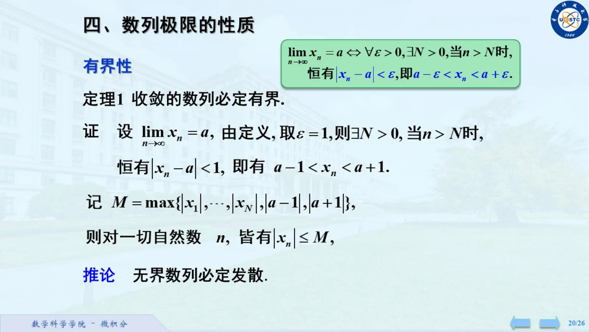
>
> [S06 · 1.2 极限的概念(1).pdf · PDF 第 2 页](/library/1.2-极限的概念-1#page=2)
>
> 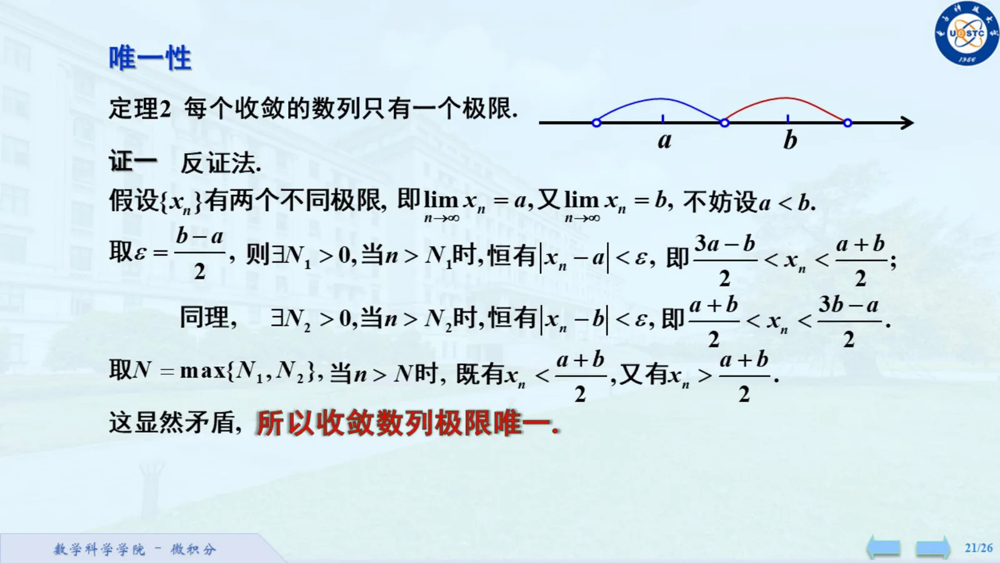
>
> [S06 · 1.2 极限的概念(1).pdf · PDF 第 3 页](/library/1.2-极限的概念-1#page=3)
>
> 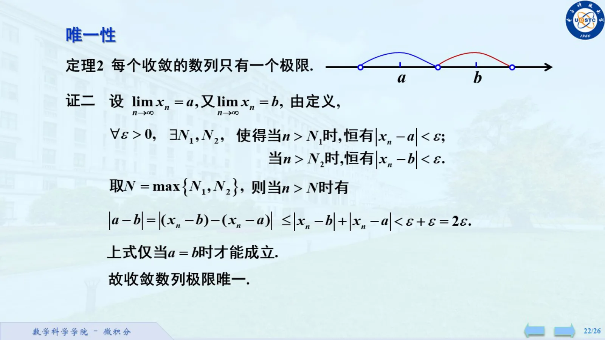
>
> [S06 · 1.2 极限的概念(1).pdf · PDF 第 4 页](/library/1.2-极限的概念-1#page=4)
>
> 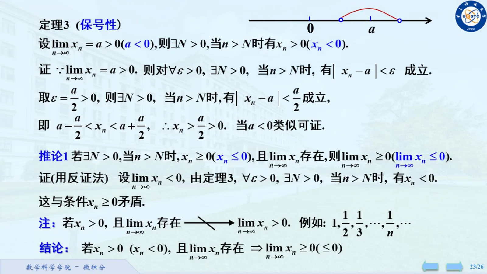
>
> [S06 · 1.2 极限的概念(1).pdf · PDF 第 5 页](/library/1.2-极限的概念-1#page=5)
>
> 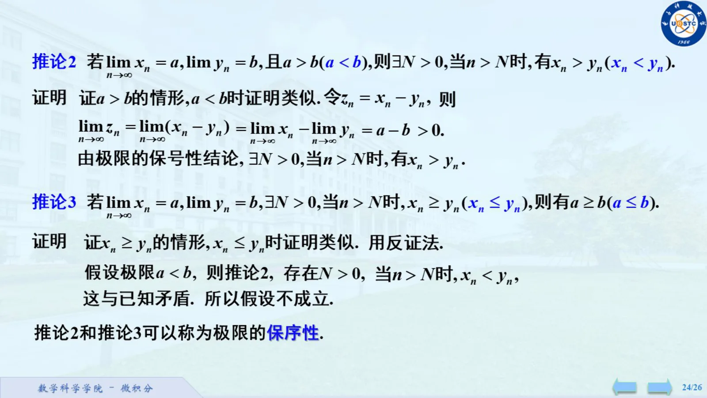
>
> [S06 · 1.2 极限的概念(1).pdf · PDF 第 6 页](/library/1.2-极限的概念-1#page=6)
>
> 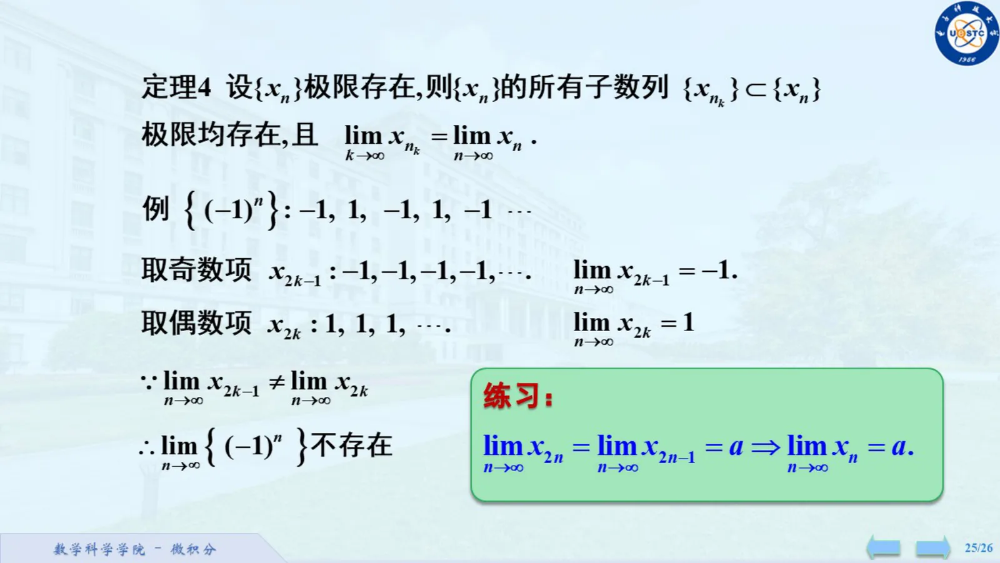

### 运算法则与课后思考

两个有限极限都存在时，和、差、积可分别求极限，商还要求分母极限非零，常数倍也成立。

课件的思考题可按下列情况整理，以下反例和说明为整理补充：

| 已知情况 | 和、差 | 积 |
| --- | --- | --- |
| 两者都收敛 | 都收敛 | 收敛 |
| 一者收敛，一者发散 | 都发散，否则可相减推出另一者收敛 | 不一定；$0\cdot(-1)^n=0$ |
| 两者都发散 | 不一定，如 $(-1)^n+[-(-1)^n]=0$ | 不一定，如 $(-1)^n(-1)^n=1$ |

若收敛因子的极限非零，而乘积收敛，则可用商法则反推出另一因子收敛。零极限因子不具备这个推论。

$\lim x_n=0\iff\lim|x_n|=0$，因为到 $0$ 的误差完全相同。一般情况下 $|x_n|$ 收敛不能推出 $x_n$ 收敛，仍看 $(-1)^n$。

> **原页核对：运算法则、全部课后问题及作业**
> [S06 · 1.2 极限的概念(1).pdf · PDF 第 7 页](/library/1.2-极限的概念-1#page=7)
>
> 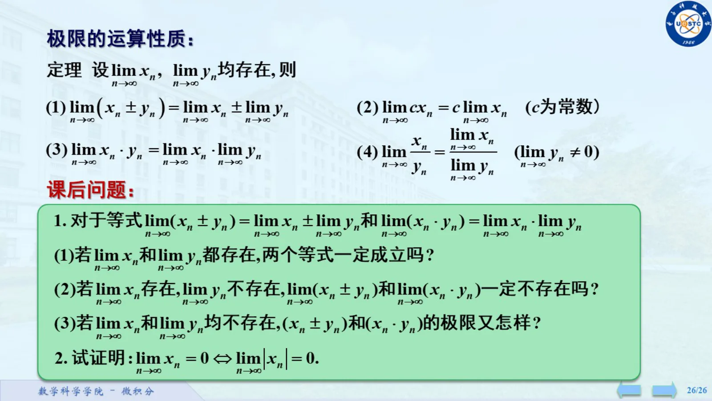
>
> [S06 · 1.2 极限的概念(1).pdf · PDF 第 8 页](/library/1.2-极限的概念-1#page=8)
>
> 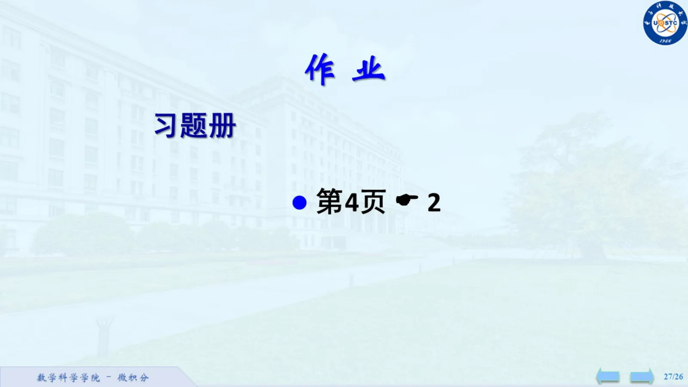

## 五、函数在无穷远处的极限

把“编号足够大”换成“自变量足够远”，得到函数极限：

| 过程 | 给定 $\varepsilon>0$ 后选 $X>0$，要求 |
| --- | --- |
| $x\to+\infty$ | $x>X\Rightarrow|f(x)-A|<\varepsilon$ |
| $x\to-\infty$ | $x<-X\Rightarrow|f(x)-A|<\varepsilon$ |
| $x\to\infty$（两端） | $|x|>X\Rightarrow|f(x)-A|<\varepsilon$ |

两端极限为 $A$，等价于正负无穷两端的极限都存在且等于 $A$。

**原图：正无穷、负无穷、两端以及误差带图像**

[S07 · 1.2 极限的概念(续).pdf · PDF 第 2 页](/library/1.2-极限的概念-续#page=2)

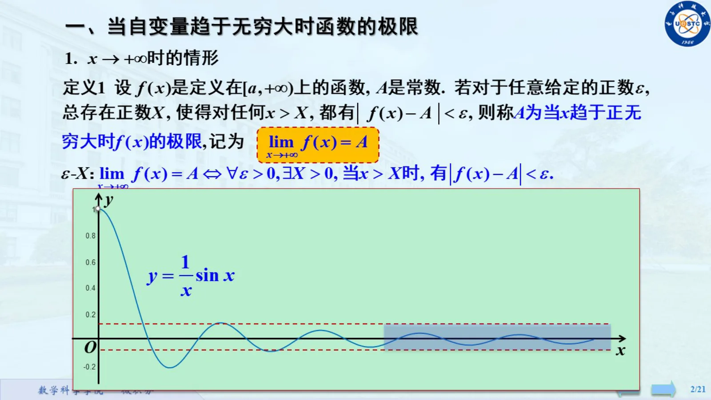

[S07 · 1.2 极限的概念(续).pdf · PDF 第 3 页](/library/1.2-极限的概念-续#page=3)

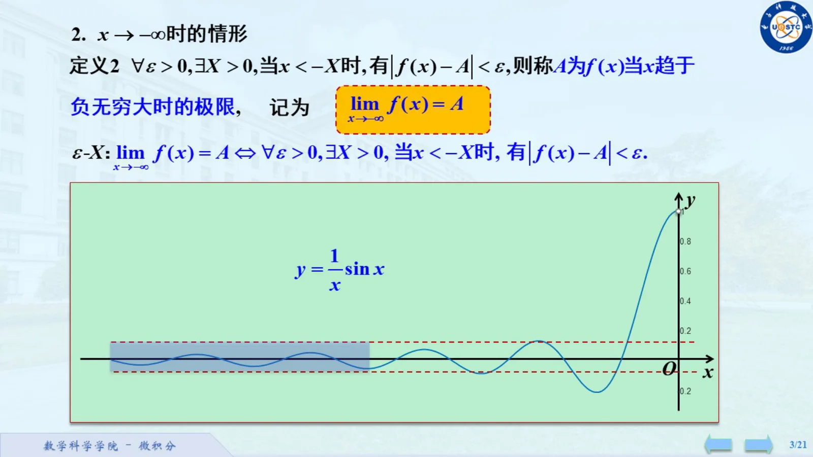

[S07 · 1.2 极限的概念(续).pdf · PDF 第 4 页](/library/1.2-极限的概念-续#page=4)

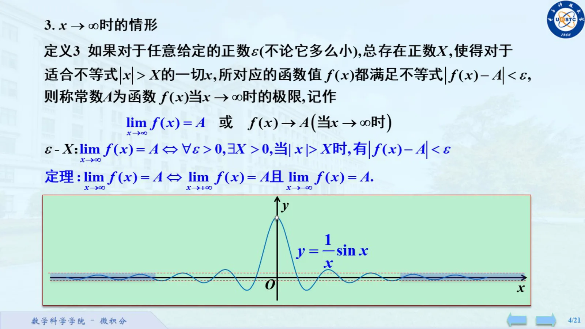

[S07 · 1.2 极限的概念(续).pdf · PDF 第 5 页](/library/1.2-极限的概念-续#page=5)

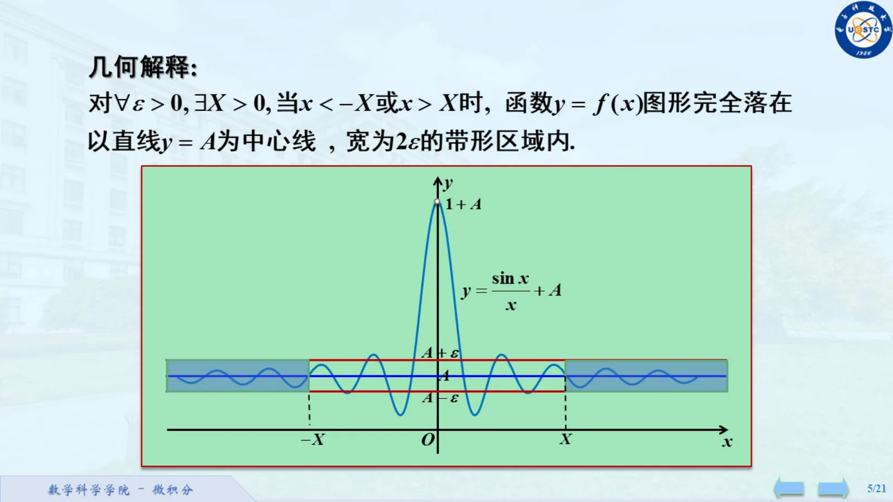

**例 1：** $\lim_{x\to\infty}\sin x/x=0$。因为

$$
\left|\frac{\sin x}{x}\right|\le\frac1{|x|},
$$

取 $X=1/\varepsilon$ 即可。这也说明 $\sin x$ 自己没有无穷远极限，但乘上衰减因子后可以收敛。

## 六、有限点处的函数极限

$$
\lim_{x\to x_0}f(x)=A
\iff
\forall\varepsilon>0,\ \exists\delta>0,\ 
0<|x-x_0|<\delta\Rightarrow|f(x)-A|<\varepsilon.
$$

先指定纵向精度 $\varepsilon$，再限制横向范围 $\delta$。条件中的 $0<$ 排除了 $x=x_0$，所以极限与 $f(x_0)$ 是否有定义、定义成什么值无直接关系。

**原图：局部放大图、去心邻域和误差带**

[S07 · 1.2 极限的概念(续).pdf · PDF 第 7 页](/library/1.2-极限的概念-续#page=7)

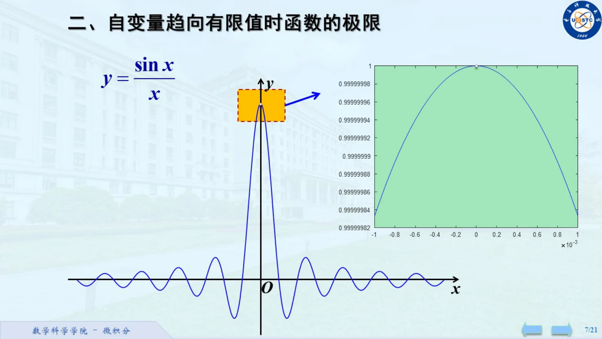

[S07 · 1.2 极限的概念(续).pdf · PDF 第 8 页](/library/1.2-极限的概念-续#page=8)

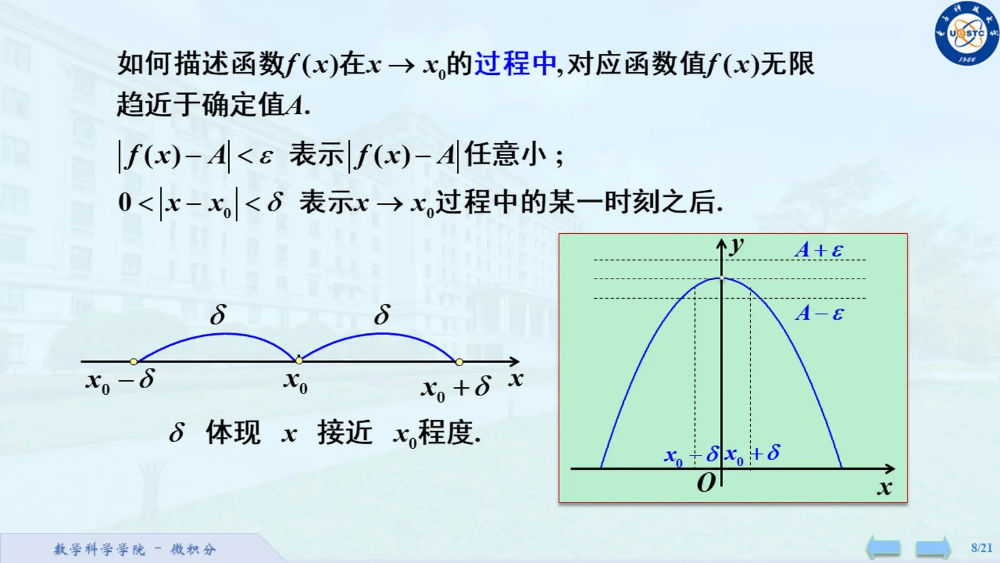

[S07 · 1.2 极限的概念(续).pdf · PDF 第 9 页](/library/1.2-极限的概念-续#page=9)

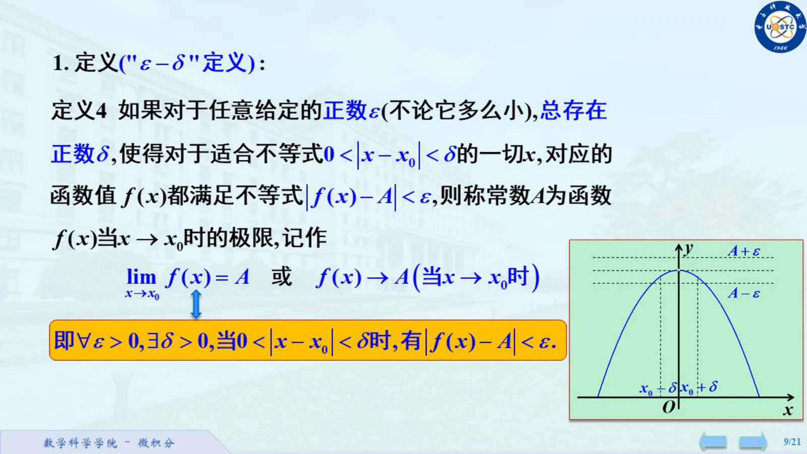

[S07 · 1.2 极限的概念(续).pdf · PDF 第 10 页](/library/1.2-极限的概念-续#page=10)

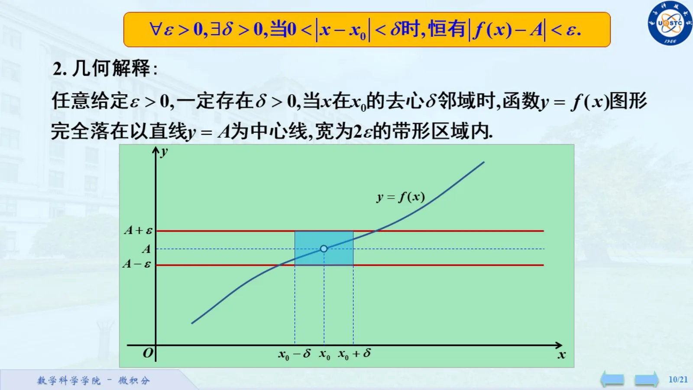

### 例 2：约去公共因子

$$
\lim_{x\to1}\frac{x^2-1}{x-1}=2.
$$

对 $x\ne1$，误差就是 $|(x+1)-2|=|x-1|$，取 $\delta=\varepsilon$。虽然原函数在 $1$ 处无定义，极限仍存在。

### 例 3：平方根的极限

$x_0>0$ 时，

$$
|\sqrt x-\sqrt{x_0}|
\le\frac{|x-x_0|}{\sqrt{x_0}}.
$$

取 $\delta=\min\{x_0,\sqrt{x_0}\varepsilon\}$，既保证 $x>0$，又控制误差。

### 例 4：先限制分母，再控制误差

$$
\lim_{x\to1}\frac{x+1}{x-2}=-2,\qquad
\left|\frac{x+1}{x-2}+2\right|=\frac{3|x-1|}{|x-2|}.
$$

先要求 $|x-1|<1/2$，得到 $|x-2|>1/2$，误差小于 $6|x-1|$。再取

$$
\delta=\min\left\{\frac12,\frac{\varepsilon}6\right\}.
$$

“先限制、再放大、最后取最小值”是课件这道证明的重点。S08 第 1 页与 S07 第 12 页保留了重叠内容。

> **原页核对：有限点处例2至例4的完整推导**
> [S07 · 1.2 极限的概念(续).pdf · PDF 第 11 页](/library/1.2-极限的概念-续#page=11)
>
> 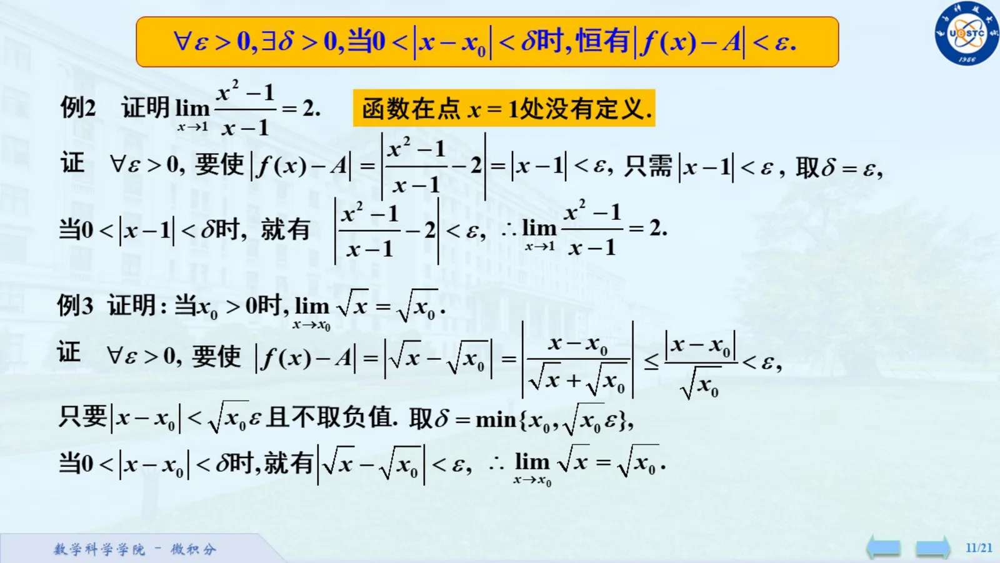
>
> [S07 · 1.2 极限的概念(续).pdf · PDF 第 12 页](/library/1.2-极限的概念-续#page=12)
>
> 

## 七、左右极限决定两侧极限

左极限只考察 $x_0-\delta<x<x_0$，右极限只考察 $x_0<x<x_0+\delta$。在左右都有定义的相应邻域中，

$$
\lim_{x\to x_0}f(x)=A
\iff
\lim_{x\to x_0^-}f(x)=
\lim_{x\to x_0^+}f(x)=A.
$$

课件先用 $f(x)=1-x\ (x<0)$、$f(x)=x^2+1\ (x\ge0)$ 引出左右极限，两侧都趋于 $1$。

**原图：左右趋近的图像和定义**

[S08 · 1.2 极限的概念(续)(1).pdf · PDF 第 2 页](/library/1.2-极限的概念-续-1#page=2)

[S08 · 1.2 极限的概念(续)(1).pdf · PDF 第 3 页](/library/1.2-极限的概念-续-1#page=3)

课件的后续例题：

| 例题 | 左极限 | 右极限 | 两侧极限 |
| --- | --- | --- | --- |
| 例5：$|x|/x$，$x\to0$ | $-1$ | $1$ | 不存在 |
| 例6：$f(x)=5+x^2\ (x<0),\ f(0)=10,\ f(x)=x\ (x>0)$ | $5$ | $0$ | 不存在 |
| 例7：$f(x)=x-1\ (x<1),\ f(x)=x^2-1\ (x>1)$，$x\to1$ | $0$ | $0$ | $0$ |

第二题中 $f(0)=10$ 不改变左右极限；第三题在 $1$ 没有函数值也不影响两侧极限。

**原图：上述例5至例7的原题、解答与图像**

[S08 · 1.2 极限的概念(续)(1).pdf · PDF 第 4 页](/library/1.2-极限的概念-续-1#page=4)

[S08 · 1.2 极限的概念(续)(1).pdf · PDF 第 5 页](/library/1.2-极限的概念-续-1#page=5)

## 八、函数极限性质与海涅定理

函数有有限极限，推出相应过程中的**局部有界**，并有唯一性、局部保号性、保序性。证明与数列相似，不过函数不能靠“补上有限开头项”就推成全定义域有界。

> **原页核对：函数极限性质的全部证明**
> [S08 · 1.2 极限的概念(续)(1).pdf · PDF 第 6 页](/library/1.2-极限的概念-续-1#page=6)
>
> 
>
> [S08 · 1.2 极限的概念(续)(1).pdf · PDF 第 7 页](/library/1.2-极限的概念-续-1#page=7)
>
> 
>
> [S08 · 1.2 极限的概念(续)(1).pdf · PDF 第 8 页](/library/1.2-极限的概念-续-1#page=8)
>
> 

海涅定理把函数极限与数列连接起来：在相应去心邻域有定义的前提下，

$$
\lim_{x\to x_0}f(x)=A
\iff
\text{对每个 }x_n\to x_0,\ x_n\ne x_0,\quad f(x_n)\to A.
$$

强调“每个”数列。只有一个选定数列能趋向目标，不足以证明函数极限存在。课件还用 $x_n=1/n$ 连接 $\sin x/x$ 的极限，用 $x_n=\ln n$ 连接 $\arctan x$ 在正无穷的极限。

**例 8：证明 $\sin(1/x)$ 在 $0$ 没有极限。** 取

$$
x_n=\frac1{n\pi},\qquad
y_n=\frac1{2n\pi+\pi/2}.
$$

二者都趋于 $0$，但函数值分别为 $0$ 和 $1$。出现两条不同的趋近结果，排除了函数极限。

**原图：海涅定理示意图和振荡函数原题**

[S08 · 1.2 极限的概念(续)(1).pdf · PDF 第 9 页](/library/1.2-极限的概念-续-1#page=9)

[S08 · 1.2 极限的概念(续)(1).pdf · PDF 第 10 页](/library/1.2-极限的概念-续-1#page=10)

## 九、作业与下一节

数列部分：习题册第 4 页第 2 题；函数极限部分：第 4 页第 3、4 题。指定文件未附习题册题面。

极限为零的情形将被单独命名为“无穷小”，它让一般极限的误差分析变得统一，见 [03-无穷小量与无穷大量](/notes/03-无穷小量与无穷大量)。

## 本篇其余原页

> **逐页保留：前文未单独嵌入的页面**
>
> [S05 · 1.2 极限的概念.pdf · PDF 第 1 页](/library/1.2-极限的概念#page=1)
>
> 
>
> [S05 · 1.2 极限的概念.pdf · PDF 第 11 页](/library/1.2-极限的概念#page=11)
>
> 
>
> [S05 · 1.2 极限的概念.pdf · PDF 第 12 页](/library/1.2-极限的概念#page=12)
>
> 
>
> [S05 · 1.2 极限的概念.pdf · PDF 第 14 页](/library/1.2-极限的概念#page=14)
>
> 
>
> [S05 · 1.2 极限的概念.pdf · PDF 第 15 页](/library/1.2-极限的概念#page=15)
>
> 
>
> [S05 · 1.2 极限的概念.pdf · PDF 第 20 页](/library/1.2-极限的概念#page=20)
>
> 
>
> [S07 · 1.2 极限的概念(续).pdf · PDF 第 1 页](/library/1.2-极限的概念-续#page=1)
>
> 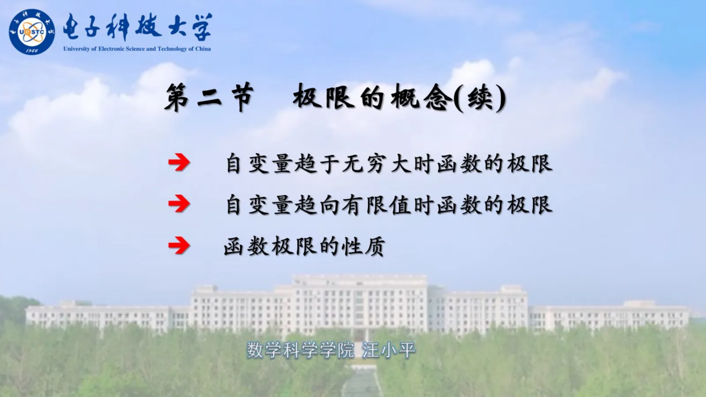
>
> [S07 · 1.2 极限的概念(续).pdf · PDF 第 6 页](/library/1.2-极限的概念-续#page=6)
>
> 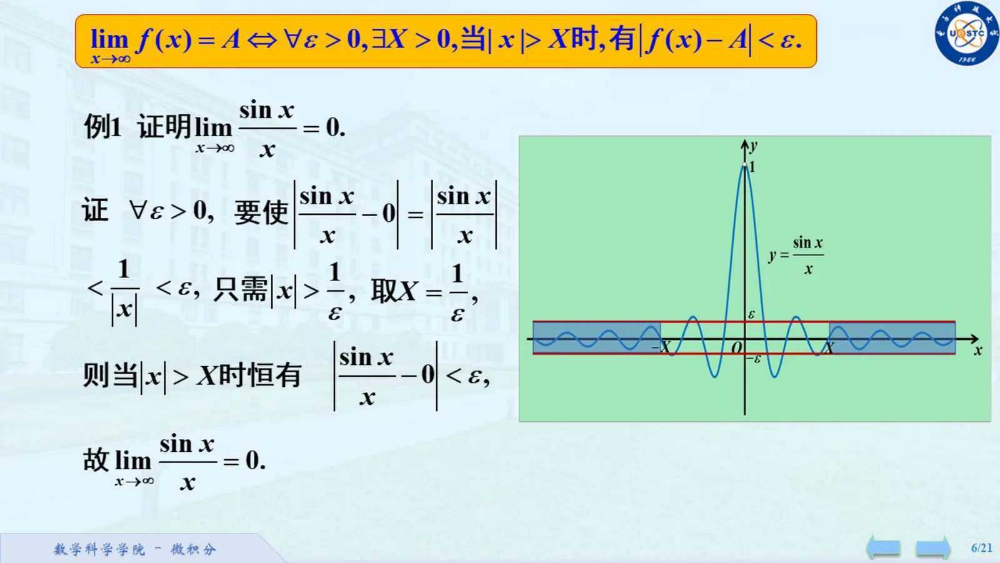
>
> [S08 · 1.2 极限的概念(续)(1).pdf · PDF 第 1 页](/library/1.2-极限的概念-续-1#page=1)
>
> 
>
> [S08 · 1.2 极限的概念(续)(1).pdf · PDF 第 11 页](/library/1.2-极限的概念-续-1#page=11)
>
> 

## 本篇来源

- S05：[1.2 极限的概念.pdf](/notes/S05-1.2-极限的概念)，20 页。
- S06：[1.2 极限的概念(1).pdf](/notes/S06-1.2-极限的概念-1)，8 页。
- S07：[1.2 极限的概念(续).pdf](/notes/S07-1.2-极限的概念-续)，12 页。
- S08：[1.2 极限的概念(续)(1).pdf](/notes/S08-1.2-极限的概念-续-1)，11 页。
