前面的运算法则往往以“各部分极限已存在”为前提。本节先解决存在性，再建立两个基础极限，最后把它们转成可反复使用的等价关系。来源为 S13、S14、S15、S16 四份 PDF，重叠页仍在原页索引中保留。

## 一、夹逼准则：让上下界趋于同一个数

在同一过程中，若足够后恒有

$$
g(x)\le f(x)\le h(x),\qquad g(x)\to A,\quad h(x)\to A,
$$

则 $f(x)\to A$。证明分别使上下界落在 $(A-\varepsilon,A+\varepsilon)$ 中，再取两者邻域半径的最小值；中间量也只能落在这个区间。

### 例 1：没有简便求和公式的和式

$$
S_n=\frac1{\sqrt{n^2+1}}+\frac1{\sqrt{n^2+2}}+\cdots+\frac1{\sqrt{n^2+n}}.
$$

每一项在 $1/\sqrt{n^2+n}$ 与 $1/\sqrt{n^2+1}$ 之间，故

$$
\frac n{\sqrt{n^2+n}}\le S_n\le
\frac n{\sqrt{n^2+1}}.
$$

左右都趋于 $1$，所以 $S_n\to1$。这里把项数 $n$ 保留在上下界中，避免逐项取零。

### 例 2：$\cos x\to1$

$$
0\le1-\cos x=2\sin^2\frac x2\le\frac{x^2}2\to0,
$$

因此 $x\to0$ 时 $\cos x\to1$。

### 例 3：最大项控制n次根

固定 $m$，各 $a_i>0$。设 $a=\max(a_1,\ldots,a_m)$，则

$$
a\le\sqrt[n]{a_1^n+\cdots+a_m^n}\le a\sqrt[n]m.
$$

$\sqrt[n]m=e^{(\ln m)/n}\to1$，故所求极限为 $\max(a_1,\ldots,a_m)$。

> **原页核对：夹逼准则证明及例1至例3原解**
> [S13 · 1.5 极限存在准则 两个重要极限.pdf · PDF 第 2 页](/library/1.5-极限存在准则-两个重要极限#page=2)
>
> 
>
> [S13 · 1.5 极限存在准则 两个重要极限.pdf · PDF 第 3 页](/library/1.5-极限存在准则-两个重要极限#page=3)
>
> 
>
> [S13 · 1.5 极限存在准则 两个重要极限.pdf · PDF 第 4 页](/library/1.5-极限存在准则-两个重要极限#page=4)
>
> 

## 二、单调有界准则：先证收敛，再求极限

单调不减且有上界，或单调不增且有下界的实数列必有有限极限。相应的单侧函数极限、无穷远函数极限也可在单调有界条件下讨论。对于递推数列，不能只把 $x_n,x_{n+1}$ 换成同一个 $A$ 就宣称证明了收敛。

### 例 4：平均迭代求平方根

$$
x_1>0,\quad a>0,\qquad
x_{n+1}=\frac12\left(x_n+\frac a{x_n}\right).
$$

所有项为正。均值不等式给出 $x_{n+1}\ge\sqrt a$，所以从第 2 项开始下界是 $\sqrt a$。当 $n\ge2$，

$$
x_{n+1}-x_n=\frac{a-x_n^2}{2x_n}\le0.
$$

因此尾部单调不增且有下界，极限 $A$ 存在且 $A\ge\sqrt a>0$。对递推式取极限，$A=(A+a/A)/2$，故 $A=\sqrt a$。

课件的第二种证明直接控制误差。对 $n\ge2$，

$$
x_{n+1}-\sqrt a
=\frac12(x_n-\sqrt a)\left(1-\frac{\sqrt a}{x_n}\right),
$$

括号在 $[0,1)$ 中，故

$$
0\le x_n-\sqrt a\le2^{-(n-2)}(x_2-\sqrt a)\to0.
$$

这同时证明收敛和极限值。

### 例 5：递推根式

$$
x_1=\sqrt a,\quad x_{n+1}=\sqrt{a+x_n},\qquad a>0.
$$

由递推的单调性归纳得 $x_{n+1}>x_n$。设

$$
L=\frac{1+\sqrt{1+4a}}2,\qquad L^2=a+L.
$$

$x_1<L$，若 $x_n<L$ 则 $x_{n+1}<\sqrt{a+L}=L$，故数列递增有上界。极限满足 $A=\sqrt{a+A}$，舍去负根得到 $A=L$。

课件展示的特殊值为

$$
\sqrt{2+\sqrt{2+\cdots}}=2,\qquad
\sqrt{6+\sqrt{6+\cdots}}=3.
$$

还展示连分式 $\sqrt2=1+\frac1{2+\frac1{2+\cdots}}$；严格含义是相应有限截断的极限。

> **原页核对：单调有界准则、例4的两证与例5全部原页**
> [S13 · 1.5 极限存在准则 两个重要极限.pdf · PDF 第 5 页](/library/1.5-极限存在准则-两个重要极限#page=5)
>
> 
>
> [S13 · 1.5 极限存在准则 两个重要极限.pdf · PDF 第 6 页](/library/1.5-极限存在准则-两个重要极限#page=6)
>
> 
>
> [S13 · 1.5 极限存在准则 两个重要极限.pdf · PDF 第 7 页](/library/1.5-极限存在准则-两个重要极限#page=7)
>
> 
>
> [S13 · 1.5 极限存在准则 两个重要极限.pdf · PDF 第 8 页](/library/1.5-极限存在准则-两个重要极限#page=8)
>
> 

## 三、第一个重要极限

$$
\boxed{\lim_{x\to0}\frac{\sin x}{x}=1}
$$

角度以弧度计。对 $0<x<\pi/2$，单位圆的三角形、扇形和切线三角形的面积比较给出

$$
\sin x<x<\tan x
\quad\Rightarrow\quad
\cos x<\frac{\sin x}{x}<1.
$$

利用 $\cos x\to1$ 夹逼；再利用 $\sin x/x$ 的偶性得到左侧。若 $u(x)\to0$ 且足够近时 $u(x)\ne0$，同样有 $\sin u(x)/u(x)\to1$。

**原图：单位圆面积比较的原图和证明**

[S13 · 1.5 极限存在准则 两个重要极限.pdf · PDF 第 9 页](/library/1.5-极限存在准则-两个重要极限#page=9)

### 课堂选择题：分母是平方时

若 $\varphi(x)\to0$ 且足够近时非零，求

$$
\frac{\sin\varphi(x)}{\varphi^2(x)}
=\frac{\sin\varphi(x)}{\varphi(x)}\cdot\frac1{\varphi(x)}.
$$

第一因子趋于 $1$，第二因子的绝对值趋于无穷，所以结果是课件记号中的无符号 $\infty$，选择 D。若要判定 $+\infty$ 或 $-\infty$，还需 $\varphi$ 的符号信息。

相关命题：若 $f\to A>0$、$|g|\to\infty$，则 $|fg|\to\infty$。给定门槛 $M$，先让 $f>A/2$，再让 $|g|>2M/A$，从而 $|fg|>M$。

> **原页核对：选择题与正极限乘无穷大的原页**
> [S13 · 1.5 极限存在准则 两个重要极限.pdf · PDF 第 10 页](/library/1.5-极限存在准则-两个重要极限#page=10)
>
> 
>
> [S13 · 1.5 极限存在准则 两个重要极限.pdf · PDF 第 11 页](/library/1.5-极限存在准则-两个重要极限#page=11)
>
> 

### 三角极限的七个例题

以下是课件的完整题目序列，部分题在 S13、S14 交界处重复：

1. **$\displaystyle\lim_{x\to0}\frac{1-\cos x}{x^2}=\frac12$。** 用 $1-\cos x=2\sin^2(x/2)$，化成 $\frac12[\sin(x/2)/(x/2)]^2$。
2. **$\displaystyle\lim_{x\to0}\frac{x^2\sin(1/x)}{\sin x}=0$。** 拆为 $(x/\sin x)\cdot[x\sin(1/x)]$，前者趋于 $1$，后者由有界乘无穷小趋于 $0$。
3. **$\displaystyle\lim_{x\to0}\frac{\tan x}{x}=1$。** 改写为 $(\sin x/x)/\cos x$。
4. **$\displaystyle\lim_{x\to0}\frac{\sin mx}{\sin nx}=\frac mn$，$m,n\ne0$。** 补齐 $mx,nx$，得到 $(\sin mx/mx)(m/n)(nx/\sin nx)$。
5. **$\displaystyle\lim_{x\to0}\frac{\tan x-\sin x}{x^3}=\frac12$。** 用 $\tan x-\sin x=\tan x(1-\cos x)$，拆成 $\tan x/x$ 和 $(1-\cos x)/x^2$。
6. **$\displaystyle\lim_{x\to\pi}\frac{\sin3x}{\tan5x}=-\frac35$。** 令 $t=\pi-x$，分子变成 $\sin3t$，分母变成 $-\tan5t$。负号不能漏。
7. **$\displaystyle\lim_{x\to1}(1-x)\tan\frac{\pi x}2=\frac2\pi$。** 令 $u=1-x$，化为 $u\cot(\pi u/2)=\frac2\pi\frac{\pi u/2}{\tan(\pi u/2)}$。

> **原页核对：三角例1至例7的原始推导**
> [S14 · 1.5 极限存在准则 两个重要极限(1).pdf · PDF 第 1 页](/library/1.5-极限存在准则-两个重要极限-1#page=1)
>
> 
>
> [S14 · 1.5 极限存在准则 两个重要极限(1).pdf · PDF 第 2 页](/library/1.5-极限存在准则-两个重要极限-1#page=2)
>
> 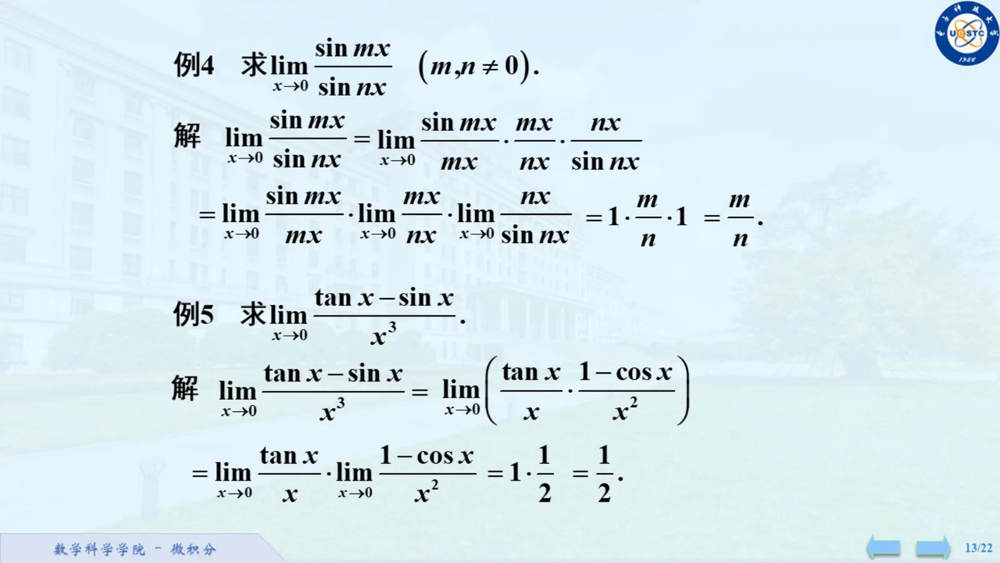
>
> [S14 · 1.5 极限存在准则 两个重要极限(1).pdf · PDF 第 3 页](/library/1.5-极限存在准则-两个重要极限-1#page=3)
>
> 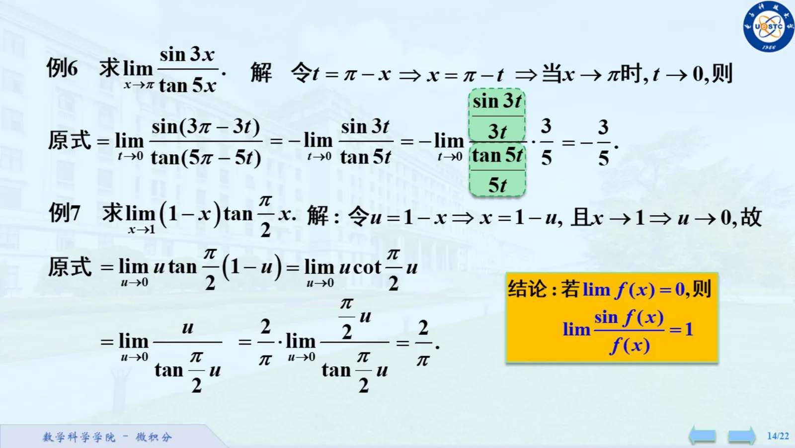

## 四、第二个重要极限

$$
\boxed{
\lim_{n\to\infty}\left(1+\frac1n\right)^n
=\lim_{x\to\infty}\left(1+\frac1x\right)^x
=\lim_{t\to0}(1+t)^{1/t}=e
}
$$

课件以利息分期结算引入：单位本金、单位年利率，一年结算 $n$ 次得到 $(1+1/n)^n$。这是数学模型，分期次数不断增加时，结果趋于 $e=2.71828\ldots$。

### 证明线索全部保留

先令 $a_n=(1+1/n)^n$。二项式展开为

$$
a_n=2+\sum_{k=2}^n\frac1{k!}
\left(1-\frac1n\right)\left(1-\frac2n\right)\cdots
\left(1-\frac{k-1}n\right).
$$

$n$ 增加时已有因子不减，又多出一个正项，因此数列递增。另一方面，

$$
a_n\le2+\frac1{2!}+\cdots+\frac1{n!}<3
$$

（边界小 $n$ 可直接检查）。所以由单调有界准则存在极限，把它定义为 $e$。

实变量 $x\to+\infty$ 时，取整数 $n\le x<n+1$，有

$$
\left(1+\frac1{n+1}\right)^n
\le\left(1+\frac1x\right)^x
\le\left(1+\frac1n\right)^{n+1}.
$$

两端都趋于 $e$。对 $x\to-\infty$，令 $t=-x$，把原式改写成

$$
\left(1-\frac1t\right)^{-t}
=\left(1+\frac1{t-1}\right)^t
=\left(1+\frac1{t-1}\right)^{t-1}
\cdot\left(1+\frac1{t-1}\right)\to e.
$$

即把指数分为 $(t-1)+1$，两个因子的极限分别为 $e$ 和 $1$。

> **原页核对：利息引入、二项式证明、正负无穷换元的完整原页**
> [S14 · 1.5 极限存在准则 两个重要极限(1).pdf · PDF 第 4 页](/library/1.5-极限存在准则-两个重要极限-1#page=4)
>
> 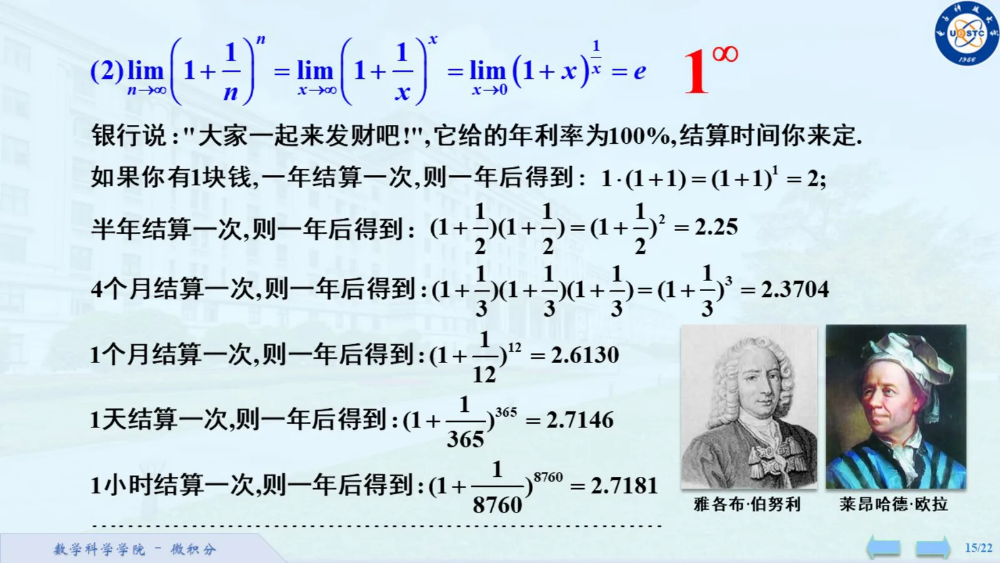
>
> [S14 · 1.5 极限存在准则 两个重要极限(1).pdf · PDF 第 5 页](/library/1.5-极限存在准则-两个重要极限-1#page=5)
>
> 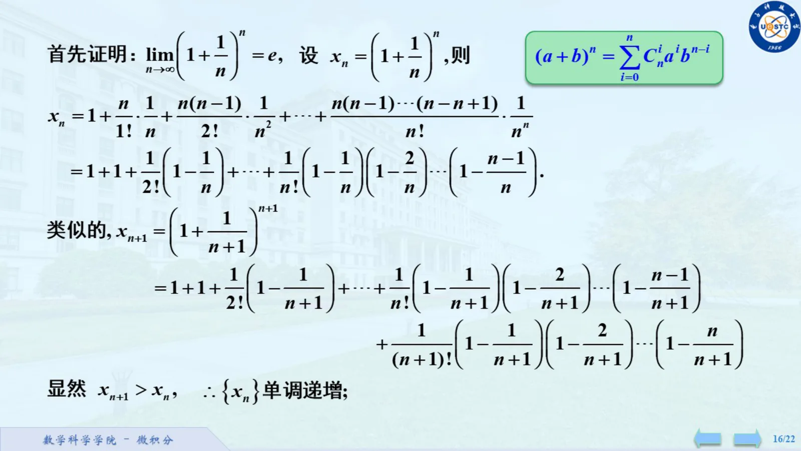
>
> [S14 · 1.5 极限存在准则 两个重要极限(1).pdf · PDF 第 6 页](/library/1.5-极限存在准则-两个重要极限-1#page=6)
>
> 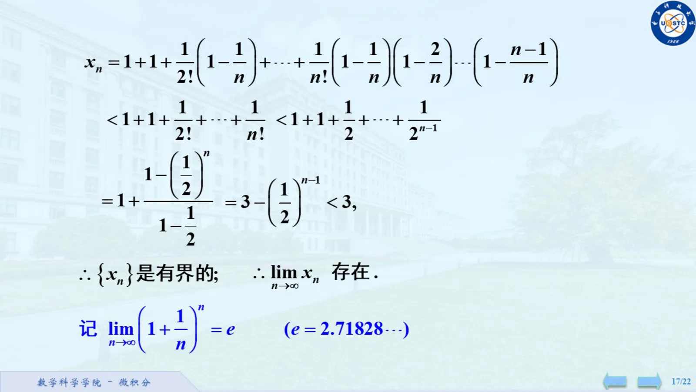
>
> [S14 · 1.5 极限存在准则 两个重要极限(1).pdf · PDF 第 7 页](/library/1.5-极限存在准则-两个重要极限-1#page=7)
>
> 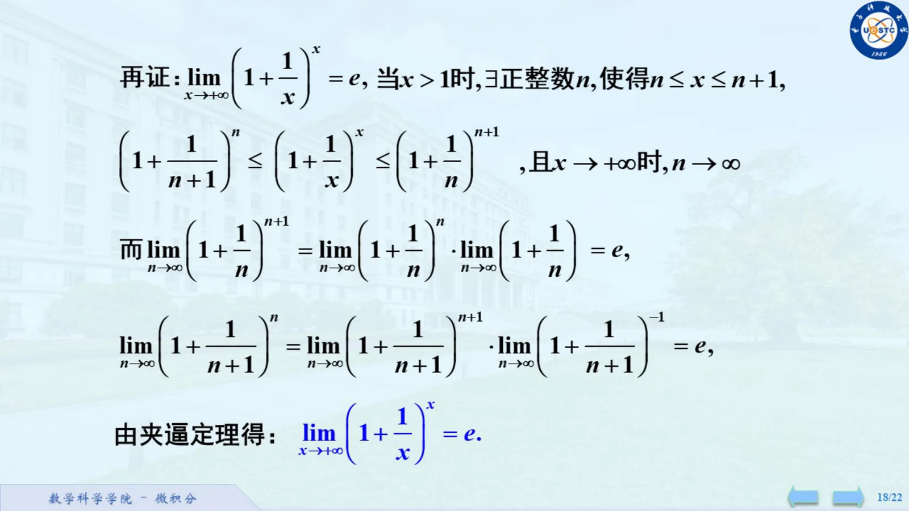
>
> [S14 · 1.5 极限存在准则 两个重要极限(1).pdf · PDF 第 8 页](/library/1.5-极限存在准则-两个重要极限-1#page=8)
>
> 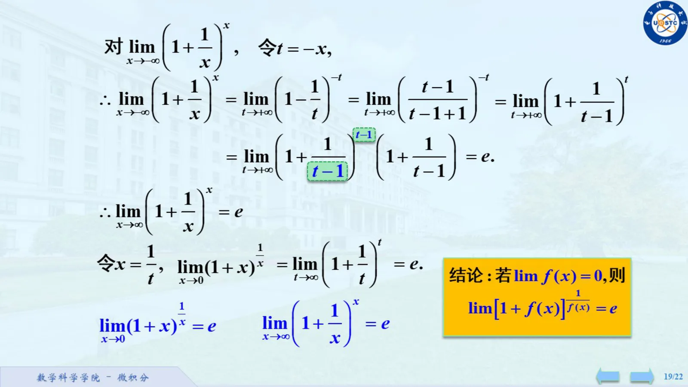

令 $t=1/x$，最后得到 $t\to0$ 的形式。使用时需要底数为正、分母中的趋零量非零。对一般 $u\to0$，常把

$$
(1+u)^v=\left[(1+u)^{1/u}\right]^{uv}
$$

作为配形方法；若 $uv\to L$，在相应定义条件下极限为 $e^L$。

### 指数型极限的全部例题

| 原课件题目 | 改写的关键 | 结果 |
| --- | --- | --- |
| 例8：$\displaystyle(1-1/x)^x,\ x\to\infty$ | $u=-1/x,\ ux=-1$ | $e^{-1}$ |
| 例9(1)：$\displaystyle((x+3)/(x+2))^{2x},\ x\to\infty$ | 底数 $1+1/(x+2)$；$2x/(x+2)\to2$ | $e^2$ |
| 例9(2)：$\displaystyle(1+3\tan^2x)^{\cot^2x},\ x\to0$ | $u=3\tan^2x$；$u\cot^2x=3$ | $e^3$ |
| 例10及选择题：$\displaystyle(1-m^2/n^2)^n,\ n\to\infty$ | $m$ 固定；$n(-m^2/n^2)\to0$ | $1$，选 B |
| 例11：$\displaystyle(1+(2nx+x^2)/(2n^2))^{-n},\ n\to\infty$ | $x$ 固定；$(-n)(2nx+x^2)/(2n^2)\to-x$ | $e^{-x}$ |

课件还有正底数的变指数法则：若 $f\to B>0,\ g\to A$ 都为有限极限，则 $f^g=e^{g\ln f}\to B^A$。这里的证明也解释了配形后的指数为什么可以继续取极限。

> **原页核对：全部指数型例题、选择题、变指数命题与作业**
> [S14 · 1.5 极限存在准则 两个重要极限(1).pdf · PDF 第 9 页](/library/1.5-极限存在准则-两个重要极限-1#page=9)
>
> 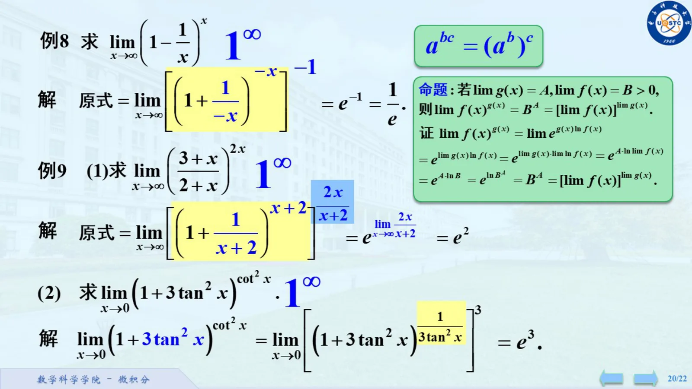
>
> [S14 · 1.5 极限存在准则 两个重要极限(1).pdf · PDF 第 10 页](/library/1.5-极限存在准则-两个重要极限-1#page=10)
>
> 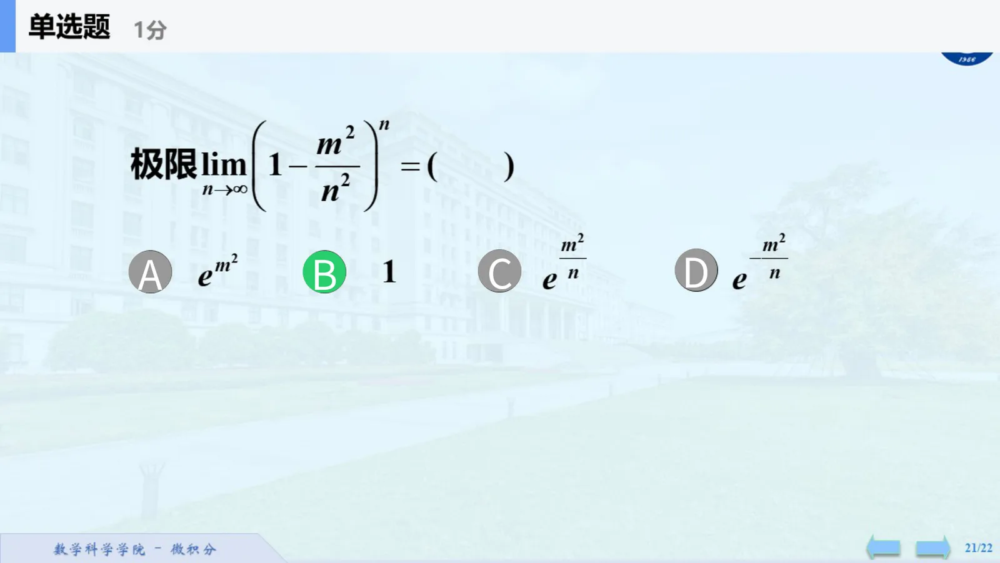
>
> [S14 · 1.5 极限存在准则 两个重要极限(1).pdf · PDF 第 11 页](/library/1.5-极限存在准则-两个重要极限-1#page=11)
>
> 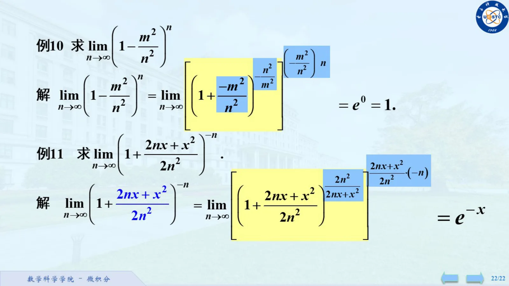
>
> [S14 · 1.5 极限存在准则 两个重要极限(1).pdf · PDF 第 12 页](/library/1.5-极限存在准则-两个重要极限-1#page=12)
>
> 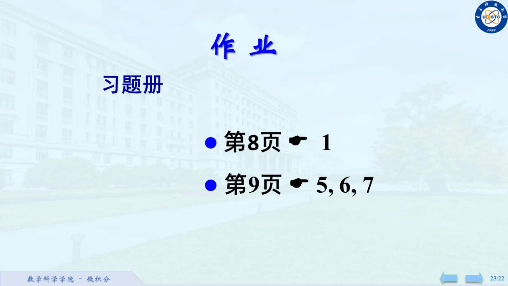

## 五、无穷小的阶：比较趋零的速度

以下都在同一极限过程中，$\alpha,\beta\to0$，相应比值有定义：

| 比较 | 含义 |
| --- | --- |
| $\beta/\alpha\to0$ | $\beta=o(\alpha)$，高阶无穷小 |
| $\beta/\alpha\to C\ne0$ | 同阶无穷小 |
| $\beta/\alpha\to1$ | 等价无穷小，$\alpha\sim\beta$ |
| $\beta/\alpha^k\to C\ne0$ | $\beta$ 是关于 $\alpha$ 的 $k$ 阶无穷小 |

例如 $x^2/(3x)\to0$，$x^2$ 比 $3x$ 更快趋零；$\sin x/(3x)\to1/3$，两者同阶但不等价。

**例 1：** $4x\tan^3x$ 关于 $x$ 是四阶，因为除以 $x^4$ 后得到 $4(\tan x/x)^3\to4$。

**例 2：** $\tan x-\sin x$ 关于 $x$ 是三阶，因为除以 $x^3$ 的极限为 $1/2$。

## 六、常用等价关系及其来路

当 $x\to0$，

$$
\sin x\sim x,\quad\tan x\sim x,\quad
\arcsin x\sim x,\quad\arctan x\sim x,
$$

$$
1-\cos x\sim\frac{x^2}2,\qquad
\tan x-\sin x\sim\frac{x^3}2,
$$

$$
e^x-1\sim x,\quad a^x-1\sim x\ln a,\quad
\ln(1+x)\sim x,\quad\log_a(1+x)\sim\frac x{\ln a},
$$

$$
\sqrt[n]{1+x}-1\sim\frac xn,\qquad
(1+x)^\mu-1\sim\mu x.
$$

一般指数关系要求固定 $\mu\ne0$；对数底数要求 $a>0,\ a\ne1$。所有式子都在各自定义域内使用。

这些公式可以相互推出：$\sin x/x\to1$ 推出三角类；令 $t=\arctan x$ 可推出反正切类；$\ln(1+x)/x=\ln[(1+x)^{1/x}]\to1$ 来自第二重要极限；令 $u=a^x-1$ 再换元可推出指数类。

**原图：公式推导、完整等价表和关系图**

[S15 · 1.5 极限存在准则 两个重要极限(续).pdf · PDF 第 3 页](/library/1.5-极限存在准则-两个重要极限-续#page=3)

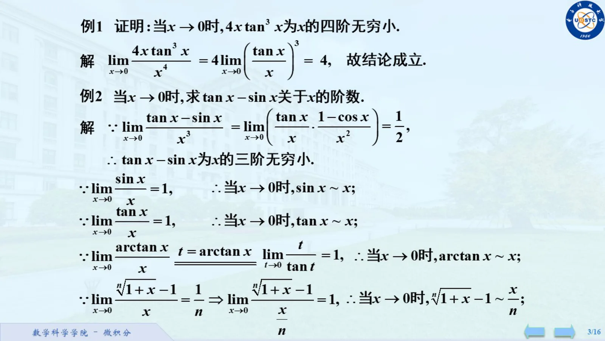

[S15 · 1.5 极限存在准则 两个重要极限(续).pdf · PDF 第 4 页](/library/1.5-极限存在准则-两个重要极限-续#page=4)

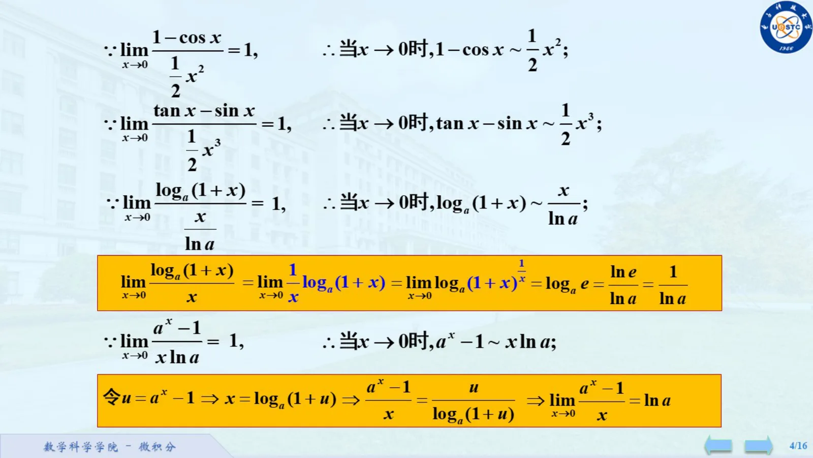

[S15 · 1.5 极限存在准则 两个重要极限(续).pdf · PDF 第 5 页](/library/1.5-极限存在准则-两个重要极限-续#page=5)

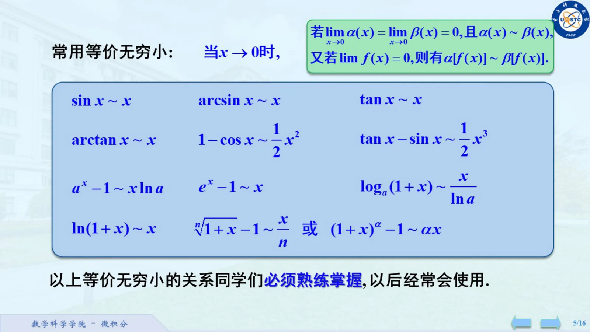

[S15 · 1.5 极限存在准则 两个重要极限(续).pdf · PDF 第 6 页](/library/1.5-极限存在准则-两个重要极限-续#page=6)

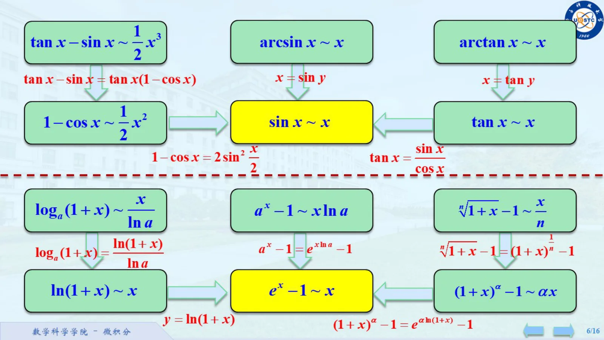

## 七、替换定理：乘除结构保留主要量

如果 $\alpha\sim\alpha'$、$\beta\sim\beta'$，且相关比值有定义，替换后的比值有极限，则

$$
\lim\frac{\beta}{\alpha}
=\lim\frac{\beta'}{\alpha'}.
$$

因为

$$
\frac{\beta}{\alpha}
=\frac{\beta}{\beta'}\cdot\frac{\beta'}{\alpha'}\cdot\frac{\alpha'}{\alpha},
$$

两边因子趋于 $1$。乘积中也可替换相应因子。

但加减内部可能发生主项抵消，不能把 $\tan x-\sin x$ 各自替换成 $x-x$。正确做法是把整个差式视为一个量，使用 $\tan x-\sin x\sim x^3/2$，或先作恒等变形。

课件多选题选 B、D：替换的是完整乘法因子或完整分母；A、C 在减法内部替换，缺乏一般保证。题目默认相关定义和极限条件满足。

> **原页核对：替换定理证明、推论及多选题原页**
> [S15 · 1.5 极限存在准则 两个重要极限(续).pdf · PDF 第 7 页](/library/1.5-极限存在准则-两个重要极限-续#page=7)
>
> 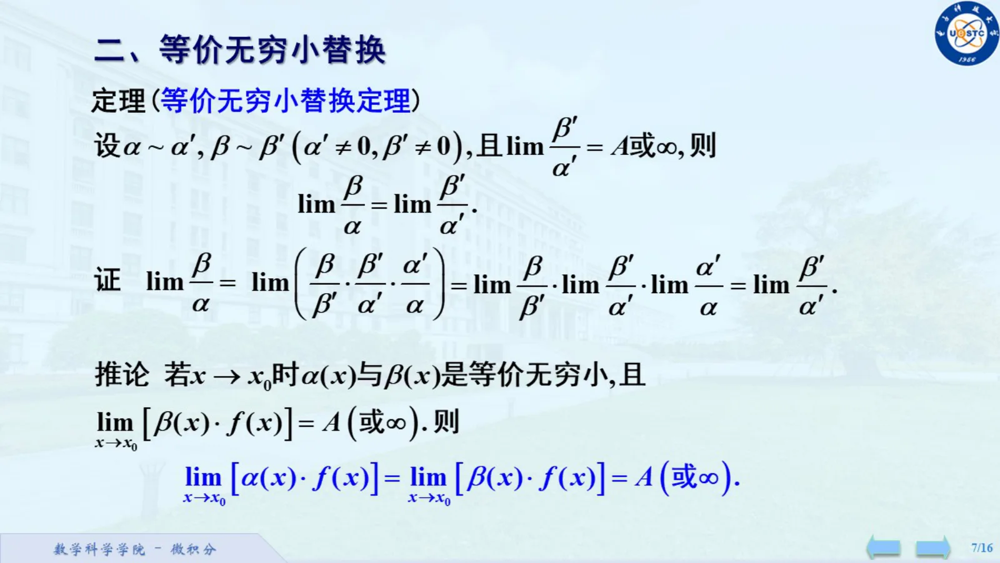
>
> [S15 · 1.5 极限存在准则 两个重要极限(续).pdf · PDF 第 8 页](/library/1.5-极限存在准则-两个重要极限-续#page=8)
>
> 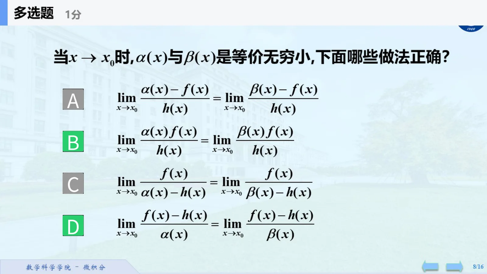

## 八、等价替换例题全录

### 例 3 与例 4：先看阶数

$$
\lim_{x\to0}\frac{\tan^2(2x)}{1-\cos x}
=\lim\frac{(2x)^2}{x^2/2}=8,
$$

$$
\lim_{x\to0}\frac{\tan x-\sin x}{\sin^3(2x)}
=\lim\frac{x^3/2}{(2x)^3}=\frac1{16}.
$$

### 例 5 与例 6：根式内部也可作整体换元

$$
\lim_{x\to0}\frac{1-\cos2x}{\sqrt[3]{1+x^2}-1}
=\lim\frac{(2x)^2/2}{x^2/3}=6,
$$

$$
\lim_{x\to0}\frac{\tan x-\sin x}{x^2(\sqrt{1+x}-1)}
=\lim\frac{x^3/2}{x^2(x/2)}=1.
$$

S16 第 1 页重复保留了这两题。

> **原页核对：例3至例6的原始完整推导**
> [S15 · 1.5 极限存在准则 两个重要极限(续).pdf · PDF 第 9 页](/library/1.5-极限存在准则-两个重要极限-续#page=9)
>
> 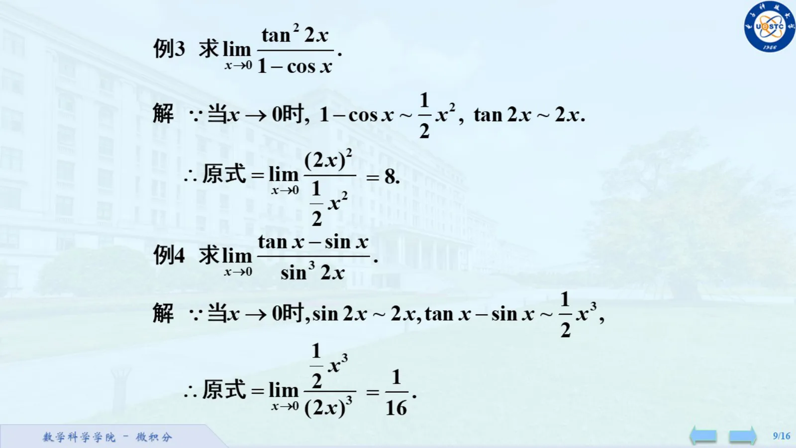
>
> [S15 · 1.5 极限存在准则 两个重要极限(续).pdf · PDF 第 10 页](/library/1.5-极限存在准则-两个重要极限-续#page=10)
>
> 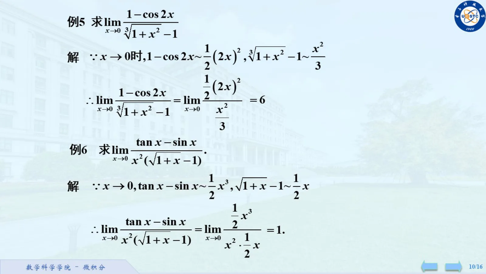

### 例 7：两层复合的等价

$$
\lim_{x\to0}\frac{\sqrt{1+x\sin x}-1}{e^{x^2}-1}
=\lim\frac{\frac12x\sin x}{x^2}
=\frac12.
$$

先对 $u=x\sin x\to0$ 用 $\sqrt{1+u}-1\sim u/2$，再用 $\sin x\sim x$。

### 例 8：无穷远处的对数乘积

对固定 $a>0$、实数 $b$，

$$
\lim_{x\to+\infty}\ln(1+e^{ax})\ln\left(1+\frac bx\right)=ab.
$$

当 $b=0$ 时表达式恒为 $0$；其余情况先用 $\ln(1+b/x)\sim b/x$，再写

$$
\ln(1+e^{ax})=ax+\ln(1+e^{-ax}).
$$

原乘积的极限等于 $ab+\lim(b/x)\ln(1+e^{-ax})=ab$。

### 例 9：先把相消的余弦差变成乘积

$$
\lim_{x\to0}\frac{\cos(xe^x)-\cos(xe^{-x})}{(\sin x)^3}=-2.
$$

用和差化积，分子为

$$
-2\sin\left(\frac{x(e^x+e^{-x})}2\right)
\sin\left(\frac{x(e^x-e^{-x})}2\right).
$$

两个正弦的自变量都趋于零，可替换完整正弦因子，得到

$$
-\frac12(e^x+e^{-x})\frac{e^x-e^{-x}}x\to-2.
$$

课件两种收尾方式都成立：一是 $e^x-e^{-x}=e^{-x}(e^{2x}-1)$；二是拆成 $(e^x-1)-(e^{-x}-1)$，两项各自除以 $x$ 后都存在有限极限。不能在未检查条件时任意拆开相消项。

> **原页核对：例7至例9及例9的两种解法**
> [S16 · 1.5 极限存在准则 两个重要极限(续)(1).pdf · PDF 第 2 页](/library/1.5-极限存在准则-两个重要极限-续-1#page=2)
>
> 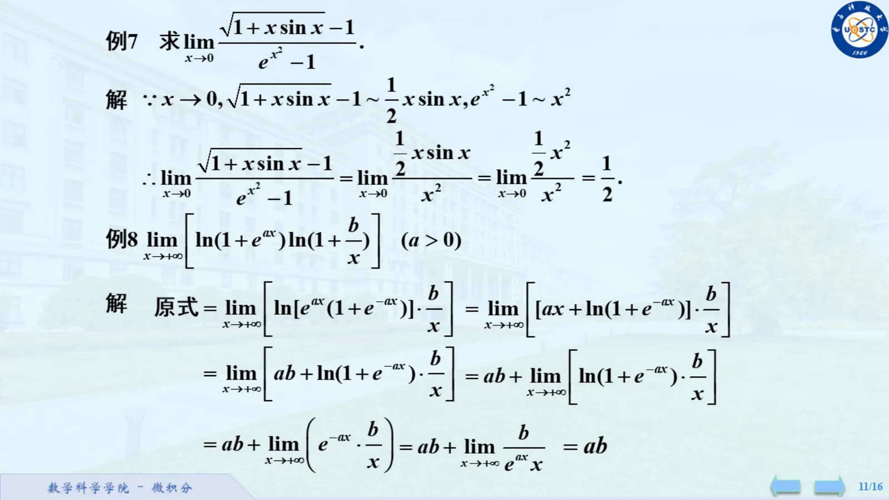
>
> [S16 · 1.5 极限存在准则 两个重要极限(续)(1).pdf · PDF 第 3 页](/library/1.5-极限存在准则-两个重要极限-续-1#page=3)
>
> 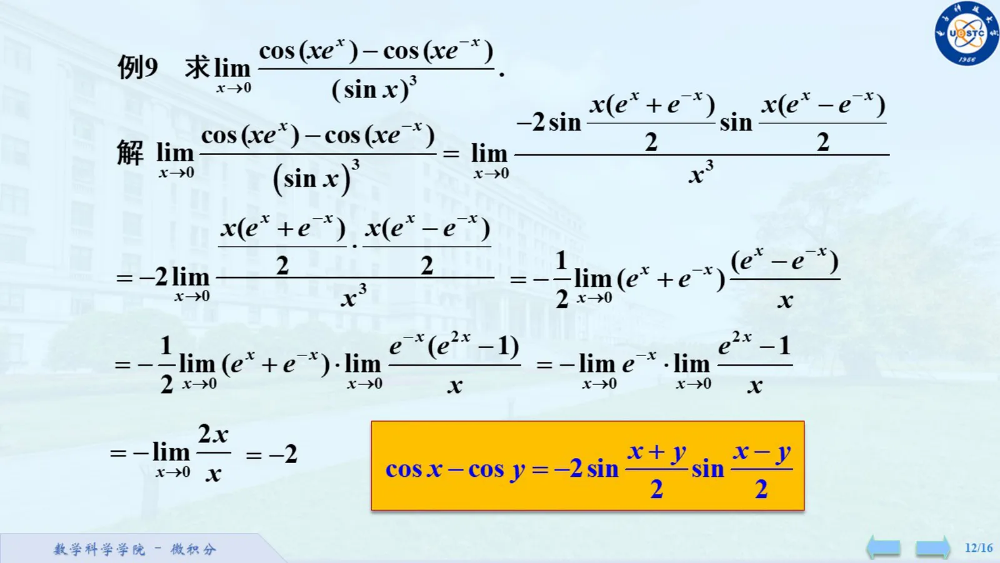
>
> [S16 · 1.5 极限存在准则 两个重要极限(续)(1).pdf · PDF 第 4 页](/library/1.5-极限存在准则-两个重要极限-续-1#page=4)
>
> 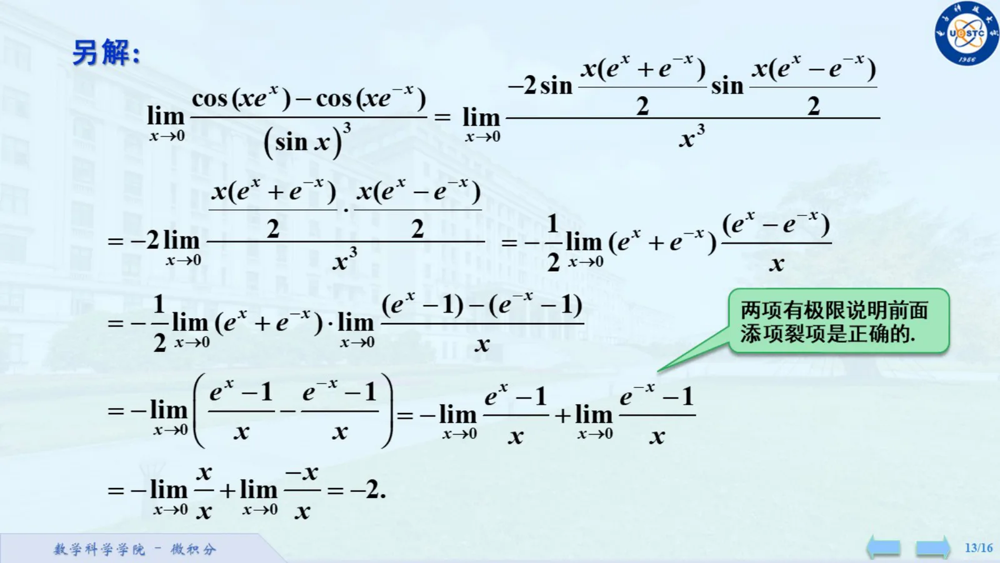

### 例 10：在非零点平移变量

$$
\lim_{x\to a}\frac{a^x-x^a}{x^2-a^2}
=\frac{a^a(\ln a-1)}{2a},\qquad a>0.
$$

加减 $a^a$，并把分母写成 $(x+a)(x-a)$。分别计算

$$
\frac{a^x-a^a}{x-a}
=a^a\frac{a^{x-a}-1}{x-a}\to a^a\ln a,
$$

$$
\frac{x^a-a^a}{x-a}
=a^a\frac{(1+(x-a)/a)^a-1}{x-a}\to a^a.
$$

两项相减后再除以 $x+a\to2a$。这里的拆项成立，是因为每项的新比值都有有限极限。

> **原页核对：例10原解与课件中的后续方法备注**
> [S16 · 1.5 极限存在准则 两个重要极限(续)(1).pdf · PDF 第 5 页](/library/1.5-极限存在准则-两个重要极限-续-1#page=5)
>
> 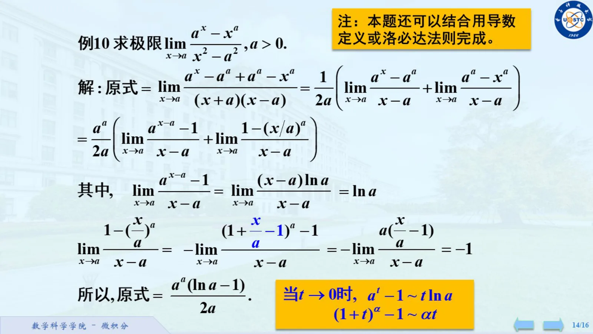

### 小o表达式与例 11

$\beta\sim\alpha$ 等价于 $\beta=\alpha+o(\alpha)$；这把“近似”写成带误差阶数的等式。例如

$$
\sin x=x+o(x),\qquad 1-\cos x=\frac{x^2}2+o(x^2).
$$

于是

$$
\lim_{x\to0}\frac{\tan5x-\cos x+1}{\sin3x}
=\lim\frac{5x+o(x)+x^2/2+o(x^2)}{3x+o(x)}
=\frac53.
$$

这里没有把加减中的每项直接用“$\sim$”乱替换，而是明确保留误差，并在除以 $x$ 后控制它们。

### 例 12：非整数阶数

当 $x\to0$，$\tan2x\sin3x\sim6x^2$，是关于 $x$ 的二阶无穷小。

当 $x\to0^+$，

$$
2\sqrt x+x+x^2=\sqrt x(2+\sqrt x+x^{3/2})\sim2\sqrt x,
$$

是关于 $x$ 的 $1/2$ 阶无穷小。这里需要右侧过程，因为实数平方根的定义域限制。

> **原页核对：小o表达、例11、例12与作业**
> [S16 · 1.5 极限存在准则 两个重要极限(续)(1).pdf · PDF 第 6 页](/library/1.5-极限存在准则-两个重要极限-续-1#page=6)
>
> 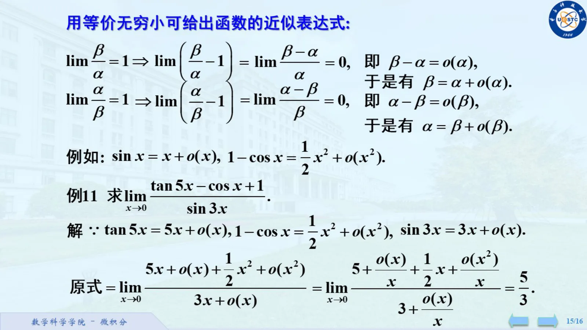
>
> [S16 · 1.5 极限存在准则 两个重要极限(续)(1).pdf · PDF 第 7 页](/library/1.5-极限存在准则-两个重要极限-续-1#page=7)
>
> 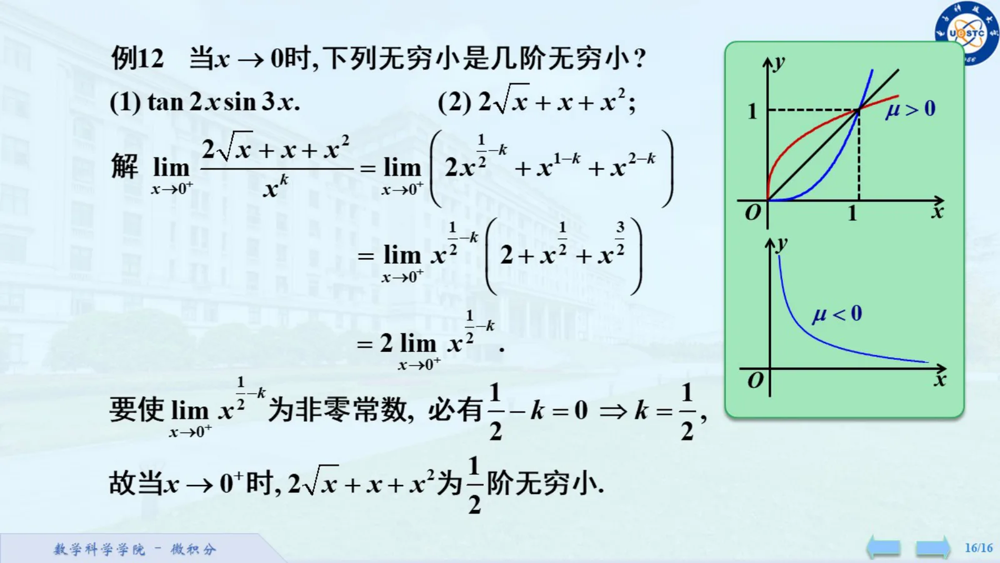
>
> [S16 · 1.5 极限存在准则 两个重要极限(续)(1).pdf · PDF 第 8 页](/library/1.5-极限存在准则-两个重要极限-续-1#page=8)
>
> 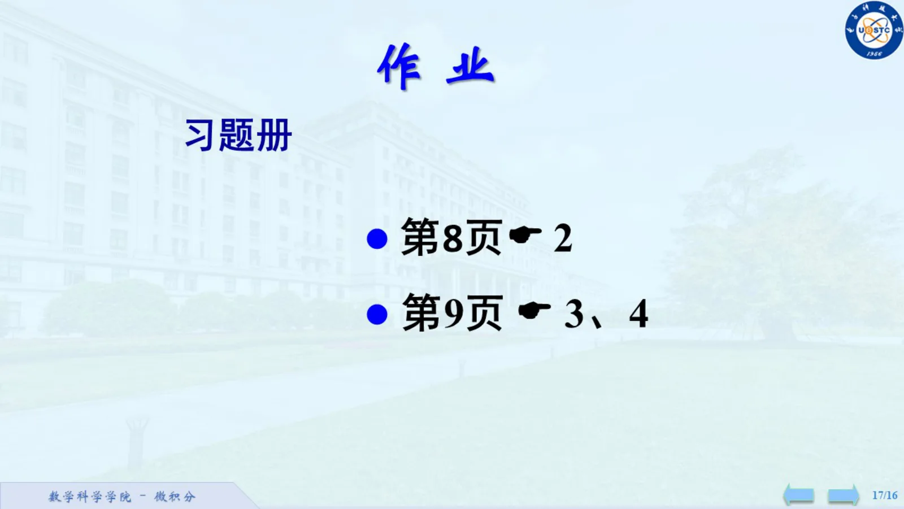

## 九、作业及下一步

前半部分：习题册第 8 页第 1 题，第 9 页第 5、6、7 题。等价无穷小部分：第 8 页第 2 题，第 9 页第 3、4 题。

两个重要极限提供了局部近似。接下来把“趋近后的极限”与“该点实际函数值”比较，就得到 [06-连续函数](/notes/06-连续函数)。

## 本篇其余原页

> **逐页保留：前文未单独嵌入的页面**
>
> [S13 · 1.5 极限存在准则 两个重要极限.pdf · PDF 第 1 页](/library/1.5-极限存在准则-两个重要极限#page=1)
>
> 
>
> [S13 · 1.5 极限存在准则 两个重要极限.pdf · PDF 第 12 页](/library/1.5-极限存在准则-两个重要极限#page=12)
>
> 
>
> [S15 · 1.5 极限存在准则 两个重要极限(续).pdf · PDF 第 1 页](/library/1.5-极限存在准则-两个重要极限-续#page=1)
>
> 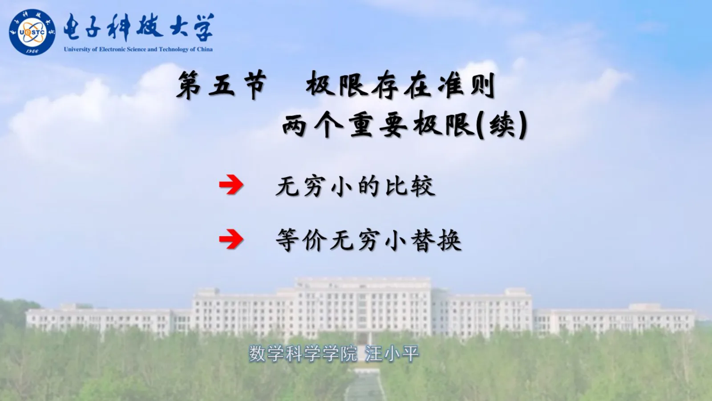
>
> [S15 · 1.5 极限存在准则 两个重要极限(续).pdf · PDF 第 2 页](/library/1.5-极限存在准则-两个重要极限-续#page=2)
>
> 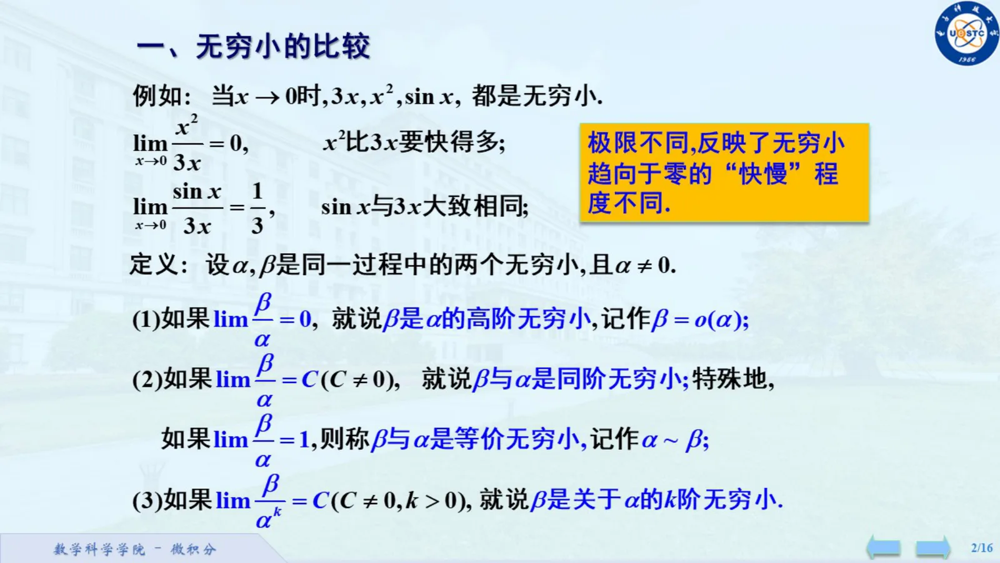
>
> [S16 · 1.5 极限存在准则 两个重要极限(续)(1).pdf · PDF 第 1 页](/library/1.5-极限存在准则-两个重要极限-续-1#page=1)
>
> 

## 本篇来源

- S13：[1.5 极限存在准则 两个重要极限.pdf](/notes/S13-1.5-极限存在准则-两个重要极限)，12 页。
- S14：[1.5 极限存在准则 两个重要极限(1).pdf](/notes/S14-1.5-极限存在准则-两个重要极限-1)，12 页。
- S15：[1.5 极限存在准则 两个重要极限(续).pdf](/notes/S15-1.5-极限存在准则-两个重要极限-续)，10 页。
- S16：[1.5 极限存在准则 两个重要极限(续)(1).pdf](/notes/S16-1.5-极限存在准则-两个重要极限-续-1)，8 页。
