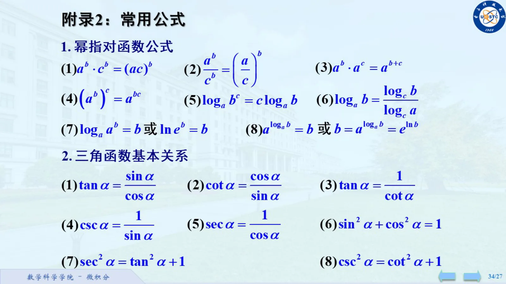
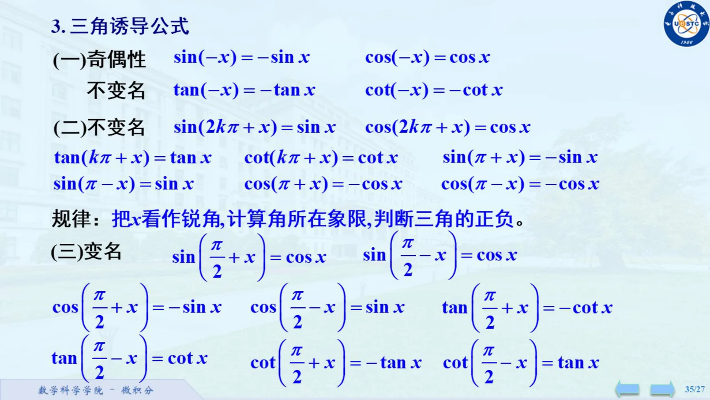
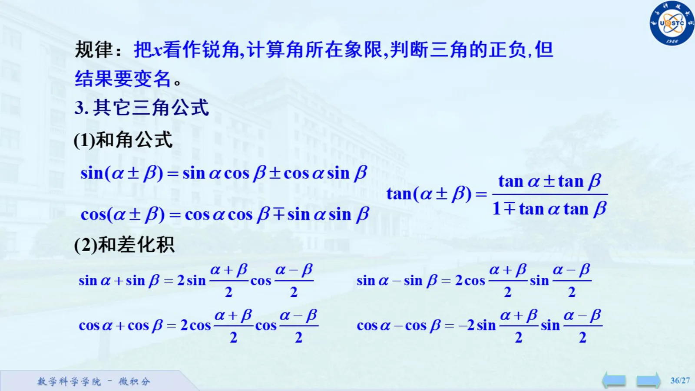
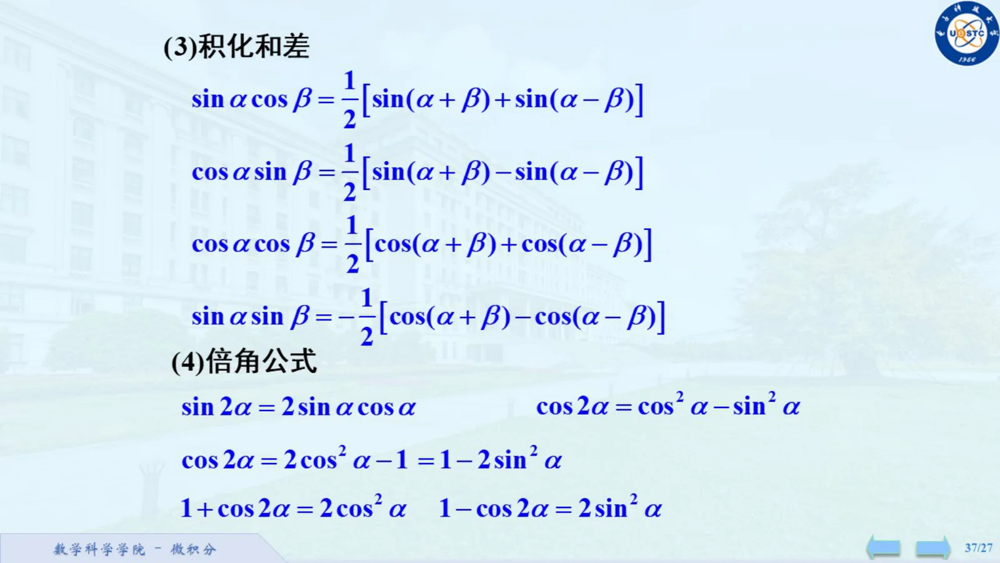
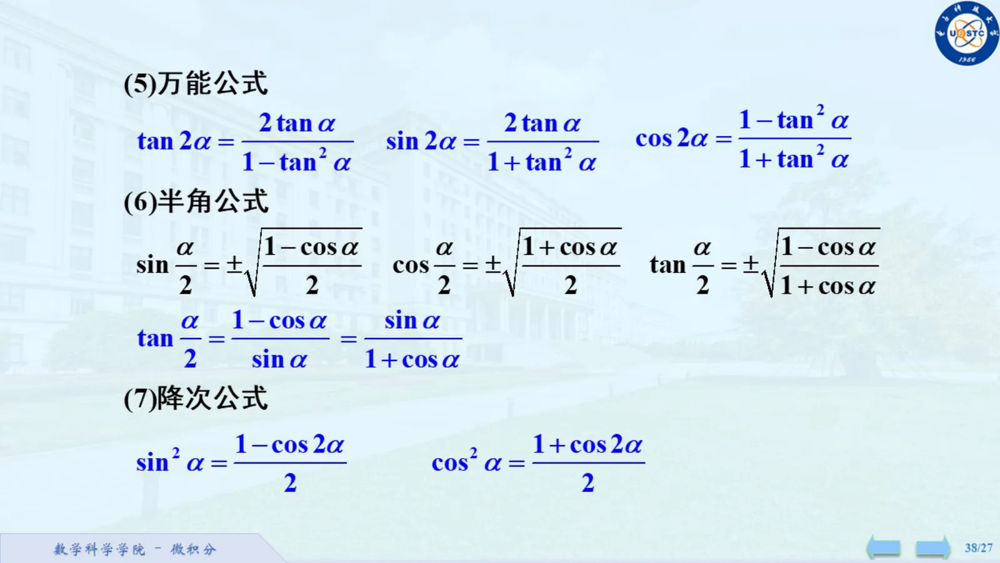

来源为 S04《1.1 映射与函数(2).pdf》第 3 至 7 页。以下保留原附录各组公式；每一式都在实数表达式有定义的条件下使用，分母不能为零。对数底数要求正且不为 $1$，真数要求正。

## 一、幂、指数与对数

在相应底数和指数允许的条件下，

$$
a^bc^b=(ac)^b,\qquad
\frac{a^b}{c^b}=\left(\frac ac\right)^b,
$$

$$
a^ba^c=a^{b+c},\qquad
(a^b)^c=a^{bc}.
$$

实指数情形优先在正底数下使用这些恒等式。

$$
\log_a(b^c)=c\log_a b,\qquad
\log_a b=\frac{\log_c b}{\log_c a},
$$

$$
\log_a(a^b)=b,\qquad \ln(e^b)=b,
$$

$$
a^{\log_a b}=b,\qquad b=a^{\log_a b},\qquad
a^b=e^{b\ln a}.
$$

## 二、三角函数基本关系

$$
\tan\alpha=\frac{\sin\alpha}{\cos\alpha},\quad
\cot\alpha=\frac{\cos\alpha}{\sin\alpha},\quad
\tan\alpha=\frac1{\cot\alpha},
$$

$$
\csc\alpha=\frac1{\sin\alpha},\qquad
\sec\alpha=\frac1{\cos\alpha},
$$

$$
\sin^2\alpha+\cos^2\alpha=1,\qquad
\sec^2\alpha=\tan^2\alpha+1,\qquad
\csc^2\alpha=\cot^2\alpha+1.
$$

> **原页核对：幂指对与三角基本关系原页**
> [S04 · 1.1 映射与函数(2).pdf · PDF 第 3 页](/library/1.1-映射与函数-2#page=3)
>
> 

## 三、诱导公式

### 奇偶性与周期

$$
\sin(-x)=-\sin x,\quad \cos(-x)=\cos x,\quad
\tan(-x)=-\tan x,\quad\cot(-x)=-\cot x.
$$

对整数 $k$，

$$
\sin(2k\pi+x)=\sin x,\quad\cos(2k\pi+x)=\cos x,
$$

$$
\tan(k\pi+x)=\tan x,\quad\cot(k\pi+x)=\cot x.
$$

### $\pi$ 附近

$$
\sin(\pi+x)=-\sin x,\quad\sin(\pi-x)=\sin x,
$$

$$
\cos(\pi+x)=-\cos x,\quad\cos(\pi-x)=-\cos x.
$$

### $\pi/2$ 附近

$$
\sin\left(\frac\pi2+x\right)=\cos x,\quad
\sin\left(\frac\pi2-x\right)=\cos x,
$$

$$
\cos\left(\frac\pi2+x\right)=-\sin x,\quad
\cos\left(\frac\pi2-x\right)=\sin x,
$$

$$
\tan\left(\frac\pi2+x\right)=-\cot x,\quad
\tan\left(\frac\pi2-x\right)=\cot x,
$$

$$
\cot\left(\frac\pi2+x\right)=-\tan x,\quad
\cot\left(\frac\pi2-x\right)=\tan x.
$$

课件记忆方法是先把 $x$ 看成锐角，判断原角所在象限以确定符号；$\pi/2$ 的这一组还要把函数名称换成对应余函数。

> **原页核对：诱导公式及记忆规律**
> [S04 · 1.1 映射与函数(2).pdf · PDF 第 4 页](/library/1.1-映射与函数-2#page=4)
>
> 
>
> [S04 · 1.1 映射与函数(2).pdf · PDF 第 5 页](/library/1.1-映射与函数-2#page=5)
>
> 

## 四、和角与差角

$$
\sin(\alpha\pm\beta)=\sin\alpha\cos\beta\pm\cos\alpha\sin\beta,
$$

$$
\cos(\alpha\pm\beta)=\cos\alpha\cos\beta\mp\sin\alpha\sin\beta,
$$

$$
\tan(\alpha\pm\beta)=
\frac{\tan\alpha\pm\tan\beta}{1\mp\tan\alpha\tan\beta}.
$$

## 五、和差化积

$$
\sin\alpha+\sin\beta=
2\sin\frac{\alpha+\beta}2\cos\frac{\alpha-\beta}2,
$$

$$
\sin\alpha-\sin\beta=
2\cos\frac{\alpha+\beta}2\sin\frac{\alpha-\beta}2,
$$

$$
\cos\alpha+\cos\beta=
2\cos\frac{\alpha+\beta}2\cos\frac{\alpha-\beta}2,
$$

$$
\cos\alpha-\cos\beta=
-2\sin\frac{\alpha+\beta}2\sin\frac{\alpha-\beta}2.
$$

## 六、积化和差

$$
\sin\alpha\cos\beta=\frac12[\sin(\alpha+\beta)+\sin(\alpha-\beta)],
$$

$$
\cos\alpha\sin\beta=\frac12[\sin(\alpha+\beta)-\sin(\alpha-\beta)],
$$

$$
\cos\alpha\cos\beta=\frac12[\cos(\alpha+\beta)+\cos(\alpha-\beta)],
$$

$$
\sin\alpha\sin\beta=-\frac12[\cos(\alpha+\beta)-\cos(\alpha-\beta)].
$$

## 七、倍角公式

$$
\sin2\alpha=2\sin\alpha\cos\alpha,
$$

$$
\cos2\alpha=\cos^2\alpha-\sin^2\alpha
=2\cos^2\alpha-1=1-2\sin^2\alpha,
$$

$$
1+\cos2\alpha=2\cos^2\alpha,\qquad
1-\cos2\alpha=2\sin^2\alpha.
$$

> **原页核对：和差角、和差化积、积化和差与倍角公式**
> [S04 · 1.1 映射与函数(2).pdf · PDF 第 5 页](/library/1.1-映射与函数-2#page=5)
>
> 
>
> [S04 · 1.1 映射与函数(2).pdf · PDF 第 6 页](/library/1.1-映射与函数-2#page=6)
>
> 

## 八、万能公式

按课件的角度写法：

$$
\tan2\alpha=\frac{2\tan\alpha}{1-\tan^2\alpha},\qquad
\sin2\alpha=\frac{2\tan\alpha}{1+\tan^2\alpha},\qquad
\cos2\alpha=\frac{1-\tan^2\alpha}{1+\tan^2\alpha}.
$$

等价地，令 $t=\tan(\theta/2)$，则

$$
\sin\theta=\frac{2t}{1+t^2},\quad
\cos\theta=\frac{1-t^2}{1+t^2},\quad
\tan\theta=\frac{2t}{1-t^2}.
$$

后一个写法只是换了变量，仍需检查半角正切与各分母有定义。

## 九、半角与降次

$$
\sin\frac\alpha2=\pm\sqrt{\frac{1-\cos\alpha}2},\qquad
\cos\frac\alpha2=\pm\sqrt{\frac{1+\cos\alpha}2},
$$

$$
\tan\frac\alpha2=\pm\sqrt{\frac{1-\cos\alpha}{1+\cos\alpha}},
$$

$$
\tan\frac\alpha2=\frac{1-\cos\alpha}{\sin\alpha}
=\frac{\sin\alpha}{1+\cos\alpha}.
$$

根式前的符号由半角所在象限决定，不是任选。两个分式各自在自身有定义的角度使用。

$$
\sin^2\alpha=\frac{1-\cos2\alpha}2,\qquad
\cos^2\alpha=\frac{1+\cos2\alpha}2.
$$

> **原页核对：万能、半角与降次公式原页**
> [S04 · 1.1 映射与函数(2).pdf · PDF 第 7 页](/library/1.1-映射与函数-2#page=7)
>
> 

## 本篇来源

- S04：[1.1 映射与函数(2).pdf](/notes/S04-1.1-映射与函数-2)，8 页。
