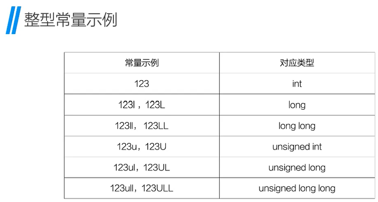
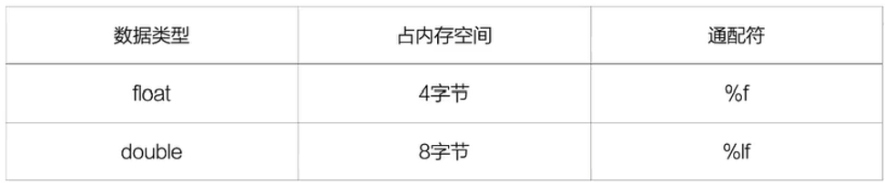
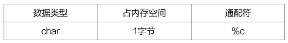
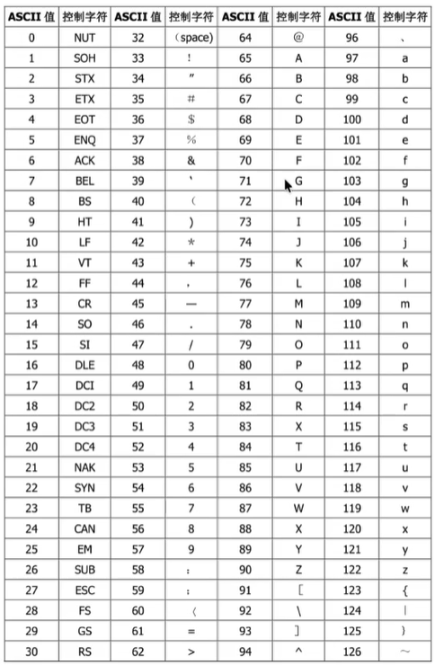
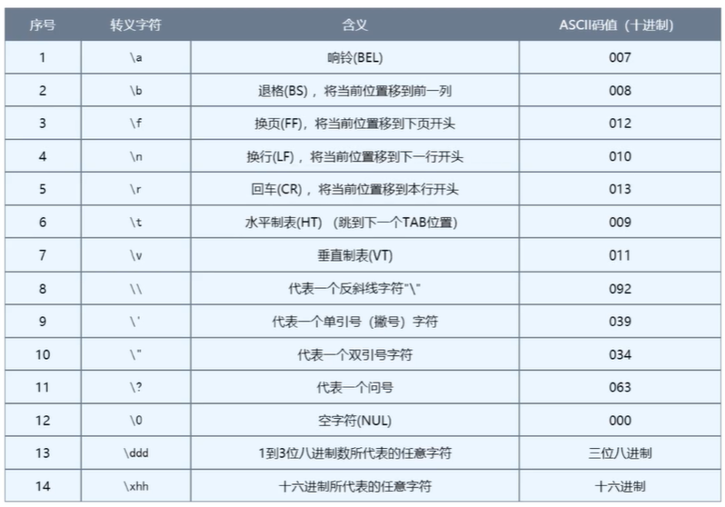

C语言应用较为底层
嵌入式，云计算比较多

## 接上回数据类型
拓展：用补码表示数据

## 整型


### sizeof()函数
返回传入参数在内存中占的字节数
```c
#include <stdio.h>
int main(int argc, char const *argv[])
{
	int a = 10;
	short b = 34;
	long c = 1234087913542l; //最好后面加上l，避免整数溢出和跨平台陷阱

	printf ("%zu\n", sizeof (a) );//4
	printf ("%zu\n", sizeof (int));//4
	printf ("%zu\n", sizeof (b) );//2
	printf ("%zu\n", sizeof (short));//2
	printf ("%zu\n", sizeof (c) );//4
	printf ("%zu\n", sizeof (long));//4
	printf ("%zu\n", sizeof (long long));//8
	return 0;
}
```
%zu：size_t 类型数据，无符号数。

## 浮点型（实型）：
float(单精度)、double(双精度)

C语言用浮点类型表示小数
float类型的数值在末尾要加f或F
**不加f默认是double类型**，声明为float时会把8字节转换为4字节
会缺失精度，数据溢出
？？其实我也不清楚因为我试了一下
反正平时写的时候格式规范一点就好了

除了普通的小数形式外，还支持科学计数法
```c
#include <stdio.h>
int main(int argc, char const *argv[])
{
	float f = 3.12345678901234E5;
	float f_real = 3.12345678901234E5f;
	double d = 3.12345678901234E5;
	printf("%f\n", f);//312345.687500
	printf("%.2f\n", f);//312345.69
	printf("%.20f\n", f);//312345.68750000000000000000
	printf("%f\n", f_real);//312345.687500
	printf("%lf\n", d);//312345.678901
	printf("%.20f\n", d);//312345.67890123400138691068
	return 0;
}
```


## 字符型：char
用单引号括起来的单个字符，用于存储一个单一字符。

字符变量实际上并不是把字符本身存放到变量的内存单元中去，而是将该变量对应的ASCIl
码值存放到变量的存储单元中。

计算机不能直接识别字母abcd，要设计编码方案
所以C语言编码方式：ASCII
C语言不能写：char c1 = '我';
（一个字节不够用）



```c
#include <stdio.h>
int main(int argc, char const *argv[])
{
	char c1 = 'a';
	char c2='A';
	printf("%c\n", c1);//a
	printf("%c\n",c2);//A

	printf("%d\n", c1);//97
	printf("%d\n", c2);//65
	return 0;
}
```
小技巧：转化类型小方法
本质字符储存的是数字，可做加减法
eg. 'a' - 'A' = 32
```c
char symbol = '8';
int number;
number = symbol - '0';//将字符8转化为数字8
```
还有GBK UTF-8(Mac) Unicode iso-8859-1
## 转义字符


\t：跳到下一个制表域
一个制表域是8位
但是输出行看不太出来严格的8位？？

## 运算符

算术运算符
 1. + ,- ,* ,/ , %
int / int = int -> 整除操作
2. 前置/后置，自增/自减运算符
++i --i，先加一或减一再参与赋值或运算
i++ i--，先参与赋值或运算再加一或减一

赋值运算符：,= ,+=, -=, \*=, /=, %=

关系（比较）运算符：\==, >, <, >=, <=, !=
结果：非0则真，为0则假

逻辑运算符
非：！
与：&&
或：||
