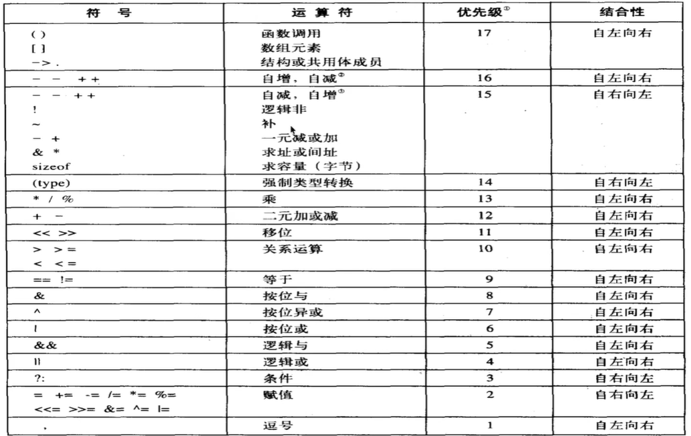

逻辑运算符（剩下不太常用的那三个）

int a = 23; ->10111
int b = 25; ->11001
按位与&         10001 -> 17
按位或|           11111 -> 31
按位异或^      01110 -> 14

应用场景：嵌入式开发，计算机网络的一些验证算法

三目运算符
表达式1？表达式2：表达式3；
如果1为真，返回2的值，否则返回3的值
```c
int a = 5;
int b = 10;
int c = a > b ? a : b;//max
printf("%d\n", c)

double score = 75;
printf("%s\n",score >= 60 ? "成绩及格" : "成绩不及格")
```



## 运算符优先级
赋值运算符<三目运算符<逻辑运算符<关系运算符<算术运算符

## 数据类型转换 - 自动转换（隐式转换）
char -> short -> int -> long、float -> double
```c
//10 / 3 = 3;
//10 / 3.0 = 3.333333; //自动转换

int a = 3.14; //不同编译器可能会报错，我的sublime编译器会自动转化为3
int a = (int)3.14; //强制转换
int a = 1 + 3.14; //自动转换

printf("%d\n", 10.0/3);//我的编译器会输出-1431655765
printf("%d\n", 10/3.0);//-1431655765
printf("%lf\n", 10/3.0);//3/333333
```

## 程序结构
### 顺序结构

### 分支（选择）结构
```c
if ()
{
	
}
```

如何实现键盘输入：
```c
int a;
scanf("%d",&a);
```
### 循环结构
