来源：`C:\Users\29459\Desktop\微积分Ⅰ\1.4 极限的性质及运算法则.pdf`。共 11 个 PDF 页面。以下页码按 PDF 计数，不使用可能不同的幻灯片页脚编号。

本页保留全部原图，包括封面、题目、推导、作业、重复页及批注。整理正文入口：[00-微积分Ⅰ导航](/notes/00-微积分I导航-3)。

## PDF 第 1 页

[S11 · 1.4 极限的性质及运算法则.pdf · PDF 第 1 页](/library/1.4-极限的性质及运算法则#page=1)

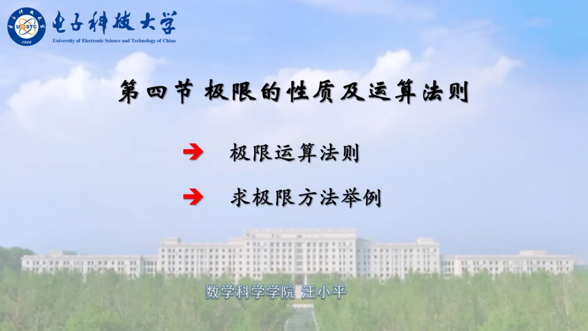

## PDF 第 2 页

[S11 · 1.4 极限的性质及运算法则.pdf · PDF 第 2 页](/library/1.4-极限的性质及运算法则#page=2)

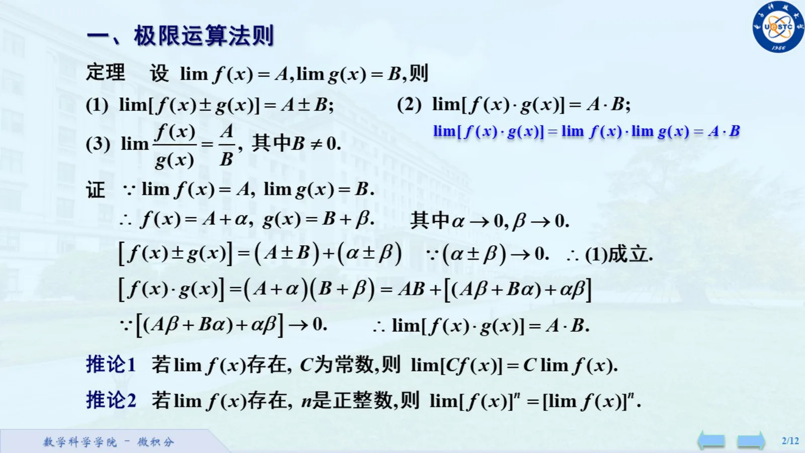

## PDF 第 3 页

[S11 · 1.4 极限的性质及运算法则.pdf · PDF 第 3 页](/library/1.4-极限的性质及运算法则#page=3)

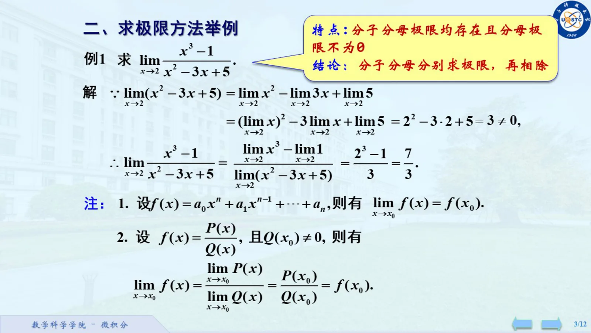

## PDF 第 4 页

[S11 · 1.4 极限的性质及运算法则.pdf · PDF 第 4 页](/library/1.4-极限的性质及运算法则#page=4)

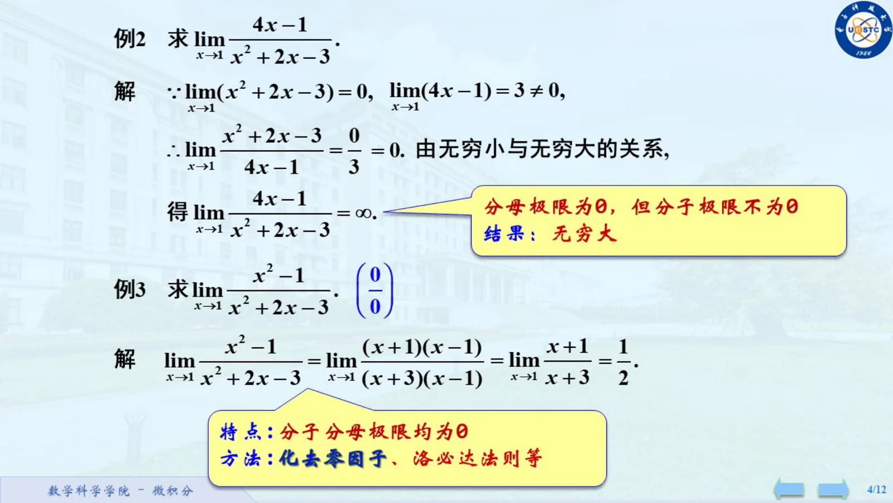

## PDF 第 5 页

[S11 · 1.4 极限的性质及运算法则.pdf · PDF 第 5 页](/library/1.4-极限的性质及运算法则#page=5)

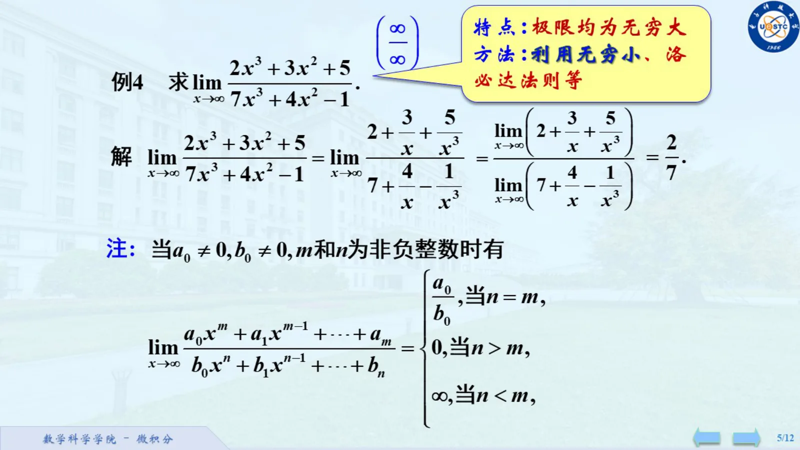

## PDF 第 6 页

[S11 · 1.4 极限的性质及运算法则.pdf · PDF 第 6 页](/library/1.4-极限的性质及运算法则#page=6)

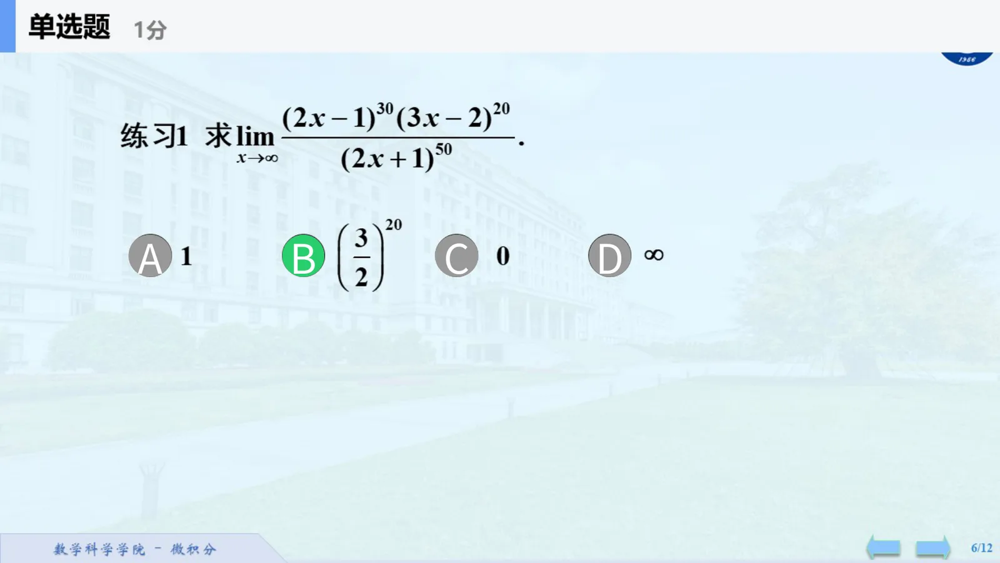

## PDF 第 7 页

[S11 · 1.4 极限的性质及运算法则.pdf · PDF 第 7 页](/library/1.4-极限的性质及运算法则#page=7)

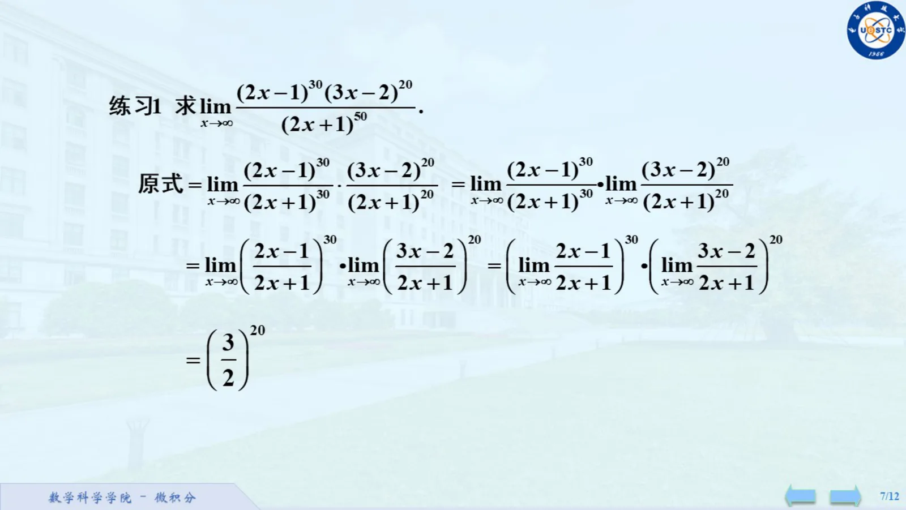

## PDF 第 8 页

[S11 · 1.4 极限的性质及运算法则.pdf · PDF 第 8 页](/library/1.4-极限的性质及运算法则#page=8)

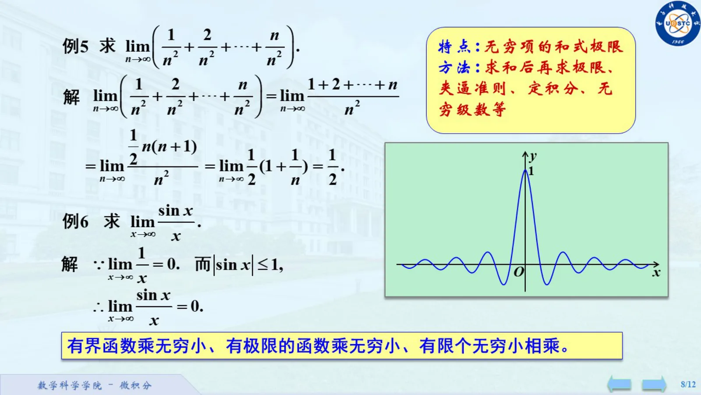

## PDF 第 9 页

[S11 · 1.4 极限的性质及运算法则.pdf · PDF 第 9 页](/library/1.4-极限的性质及运算法则#page=9)

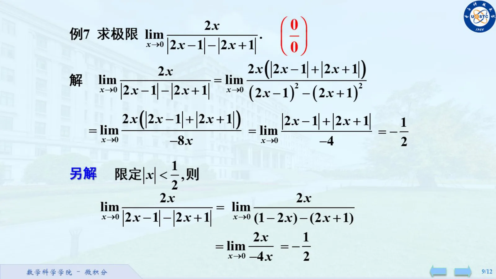

## PDF 第 10 页

[S11 · 1.4 极限的性质及运算法则.pdf · PDF 第 10 页](/library/1.4-极限的性质及运算法则#page=10)

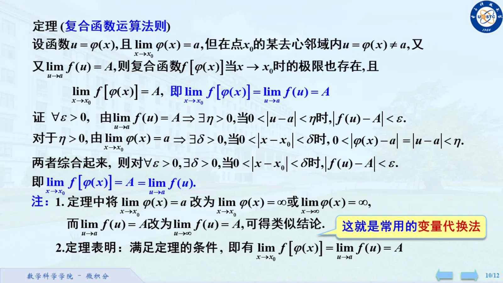

## PDF 第 11 页

[S11 · 1.4 极限的性质及运算法则.pdf · PDF 第 11 页](/library/1.4-极限的性质及运算法则#page=11)

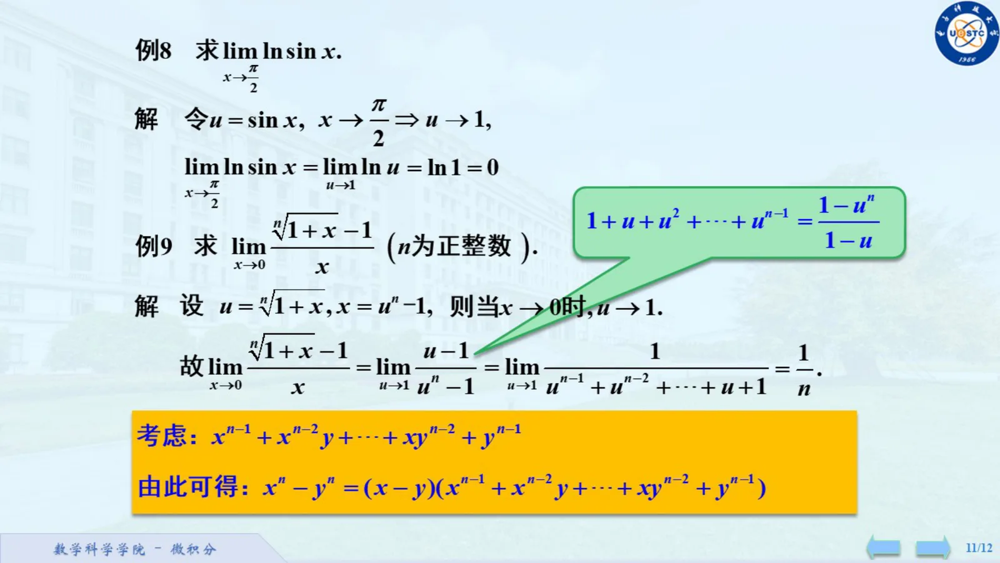
