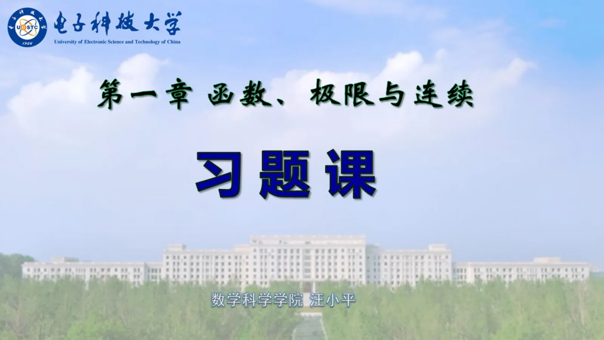
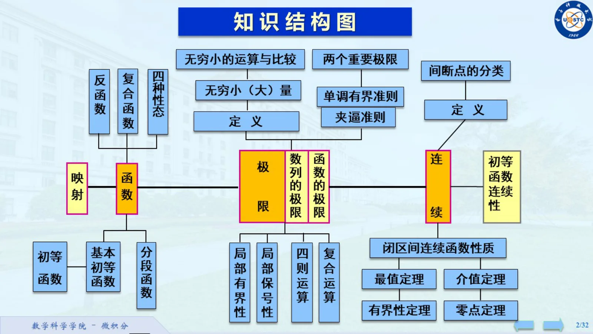
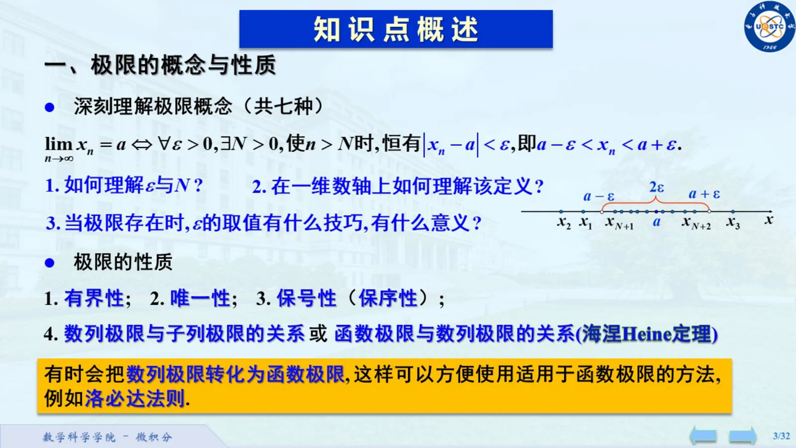
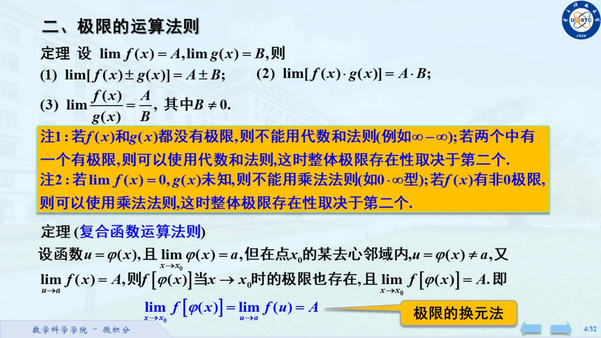
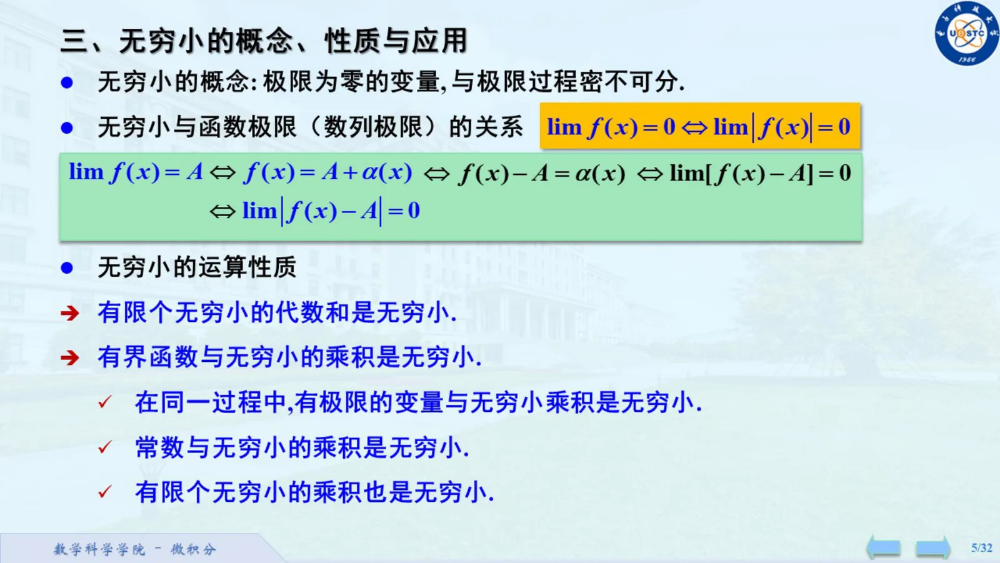

来源：`C:\Users\29459\Desktop\微积分Ⅰ\第一章习题课.pdf`。共 5 个 PDF 页面。以下页码按 PDF 计数，不使用可能不同的幻灯片页脚编号。

本页保留全部原图，包括封面、题目、推导、作业、重复页及批注。整理正文入口：[00-微积分Ⅰ导航](/notes/00-微积分I导航)。

## PDF 第 1 页

[S20 · 第一章习题课.pdf · PDF 第 1 页](/library/第一章习题课#page=1)

## PDF 第 2 页

[S20 · 第一章习题课.pdf · PDF 第 2 页](/library/第一章习题课#page=2)

## PDF 第 3 页

[S20 · 第一章习题课.pdf · PDF 第 3 页](/library/第一章习题课#page=3)

## PDF 第 4 页

[S20 · 第一章习题课.pdf · PDF 第 4 页](/library/第一章习题课#page=4)

## PDF 第 5 页

[S20 · 第一章习题课.pdf · PDF 第 5 页](/library/第一章习题课#page=5)

