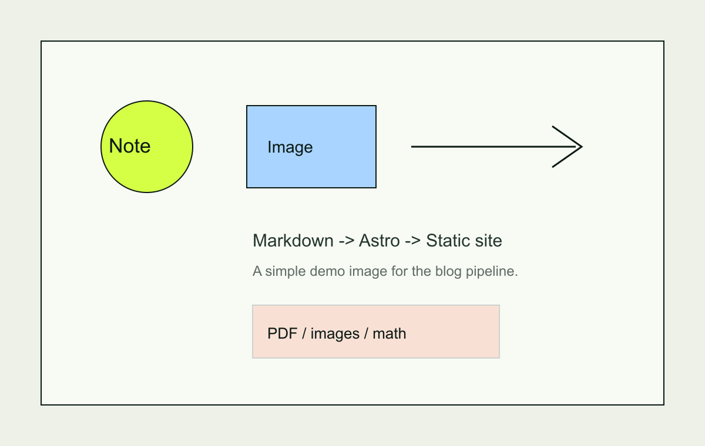

这是一篇功能验证用的示例文章，确认 Markdown、公式、图片和 PDF 都能正常工作。发布自己的笔记后可以直接删掉。

## 行内公式与块公式

行内公式：$e^{i\pi} + 1 = 0$，以及 $f'(x) = \lim_{h \to 0}\frac{f(x+h)-f(x)}{h}$。

块级公式：

$$
\int_{0}^{1} x^{2}\,\mathrm{d}x = \frac{1}{3}
$$

## 图片

下面这张图片会自动压缩，点击可以放大。



## 引用与列表

> 引用块用于放提示、原文摘录或待确认的问题。

- 第一件事
- 第二件事
- 第三件事

## 代码

```js
const posts = await getCollection("posts");
console.log(posts.length);
```

## PDF 资料

这份示例 PDF 可以在资料库中打开，也可以从下面的链接直接跳到第 2 页：

[打开示例 PDF（第 2 页）](/library/demo-study-notes#page=2)
