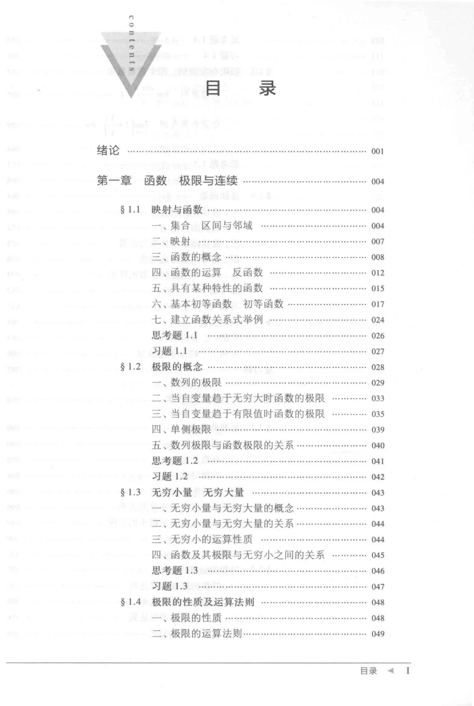
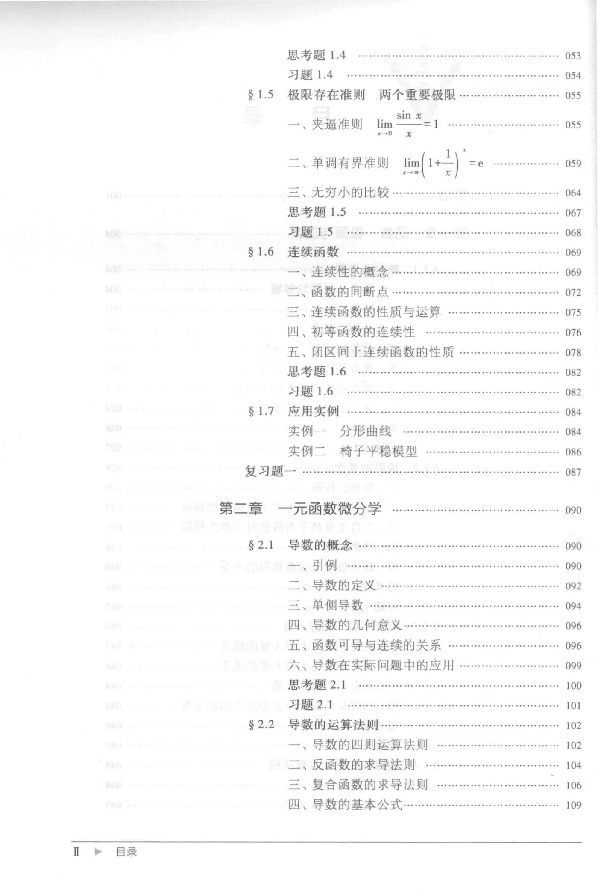
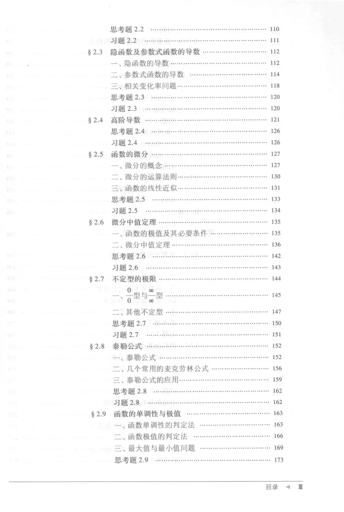
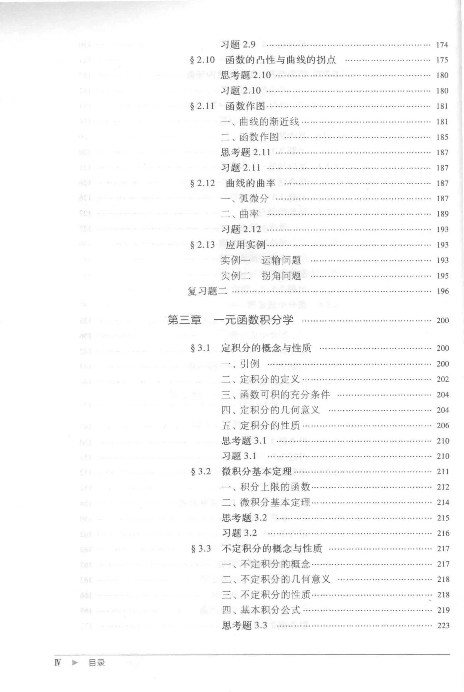
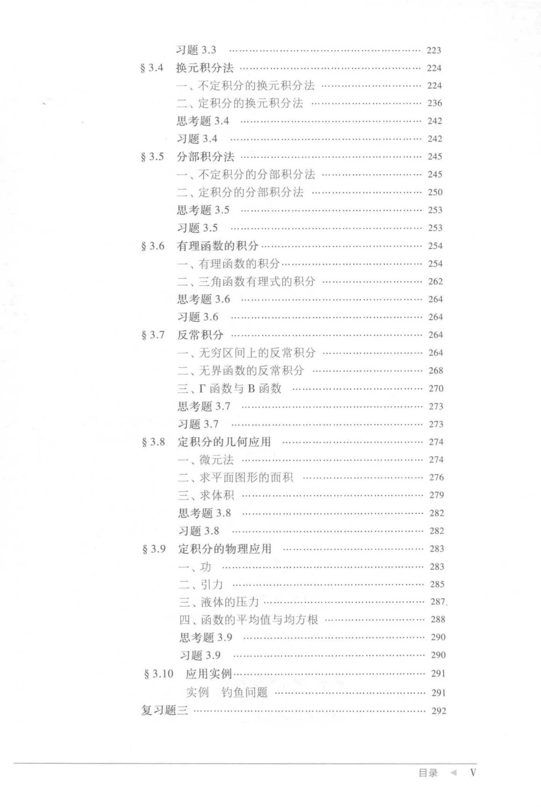
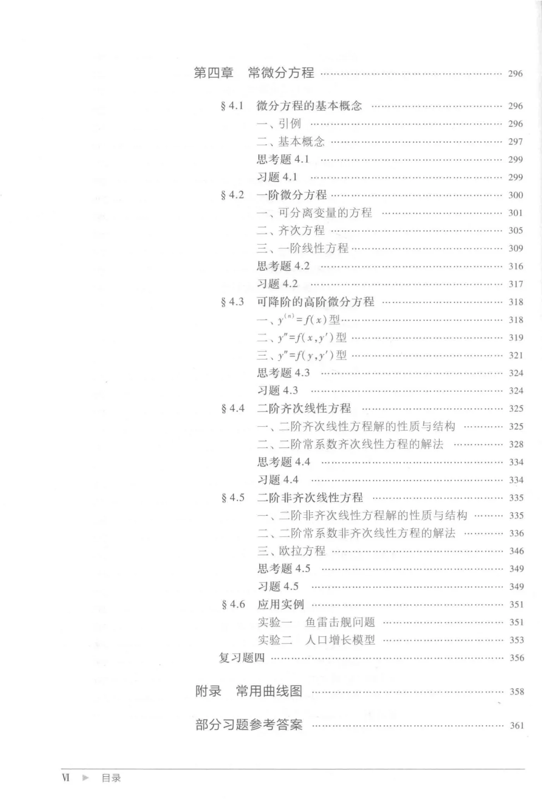

本篇对应 S22《微积分  上册  第3版.pdf》，电子科技大学数学科学学院编，原 PDF 共 **403 页**，已完整放在本笔记库附件中。教材没有逐页改写为正文；课堂讲义仍按你指定的上课课件组织。原书全部内容可以从下方链接打开。

打开完整教材

## 第一章与课堂笔记的对应

这份扫描文件中，印刷页码第 1 页对应 PDF 第 16 页；以下“印刷页”按教材目录，“PDF 页”用于实际跳转。

| 主题 | 教材印刷页起点 | PDF 页起点 | 对应笔记 |
| --- | --- | --- | --- |
| 绪论 | 1 | 16 | [09-第一次课与课程说明](/notes/09-第一次课与课程说明) |
| 1.1 映射与函数 | 4 | 19 | [01-映射与函数](/notes/01-映射与函数) |
| 1.2 极限的概念 | 28 | 43 | [02-极限的概念](/notes/02-极限的概念) |
| 1.3 无穷小量、无穷大量 | 43 | 58 | [03-无穷小量与无穷大量](/notes/03-无穷小量与无穷大量) |
| 1.4 极限的性质及运算法则 | 48 | 63 | [04-极限的性质及运算法则](/notes/04-极限的性质及运算法则) |
| 1.5 极限存在准则、两个重要极限 | 55 | 70 | [05-极限存在准则与两个重要极限](/notes/05-极限存在准则与两个重要极限) |
| 1.6 连续函数 | 69 | 84 | [06-连续函数](/notes/06-连续函数) |
| 第一章教材应用实例 | 84 | 99 | 留作教材参考 |
| 复习题一 | 87 | 102 | 教材题，与课件所指习题册不同 |
| 2.6 微分中值定理 | 135 | 150 | [参考-微分中值定理](/notes/参考-微分中值定理) |

## 第一章思考题、习题定位

| 节 | 思考题印刷页 / PDF 页 | 习题印刷页 / PDF 页 |
| --- | --- | --- |
| 1.1 | 26 / 41 | 27 / 42 |
| 1.2 | 41 / 56 | 42 / 57 |
| 1.3 | 46 / 61 | 47 / 62 |
| 1.4 | 53 / 68 | 54 / 69 |
| 1.5 | 67 / 82 | 68 / 83 |
| 1.6 | 82 / 97 | 82 / 97 |

课件布置的“习题册第几页”不能用这里的教材题号冒充。需要对照课件作业时看 [11-例题与作业索引](/notes/11-例题与作业索引)。

## 全书目录原页

下列目录保留了包括后续章节在内的全书结构，仅用于查书，不作为已授课的范围。

教材目录 PDF 第10页

教材目录 PDF 第11页

教材目录 PDF 第12页

教材目录 PDF 第13页

教材目录 PDF 第14页

教材目录 PDF 第15页

